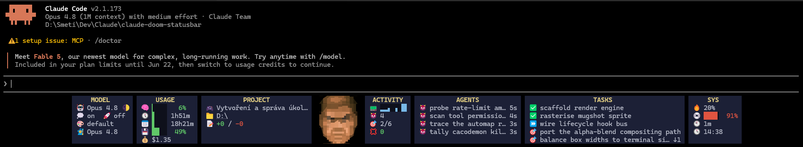
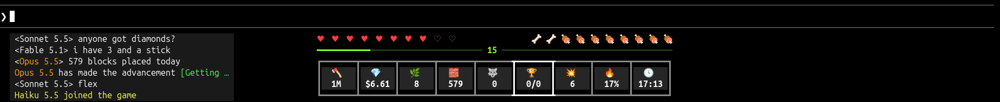

# claude-game-bar

A status bar for the [Claude Code](https://docs.claude.com/en/docs/claude-code) CLI that reads your session and draws it as a game HUD. It shows usage and rate limits, the model, the project, running agents, tasks and the machine, and it reacts to what just happened: an error, a write, a finished task. Each game is its own look on the same data. You pick one and can switch at any time.

## Games

There are two games: **DOOM** (the default) and **Minecraft**. See [Switching themes](#switching-themes) to change between them.

### DOOM

<p align="center">
  
</p>

The Doomguy HUD: a mugshot whose face tracks your health, boxes for usage, model, project and system, and live lists of running agents and tasks. The mugshot is the real DOOM (1993) status-face sprite, rasterised into the terminal at runtime. It is not ASCII art of it.

The HUD is a row of boxes centred on the mugshot. Each box is configurable; the `full` preset turns everything on:

- **mugshot**: the Doomguy face. Its HP (how bloodied it looks) follows your *usage headroom*: `min(5h, 7d) rate-limit room`, with context as a fallback. It glances around when idle, winces on errors, snarls on writes, grins on a clean finish, dies when you're tapped out, and flashes invulnerable just after an advisor consult.
- **MODEL**: model name and reasoning effort (a waxing-moon to sun icon), thinking and fast toggles, output style, and the configured `/advisor` model.
- **USAGE**: context window (HP bar), the 5h and 7d rate-limit bars (with reset countdowns), RAM, session cost.
- **PROJECT**: session name, cwd, git branch, a merged work line (changed files, ahead/behind), lines added and removed, PR state. The cwd, branch and PR are **clickable** (OSC 8 hyperlinks): Ctrl/Cmd-click to open the folder, the branch on the host, or the pull request (see [Clickable links](#clickable-links)). Long names are clipped to 24 characters so the box can't blow up.
- **ACTIVITY**: a tool-activity "geiger" sparkline (duty cycle over the last 30 s), running-agent count, task progress, error count.
- **AGENTS**: a live list of running subagents (type or description, and a ticking runtime), always visible. Long lists scroll within the box height, with ↑/↓ markers counting the rows hidden off-screen.
- **TASKS**: the session's todo list. Settled items (✅ done, ❌ removed) are on top, open items (⏩ in progress, 🎯 pending) below. It scrolls like AGENTS, anchored on the boundary between open and settled items.
- **SYSTEM**: a per-core CPU equalizer (one threshold-coloured column per core) with the aggregate CPU % right-aligned beside it, disk, session length, wall clock.

Anything the session can't supply is hidden automatically, so the same config degrades cleanly. The layout comes from a preset; see [Presets](#presets).

**Credit:** the status-face sprites are from **DOOM** (1993), id Software.

### Minecraft

<p align="center">
  
</p>

The in-game survival screen instead of the boxes. The same session data, mapped to Minecraft:

| | DOOM | Minecraft |
|---|---|---|
| 5h rate limit | 🕔 bar | ♥ hearts left ("You died!" when they run out) |
| context window | 🧠 HP bar | 🍖 hunger (🦴 when eaten) |
| 7d rate limit | 📅 bar | the XP bar; the level is its percent |
| everything else | boxes around the Doomguy mugshot | a 9-slot hotbar: context size, cost, changed files, lines added, agents, tasks, errors, CPU, clock |

The selected hotbar slot jumps to what just happened (💥 on an error, 🧱 on a write, 🏆 when a task finishes) and wanders on its own when idle. Hearts flash on errors, turn gold while invulnerable, and "You died!" appears when you're out of usage.

On the left is a chat in Minecraft's format. It's a long pre-written script that loops, so it costs no tokens. The model you're running is always one of the speakers. Between the banter they talk about everything the status bar knows about your session: its name, the project and branch, changes, PR, effort and modes, context and usage with reset times, cost, agents and what they're doing, tasks, errors, token savings and the machine. Lines whose facts aren't known are skipped, and some only show when they fit, like a warning when context is nearly full. Answers to questions come quickly, other messages after a varied pause.

The colour of your model's name in the chat follows Claude Code's reasoning effort, so `/effort` changes it: low is red, medium orange, high green, xhigh aqua and max a rainbow.

To change what's in the hotbar, edit the `[[slot]]` entries in `src/games/minecraft/presets/minecraft.toml`. To change the chat, edit the `SCRIPT` in `src/games/minecraft/chat.js`.

**Credit:** the Minecraft theme is a fan-made look. This project isn't affiliated with Mojang.

## Requirements

- **Node.js 18+**. One runtime dependency (`smol-toml`, a TOML parser); everything else is Node built-ins.
- A terminal with **truecolor**. The DOOM mugshot is converted to block glyphs inside the bar at any height, with no external tool. Terminals that draw the Unicode legacy-computing glyphs (sextants, wedges, octants) get a finer face, and the rest get half blocks (see [Glyph test card](#glyph-test-card)). Windows Terminal, WezTerm, kitty, Ghostty and foot all work.
- For the render daemon and its fast client: **Git Bash** on Windows, **bash 5 or newer** on Linux and macOS (every Linux distribution ships one; macOS ships 3.2, so a Mac needs Homebrew's `bash`). Without it the bar still works, with the slower one-shot renderer (see [How it works](#how-it-works)).
- A **colour emoji font**. Windows and macOS ship one. On Linux the installer checks for one and installs Noto Color Emoji for you if it is missing (see [Emoji font on Linux](#emoji-font-on-linux)).

## Install

```bash
npm i -g claude-game-bar
claude-game-bar install
```

That writes the `statusLine`, the lifecycle hooks and the preset into `~/.claude/settings.json` for you, merging into whatever's already there, with a one-level `.bak`. Restart Claude Code and the HUD is live.

If you used the bar under its old package name, the same two commands move you over. See [Moving from the old package](#moving-from-claude-doom-statusbar).

```bash
claude-game-bar install --preset full   # full | standard | minimal (default: keep the current one, else full)
claude-game-bar install --project       # write ./.claude/settings.json instead of ~/.claude
claude-game-bar install --local         # write ./.claude/settings.local.json (overrides settings.json)
claude-game-bar install --refresh 5     # redraw every 5 s as well as on events (default 1; 0 = events only)
claude-game-bar install --no-fonts      # skip the emoji font check (Linux)
claude-game-bar install --keep-old      # keep the old package installed (see the moving section below)
claude-game-bar install --help          # list the install options
```

`npx claude-game-bar <command>` runs any of these without a global install.

The `statusLine` alone gives you the bar and the idle reactions. The hooks add the live reactions, the geiger, and the subagent list. The installer is idempotent and merge-safe: re-running it won't add anything twice, and an existing `statusLine` of your own is backed up to `settings.json.bak`.

A checkout wired with `install --local` over a global install has hooks in both settings files, and Claude Code runs both sets. In a session the checkout draws, the global hooks step aside, so each event is counted once and the checkout's hook code works with the checkout's daemon. The second set still costs one extra `node` start per event.

### Emoji font on Linux

The bar uses emoji (🧠 💾 🪓 🪶 …). A Linux desktop without a colour emoji font, such as Raspberry Pi OS or a minimal Debian or Ubuntu, shows boxes with hex codes in their place. So on Linux, `install` checks the fonts too:

- It asks fontconfig (`fc-list`) whether any installed font covers the emoji the bar draws, up to Emoji 13. If one does, it prints its name and does nothing else.
- If none does, it downloads **Noto Color Emoji** v2.051 (googlefonts/noto-emoji, SIL OFL 1.1, about 10 MB) and checks its SHA-256. It then installs it for your user only, with no `sudo`, into `$XDG_DATA_HOME/fonts` (by default `~/.local/share/fonts`) and runs `fc-cache`. **Restart your terminal** afterwards, because terminals load fonts only when they start.
- Over **SSH** it installs nothing. The terminal draws the glyphs on the machine you sit at, so the font belongs there.
- If the download fails, it tells you to run `sudo apt install fonts-noto-color-emoji` (or your distribution's equivalent).

Windows (Segoe UI Emoji) and macOS (Apple Color Emoji) are skipped. Turn the check off with `--no-fonts` or `GAMEBAR_NO_FONTS=1`. `uninstall` leaves the font in place, since other programs may use it. Delete `~/.local/share/fonts/NotoColorEmoji.ttf` yourself if you want it gone.

### Updating

```bash
npm i -g claude-game-bar@latest           # global install
npx claude-game-bar@latest install        # or run the latest on demand
```

An upgrade in the same place reaches the client and the render daemon without touching `settings.json`. Run `claude-game-bar install` again (with `--project` or `--local` if that is where you installed) when the changelog says a release adds a hook or changes the `statusLine` command.

### Windows: Git Bash and the 1-second tick

The refresh interval is **1 second on every platform, Windows included**. On Windows that costs something. This section explains what, and how it's paid. The answer is not a slower tick.

Claude Code's `statusLine` has no exec form. Its entire schema is `type`, `command`, `padding`, `refreshInterval`, so there is no `args` array and the command is always handed to a shell. On Windows that shell is **Git Bash whenever Git for Windows is installed**, and nothing in your settings redirects it. `CLAUDE_CODE_GIT_BASH_PATH`, `CLAUDE_CODE_USE_POWERSHELL_TOOL` and `defaultShell` were all measured with no effect on it; renders still came from `C:\Program Files\Git\bin\bash.exe`. (`defaultShell` governs only the `!` shell-mode prefix.)

Each render therefore costs **two** MSYS initialisations, because `Git\bin\bash.exe` is a stub that re-execs `Git\usr\bin\bash.exe`. Healthy, each pair takes about 0.15 s and nothing accumulates, so 1 Hz is sustainable. The danger is not the rate but a single **hung** init, which poisons Git Bash's shared MSYS section:

```
bash.exe: *** fatal error - add_item ("\??\C:\Program Files\Git", "/", ...) failed, errno 1
```

From then on the failure sustains itself. A healthy `bash -c` returns in about 0.3 s; a poisoned one hangs about 15 s before dying with `0xC0000005`. At 1 Hz a new wrapper starts long before the last one dies, so the population never reaches zero, the section never gets an instant with no holder, and it cannot heal on its own. Git Bash then looks broken machine-wide, `bash --version` included, on an intact install.

**The reaper is what makes 1 Hz safe.** It kills hung wrappers so the section gets its empty instant and heals. Measured on Win11 26200: a Git Bash spawn went from 15 233 ms and `0xC0000005` to **277 ms and exit 0** the moment the accumulated wrappers were killed.

It only ever targets a `bash.exe` whose command line runs `statusline.js` or the bar's client (`gamebar-client.sh`, or `doombar-client.sh` of an older installation) and which has outlived `GAMEBAR_MSYS_REAP_AGE` (default 10 000 ms, against about 300 ms for a healthy render). Such a shell is already hung and its render is lost either way. Nothing else is ever touched.

It runs from two places, because neither alone covers a whole session:

- **From the hook**, on any Claude Code event, once live `bash.exe` processes reach `GAMEBAR_MSYS_REAP_MIN` (default 4). This covers active work and reports the count into the HUD.
- **From the render**, throttled to once per `GAMEBAR_REAP_TICK` (default 15 000 ms). This covers **idle** sessions: no events arrive when you're not working, and idle is exactly when the 1 Hz timer is the only thing spawning shells. The kick is detached and unref'd, so a render never waits on it (measured: 207 ms with the reaper armed).

Set `GAMEBAR_MSYS_REAP=0` to disable both. The `sys.zombies` metric shows the live `bash.exe` count, so a forming pile is visible before it bites.

If Git Bash is *already* poisoned and you'd rather rebase than wait for the reaper, close Claude Code and every Git Bash window, then run [`tools/fix-msys.cmd`](tools/fix-msys.cmd) (pure `cmd.exe`, since bash is what's broken). It refuses to run while any MSYS process is alive, because `rebaseall` can corrupt `msys-2.0.dll` if one is.

Two things worth knowing beyond this package:

- **Statusline commands are not the only shell-form spawner.** Any hook in your `settings.json` written as a `"command"` string rather than `"command"` plus `"args"` also launches through Git Bash, and a single `Read` can fire three of them. This package's hooks are all exec form; third-party ones frequently aren't. If a flood persists, that's where to look.
- **Removing Git Bash removes the problem entirely.** Per Claude Code's docs, statusline commands run "through Git Bash when Git Bash is installed, or through PowerShell when Git Bash is absent". Making Git Bash absent is the only way to get a 1 Hz tick free of MSYS, at the cost of the Bash tool.

### Clickable links

The cwd, branch and PR are emitted as OSC 8 hyperlinks. They render in any terminal but only click in ones Claude Code detects as hyperlink-capable (iTerm2, kitty, WezTerm, …). `install` sets `FORCE_HYPERLINK=1` in the `env` block of the settings it writes. **Windows Terminal isn't auto-detected**, so you may also need to launch Claude Code with it:

```powershell
$env:FORCE_HYPERLINK = "1"; claude
```

## Themes

A theme is the game the bar is drawn as: `doom` (the default) or `minecraft`. Switch at any time. The status bar changes on its next refresh, with no restart.

### Switching themes

```bash
claude-game-bar theme minecraft   # doom | minecraft
claude-game-bar theme next        # cycle to the next one
claude-game-bar theme             # list them and show the current one
```

From inside Claude Code, put `!` in front to run it without leaving the chat: `! claude-game-bar theme next`. In a clone of this repo, `npm run theme minecraft` does the same with the local code. Going back to `doom` restores whichever `--preset` you installed with (`full`, `standard` or `minimal`).

The choice is saved in `~/.claude/gamebar-theme.json`. Set `GAMEBAR_THEME` to override it for one shell.

### Glyph test card

The DOOM mugshot is drawn with block glyphs, from plain half blocks up to Unicode 16 octants. Not every terminal or font draws the richer ones. To see which ones yours draws, run:

```bash
claude-game-bar test-card
```

It prints each glyph step in turn, then the mugshot drawn at every step. A step whose glyphs show as boxes, question marks or gaps is one this terminal cannot draw. The closing lines name the step the bar picked for this terminal and how to choose another.

The steps, from plainest to richest: `half`, `quadrant`, `sextant`, `wedge`, `octant`. The bar picks one from the terminal type:

| Terminal | Step |
|---|---|
| tmux or screen (`TMUX` set, or `TERM` starting with `tmux` or `screen`) | `half` |
| Windows Terminal (`WT_SESSION`), kitty, Ghostty | `octant` |
| VS Code, WezTerm, VTE-based terminals (GNOME Terminal, Tilix, …) | `wedge` |
| anything else | `half` |

Set `GAMEBAR_GLYPHS` to one of the step names to override the pick, for example `GAMEBAR_GLYPHS=sextant` when the font lacks octants. The preset's `[mugshot] glyphs` key caps the step for the image itself; the face uses the lower of the two.

## Presets

A preset is the layout of a game, in a TOML file under `src/games/<game>/presets/`. The DOOM theme draws the preset named by `GAMEBAR_PRESET`, which `install` writes (with it unset, the bar uses `src/games/doom/presets/standard.toml`). A missing path in the package's old top-level `presets/` folder still finds the bundled preset of the same name, and `install` moves a path into another copy of the package, or into the old package, to this package's preset. The Minecraft theme always draws `src/games/minecraft/presets/minecraft.toml`.

DOOM has three presets:

- **`minimal`**: a couple of bars, blends into the terminal.
- **`standard`**: balanced HUD.
- **`full`**: every box, the look in the DOOM screenshot above.

A DOOM preset is TOML: a `[bar]` style block, a `[mugshot]` block, and a list of `[[segment]]` boxes. Each box lists metrics with a render type: `bar`, `number`, `text`, `spark`, `equalizer`, `ammo`, `icons`, `list`, `scroll`, or a `group`.

- `icons` draws a row of glyphs filled by value, such as Minecraft hearts: `glyph`, `empty_glyph`, `count`, and `invert = true` to count what's left of a used-% metric.
- `equalizer` draws an array of `0..1` values as a one-row VU meter: one block column per channel, each coloured by its own value, for example `sys.cores` for per-core CPU.
- `[bar].title_color` recolours box titles.

Copy one and rearrange the boxes, swap icons, or change which metrics show.

A value-carrying metric (`bar`, `ammo`, `equalizer`, `number`, `text`) can set `color`:

- `color = "threshold"`: the default heat gradient, green at 0, yellow at 50, red at 100, smoothly interpolated.
- `color = "#rrggbb"`: a solid colour.
- `color = [[0, "#60c868"], [50, "#e0b840"], [100, "#e05440"]]`: custom gradient stops as `[value, "#hex"]` pairs, interpolated between stops. A single pair is a solid colour; adjacent stops (such as `[50, "#..."], [51, "#..."]`) make a hard step instead of a smooth blend.

### Responsive width

As the terminal narrows, the HUD shrinks: bars contract and text columns shrink together, and whatever overflows scrolls (the marquee). When even the smallest layout no longer fits, the preset falls back to a smaller one through its `[bar].fallback` key: `full`, then `standard`, then `minimal`. Your chosen preset is the ceiling; widening the terminal recovers it. It's stateless: each refresh re-reads the terminal width (`COLUMNS`), so it follows live resizes.

## How it works

The bar has one general part and one part per game. The general part collects the session data, computes the metric values, runs the render daemon, the client and the hooks, and installs the bar. Each game, under `src/games/<game>/`, holds its layout, presets and assets. The game registry, `src/games/index.js`, connects the two.

The statusLine command is a small bash client, not a renderer, wherever a suitable bash exists. The client (`src/gamebar-client.sh`) uses bash builtins only and starts no process. It hands the session JSON to the **render daemon** and prints the frame the daemon prepared. There is one daemon per installation (`src/daemon.js`), running at below-normal priority. The hooks start it and restart it when it dies or is outdated, and it exits on its own after `GAMEBAR_DAEMON_IDLE_MS` (default 10 minutes) with no active session. Upgrading the package in place updates the client without touching `settings.json`.

- On **Windows with Git Bash** the installer writes `GAMEBAR_ROOT_HASH=<install hash>; f="<package>/src/gamebar-client.sh"; if [ -r "$f" ]; then . "$f"; else echo 'gamebar: offline'; fi`, which sources the client into the bash Claude Code already starts for each tick. The daemon is a single instance through the named pipe `\\.\pipe\gamebar-<install hash>`.
- On **Linux and macOS with bash 5** Claude Code runs the statusLine through `/bin/sh` (dash on Debian), so the installer writes `b='<bash>'; f='<package>/src/gamebar-client.sh'; if [ -r "$f" ] && [ -x "$b" ]; then unset BASH_ENV; exec "$b" --norc --noprofile "$f" <install hash>; else echo 'gamebar: offline'; fi`. A tick costs about as much as starting bash: 3 ms on a GitHub Actions Linux runner, against 40 ms there for the one-shot renderer (on a Raspberry Pi 5 the one-shot takes about 250 ms). The daemon is a single instance through the socket file `gamebar_daemon_<install hash>.sock` in the runtime directory below; a socket left by a daemon that was killed is taken over by the next one.
- **Everywhere else** (macOS with its own bash 3.2, Windows without Git Bash) the statusLine stays the one-shot renderer `node "<package>/src/statusline.js"`. That command also keeps working where the client is used, so sessions opened before an upgrade keep their bar until Claude Code restarts them.

**Where the files live.** On Windows, in the temp directory (`%TEMP%`), which belongs to one user. On Linux and macOS `/tmp` is shared by every user, so the bar keeps all its files (session state, the daemon's files, the face cache) in a private directory: `$XDG_RUNTIME_DIR/gamebar` (usually `/run/user/<uid>/gamebar`), on macOS `$TMPDIR/gamebar`, otherwise `/tmp/gamebar-<uid>`. The hooks create it with mode 0700. If it is not a real directory of this user (another user created it, or it is a link), nothing is read from or written to it and the bar shows `gamebar: offline`. `GAMEBAR_RUNTIME_DIR` overrides the place on every platform. The runtime directory is cleared at logout, so a session resumed after a logout starts its HUD state afresh.

The main files:

- **`src/statusline.js`** is the one-shot statusLine command. Claude Code pipes session JSON on stdin, and it prints the bar `renderSession` builds from it. It spawns nothing: git moved into the hook to keep the render path free of child processes.
- **`src/render.js`** holds `renderSession`, which the one-shot command and the daemon both call. It loads the preset, maps the session JSON (plus the hook's git snapshot, system metrics from Node built-ins, and the hook state file) to metric values (`src/metrics/`), builds the session's game-neutral reaction, and draws the bar with the layout the game registry names for the preset.
- **`src/hook.js`** is an event bus. Lifecycle hooks write a small state file (the reaction with its decay, tool-run intervals for the geiger, the running-subagent squad). The status line reads it on each refresh, and the two never block each other. Those files live in the bar's runtime directory (see above), keyed by session id, or next to `GAMEBAR_STATE` when that is set. `SessionEnd` deletes a session's files when it ends, keeping only its savings total for a later resume. `SessionStart` sweeps what is left by sessions that ended without it: a session that never showed a bar (a headless `claude -p` run) after `GAMEBAR_UNRENDERED_TTL` (default 1 hour), any other after `GAMEBAR_JOURNAL_TTL` (default 7 days, `off` to disable). Shared state and a live session's files are never touched.
- **`src/games/doom/`** turns the reaction into the mugshot sprite (`portrait.js`) and draws it from pre-baked transparent sprites (`face.js`). The sprites are converted to glyphs by **`src/kit/raster/glyph-render.js`**, with the step **`src/kit/raster/glyph-level.js`** picks for the terminal. **`src/games/minecraft/`** draws the hotbar and the chat.
- **`bin/cli.js`** is the command line: install, uninstall, theme and test card.

See [`docs/ideation/`](docs/ideation/) for the design write-ups.

### OFFLINE: when the bar is not live

The daemon gives every frame a validity window (`GAMEBAR_FRAME_WINDOW`, default 3 s) and renews it about twice a second. The client never shows stale values as if they were live:

- **Greyed bar ending in `OFFLINE`**: the last frame is past its deadline. The layout is the last one rendered with every colour turned grey, so the values are old. A daemon that died or hangs looks like this within seconds. If only one session greys, its render failed and the other sessions are still served. A build that keeps every core busy also greys it: the daemon runs at below-normal priority on purpose, so it yields the CPU to Claude Code and to the build (measured: 20 s without a frame while 12 cores were saturated), and the bar turns live again when the load drops. The hooks do not restart a daemon while the machine is that busy, so the bar spends nothing on recovering in the middle of a build.
- **A plain `gamebar: offline` line**: there is no usable frame at all. A new session shows it for its first second or few, until the daemon has rendered the session's first frame. When no daemon is running, the session's `SessionStart` hook starts one as soon as the client has written the session's first payload. It also shows when the package was removed from under the command.

### Troubleshooting the daemon

- **Heartbeat**: `gamebar_daemon_<install hash>.json` in the runtime directory (`%TEMP%` on Windows, see [Where the files live](#how-it-works) elsewhere) holds the daemon's pid, start time, version, window and last renewal (on Linux also `startTicks`, its start time from `/proc`). The `<install hash>` is the one after `GAMEBAR_ROOT_HASH=` in your statusLine command, or its last word on Linux and macOS. Per-session files sit next to it as `gamebar_payload_<hash>_<session>.json` and `gamebar_frame_<hash>_<session>.json`, and on Linux and macOS the daemon's socket as `gamebar_daemon_<hash>.sock`.
- **A plain `gamebar: offline` that never goes away** on Linux or macOS: check that the bash in the statusLine command still exists and is version 5 (`"<bash>" --version`), and that the runtime directory is a directory you own with mode `drwx------` (`ls -ld "$XDG_RUNTIME_DIR/gamebar"` or `/tmp/gamebar-$(id -u)`). If another user created `/tmp/gamebar-<your uid>`, remove it or set `GAMEBAR_RUNTIME_DIR`.
- **Restart**: run any tool in Claude Code. Every hook checks the daemon and starts a missing one, at most once per throttle window. A hung or outdated daemon is replaced after it has stayed suspect for the grace period. To force a fresh start, end the `node … src/daemon.js` process and the next tool call starts a new one. On Linux, where `KillUserProcesses=yes` (not the Debian default), a daemon started from an ssh session ends when that session logs out; the next tool call starts a new one.
- **Knobs** go in the `env` block of `settings.json`. The hooks and the daemon they start inherit them.
  - `GAMEBAR_FRAME_WINDOW` (seconds, default 3): how long a frame stays valid before it greys. It is forwarded per session.
  - `GAMEBAR_COLLECT_MS` (ms, default 1000): minimum interval between CPU samples.
  - `GAMEBAR_DAEMON_IDLE_MS` (ms, default 600000): how long the daemon runs without an active session.
  - `GAMEBAR_DAEMON_THROTTLE_MS` (ms, default 15000): at most one start or restart per window. A heartbeat older than the frame window plus this is suspect.
  - `GAMEBAR_DAEMON_GRACE_MS` (ms, default 20000): how long a suspect daemon gets to recover before it is replaced.
  - `GAMEBAR_BUSY_IDLE_PCT` (percent, default 10): below this much idle CPU the machine counts as busy, and the hooks leave a daemon with an old heartbeat alone, because it is starved rather than hung. They deal with it once the machine has room again.
  - `GAMEBAR_PAYLOAD_WAIT_MS` (ms, default 10000): how long the `SessionStart` hook waits for the session's first payload before it decides this installation's client is not in use there and starts nothing.

  The daemon reads its own settings when it starts, so a change takes effect once it is restarted.

## Moving from claude-doom-statusbar

`claude-game-bar` is the next version of `claude-doom-statusbar`, under a name that belongs to no single game. The bar looks and works the same. The last release of the old package, 0.16.0, shows an extra row under the bar saying the bar has moved and how to switch. The row stays until you move.

To move, run:

```bash
npm i -g claude-game-bar && claude-game-bar install
```

`install` takes over the old installation in the settings file it writes:

- the `statusLine` and the hooks point at the new package, with exactly one set of hooks;
- the `DOOMBAR_*` settings in the `env` block are renamed to `GAMEBAR_*`, and a preset path into the old package becomes the same preset in the new one, so your `--preset` choice stays;
- your saved theme is kept: `~/.claude/doombar-theme.json` becomes `~/.claude/gamebar-theme.json` (for an install into `~/.claude/settings.json`; elsewhere the old file is still read);
- the global `claude-doom-statusbar` package is removed. `install` stops its render daemon first, then runs `npm uninstall -g claude-doom-statusbar`. If npm cannot remove it, for example because the global prefix needs `sudo`, the install still succeeds and prints the command to run yourself;
- once the old package is removed, so is what it left behind: its learned state (the shared rate limits, the rate-health estimate and the savings totals) moves to the new file names, its other files in the temp or runtime directory are deleted, along with the old runtime directory when that leaves it empty, and `~/.claude/doombar-theme.json` goes. A settings backup from before the takeover stays in `settings.json.bak-claude-doom-statusbar`.

`install` cannot see a repository you wired with `claude-doom-statusbar install --project` or `--local`. Once the old package is removed, run `claude-game-bar install --project` (or `--local`) in each of those repositories again.

The old package is removed only by an install into `~/.claude/settings.json`, the settings its global install was wired into. `install --project` and `install --local` never remove it, because the old package may still be in use elsewhere.

To keep the old package installed, run `claude-game-bar install --keep-old`. The output then prints the command that removes it later. With `--keep-old` the old theme file stays where it is, and the bar still reads it.

The old names keep working for a few 1.x releases, so a setup you have not moved yet keeps its bar:

- `DOOMBAR_*` environment variables, and `MUGSHOT_STATE`, are read when the `GAMEBAR_*` name is not set;
- `~/.claude/doombar-theme.json` is read while `~/.claude/gamebar-theme.json` is missing;
- a missing preset path in this checkout's or package's own old top-level `presets/` folder finds the bundled preset of the same name;
- `src/doombar-client.sh` still runs the client, so a `statusLine` that names it, such as one a repository checkout wrote before the move, keeps working;
- the stale-file sweep and `uninstall` clean up files with the old names, including the old runtime directory `doombar`.

The release that removes them will say so in the changelog as a breaking change.

**From a clone of the repository:** the repository is now `99LevelsUp/claude-game-bar`. Point your clone at it with `git remote set-url origin https://github.com/99LevelsUp/claude-game-bar.git`, pull, and run `node bin/cli.js install` from the checkout (with `--local` or `--project` if that is how you wired it).

## Uninstall

```bash
claude-game-bar uninstall            # add --project or --local for those settings files
npm uninstall -g claude-game-bar
```

`uninstall` removes the `statusLine`, the hooks, and the `GAMEBAR_PRESET` and `FORCE_HYPERLINK` entries the installer added, and keeps everything else in the settings file. For `~/.claude/settings.json` it also forgets the saved theme. It stops this installation's render daemon and removes its files. It stops a pid only after the process list confirms it is node running this package's `src/daemon.js`, started when the heartbeat says (on Linux: the start time in `/proc` matches exactly). A heartbeat that names any other process is reported and left alone. On Linux and macOS it looks in every runtime directory of yours, because the shell you run it from may see another `XDG_RUNTIME_DIR` than Claude Code did, and removes the directory once it is empty. It cleans up files left under the old names too. A session still running keeps writing its payload until Claude Code restarts, so the hooks may start the daemon again until then.

The emoji font stays installed (see [Emoji font on Linux](#emoji-font-on-linux)).

## Credits

Each game's credit is in its section above: [DOOM](#doom) and [Minecraft](#minecraft).

- Emoji on Linux by **[Noto Color Emoji](https://github.com/googlefonts/noto-emoji)** (Google, SIL OFL 1.1), downloaded at install time when missing.
- The mugshot's glyph conversion follows the approach of **[chafa](https://hpjansson.org/chafa/)** (Hans Petter Jansson), which drew it in earlier versions.
- Prior art that shaped what this HUD shows: **[claude-hud](https://github.com/jarrodwatts/claude-hud)** and **[ccstatusline](https://github.com/sirmalloc/ccstatusline)**.

## License

[MIT](LICENSE).
