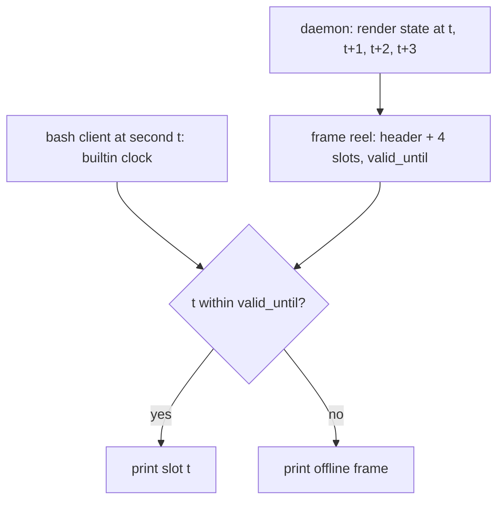

# One render daemon, a bitmap-to-glyph renderer, and a living minimap

**Date:** 2026-11-09
**Trigger:** the Warcraft III layout (G-8). The owner asked what the WC3 minimap could show. The answer
needs a map that is larger than its view and scrolls on its own, which today's one-process-per-second
statusline cannot afford. That turned the discussion to the backend.
**Status:** direction agreed by the owner (decisions below). Not planned. `ce-ideate` ran over the whole doc
(Part 6, seven ranked ideas). Next steps: `ce-brainstorm` on a chosen idea, then the usual plan → work → review
flow.

## Order agreed by the owner

1. **Render daemon first.** "First we need a solid backend, then we can attach features to it."
2. **Bitmap → glyph renderer second.**
3. Minimap and the WC3 layout come after, on top of both.

## Owner decisions so far

| Topic | Decision |
|---|---|
| Daemon scope | **One daemon for all sessions** on the machine. It keeps the list of active sessions and serves each one. Chosen to save memory over one daemon per session. |
| Daemon not running | **Spawn nothing.** No fallback to the old `node` renderer. Spawning a process every second to stand in for a dead daemon only floods the system. |
| Extra code | Fine. A few dozen lines for things like PNG encoding are acceptable. |
| Renderer | A built-in renderer with a limited glyph set and no chafa as the default, chafa as the "full" option. Better still: a built-in renderer that is good enough to be the full one. |
| Hooks and transport details | Not decided here. They belong in the brainstorm. |
| Resource budget | **The only hard limit: Claude Code must run as fast and as well as it does without the bar.** "It is just a status bar." Within that limit the bar may render as often and as richly as it likes. |

## Part 1: render daemon

### The constraint we cannot change

Claude Code spawns the statusLine command itself, once per refresh (1 s), and on Windows always through Git
Bash. statusLine has no exec form, and neither `CLAUDE_CODE_GIT_BASH_PATH` nor `defaultShell` redirects it
(see the project memory notes on the statusLine). So **one `bash` per second per session stays**. Everything
after that `bash` is ours to change. Today it is `bash → node → (chafa)`: two or three processes per second
per session, and the in-process caches (`_cache` in `src/face.js`) die with every render.

### Shape

```
SessionStart hook ──ensures──▶  daemon (node, one per machine, long-lived)
                                  │  ▲  reads  <session>/payload.json
                                  │  │  writes <session>/frame.txt (atomic rename)
                                  ▼  │
Claude Code ─every 1 s─▶  bash thin client: builtins only, no fork
                          read -r -d '' p                 # stdin → variable
                          printf '%s' "$p" > payload.json
                          read -r -d '' f < frame.txt
                          printf '%s' "$f"                # → status bar
```

- **Thin client**: only bash builtins (`read`, `printf`, redirections, `[[ -nt ]]`). It starts no `node`, no
  `cat`, nothing. The only process per tick is the one Claude Code starts.
- **One tick of latency**: the client prints the frame the daemon rendered from the previous payload. At a
  1 s refresh this is acceptable.
- **Daemon** holds state in memory: caches, map layout, camera position, animation tick. It renders when a
  session's payload changes and can also advance animations between payloads.
- **chafa inside the daemon** runs only for mugshot sprites, once per sprite × height, and the result is cached
  for the daemon's lifetime. A few dozen spawns at start, then none. The minimap never goes through chafa:
  every frame differs.
- **Daemon down**: the client sees a stale frame (`[[ payload -nt frame ]]` for longer than a threshold) and
  prints a static "offline" frame. It starts nothing (owner decision). (This test cannot work as written: the
  client writes the payload just before it, so the payload is always newer. See Part 6, idea 1.)

### Lifecycle (to settle in the brainstorm)

- Start: `SessionStart` makes sure the daemon is running (starts it if not). This is a hook spawn, once per
  session, not per tick.
- Session list: a session is active while its payload keeps updating. `SessionEnd` removes it; the existing
  end-of-session cleanup already deletes a session's files.
- Self-exit: the daemon exits when no session has updated its payload for N minutes. This covers Claude Code
  crashes where `SessionEnd` never arrives.
- Single instance: a lock (pid file or a named port) so two `SessionStart` hooks racing don't start two daemons.

### Collector and renderer on separate clocks (owner's idea, 2026-11-09)

**The wish.** The lab preview of the WC3 heads (`lab/wc3-portraits/render/preview.mjs`) animates smoothly,
and the owner wants the bar to feel the same. Split the daemon into two loops:

- **Collector**: gathers data on its own interval, **configurable**, default 1 s.
- **Renderer**: draws as fast as it can, independent of the collector. Target about one frame every 10 ms.

**The hard limit.** The lab preview is fast because it owns the whole terminal: a `setInterval` at
`1000 / fps` writes each frame straight to its own TTY (`\x1b[H` … `\x1b[J`). The status bar is drawn by
Claude Code, not by us. Claude Code runs the statusLine command on `refreshInterval` (documented minimum: 1 s)
and on its own events, and shows whatever that run prints. However fast the daemon renders, **the status bar
shows at most the frame that exists when Claude Code reads it**: about one per second, plus one per event. A
10 ms renderer behind the statusLine is invisible beyond that.

**What still follows from the idea, even within the limit:**

- **Animation time comes from the wall clock**, not from counting ticks or payloads. Whenever a frame is read,
  it shows the right moment of the animation, and an extra event-driven refresh never makes it jump or stall.
- **The collector interval applies only to data the daemon gathers itself** (P-2: rate limits, CPU/RAM,
  clock, file watchers). The Claude Code payload arrives when Claude Code sends it; no setting changes that.
- **Render on demand is enough for the statusLine.** Rendering 100 frames to keep one is wasted CPU. The
  renderer can draw the frame for "now" when a payload arrives, or a few ms before the next expected read.

**The cost of a free-running renderer** (if a faster display surface exists, see below). The owner's rule
decides it: the renderer may take whatever Claude Code does not need, and must yield the moment Claude Code
needs it. Spare CPU is fair game; slowing Claude Code is not. In practice:

- **Run the daemon at below-normal priority** (`os.setPriority`), so the OS scheduler gives Claude Code, its
  tools and builds the CPU first, without the daemon having to guess.
- **Frame rate is a ceiling, not a promise.** The renderer drops frames when it falls behind and never queues
  them. When the machine is busy (event-loop lag, CPU load), it slows down on its own; when idle, it runs at the
  ceiling.
- **Prove it by measurement**, not by argument: the same Claude Code workload (a build, a test run, a long tool
  sequence) timed with and without the bar. A difference outside the noise is a bug in the bar.

- **CPU.** Measured portrait render is 0.25–3.5 ms per frame depending on size (Part 5), plus the glyph stage
  (D-3, not measured yet). At 10 ms per frame a single-threaded daemon serving all sessions saturates at three
  or four sessions at the larger sizes. Options: adaptive frame rate (drop frames under load, never queue),
  a worker thread per session, or a lower cap for background sessions.
- **Disk.** 100 atomic writes and renames of `frame.txt` per second per session, read once per second, is
  pure load on NTFS and Windows Defender. Write a frame file only when its text changed, and cap the write rate
  at what the reader can consume.

**Open: a display surface without the 1 s limit.** The smooth animation only reaches the eye if something
other than the statusLine shows it. Candidates, all **unverified**:

- A Claude Code panel or pane beside the chat that the extension API keeps updated (the `plugin-authoring`
  skill mentions "a panel or pane that stays beside the chat and updates"). Check whether it accepts pushed
  updates and at what rate.
- A separate terminal pane (Windows Terminal split, tmux) running a viewer that owns its TTY like
  `preview.mjs` and reads frames from the daemon.
- Writing into Claude Code's own terminal from outside is not a candidate: it would fight Claude Code's renderer
  for the same screen.

### Open questions for ideation and brainstorm

- **Hooks without spawns.** Today every tool call spawns `node hook.js`. If Claude Code supports HTTP hooks
  (unverified, check the docs), the daemon could listen on a local port and receive hook events with no spawn
  at all. Before relying on that: what does Claude Code do when the daemon is down and an HTTP hook fails? A
  broken `PreToolUse` hook with no matcher can block every tool (project memory).
- **Transport** between client and daemon: files (works with builtins only) vs anything else. Files look
  like the only option that needs no fork from bash, but verify.
- **Partial payload writes**: the client writes `payload.json` without an atomic rename (`mv` would be a
  fork). The daemon must tolerate a half-written file (parse, and on failure keep the last good payload).
- **Is `read -r -d ''` + `printf > file` really fork-free in Git Bash?** Measure it, don't assume.
- **Upgrades**: a new package version while an old daemon runs. Version handshake, restart on mismatch.
- **Crash safety**: a daemon bug must not take the status bar down for every session at once. Isolate
  per-session render errors.
- **Relation to existing backlog**: P-2 (one shared producer for account- and machine-wide data) becomes part
  of the daemon. P-1 (what is expensive in a render) gives the baseline to compare against. L-A (own temp
  directory per session) fits the `<session>/payload.json`, `<session>/frame.txt` layout.

## Part 2: bitmap → glyph renderer

A built-in renderer that turns an RGB(A) pixel buffer into terminal block art, written in JS, no external
process.

- **Glyph set**: the one the mugshot uses, `block+half+quad+sextant+wedge+legacy` (`SYMS` in `src/face.js`,
  ideation 2026-06-06 §mugshot). `legacy` includes octants (2×4, U+1CD00..).
- **Algorithm** (same idea as chafa): every glyph has a precomputed mask on an 8×8 sub-pixel grid. Blocks,
  quadrants, sextants and octants are trivial masks; wedges are rasterised from their polygons. For each cell
  try every glyph, take the mean colour of the pixels under the mask as foreground and the rest as background,
  compute the error, keep the best.
- **Fast path**: a cell of one colour becomes a space or a full block without the search. On a map of flat
  terrain this is most cells.
- **Estimate**: 200–300 lines, much of it the glyph table. A 20×6-cell map is a few million operations per
  frame, a few milliseconds. Measure when it exists.
- **Limit of the glyph set**: two colours per cell, for any renderer including chafa. The minimap needs a
  priority (ping > unit > terrain) when more colours meet in one cell.
- **Terminal support**: Windows Terminal draws the legacy glyphs with its built-in rasteriser, no font needed.
  Other terminals depend on the font, so a half-block-only mode stays as a setting. (In doubt: research says
  Cascadia Code draws sextants and octants from the font. See Part 6, idea 2.)
- **Possible bonus**: if the renderer holds up, compare it with chafa on the mugshot side by side. If it is
  close enough, chafa stops being needed at all. Decide from the pictures, not in advance.
- **Mugshot without chafa** would also need a PNG decoder (inflate via built-in `zlib`, plus scanline
  unfiltering), or the sprites pre-converted to a raw format at build time.

## Part 3: the minimap

### What makes a minimap different from every other HUD element

The other console elements are numbers, fill gauges or lists. The minimap is the only one that shows
**space**, and it brings four things nothing else has: fixed **terrain**, **fog of war** (explored vs not),
**units** (coloured dots: where something happens and who does it), and **camera + pings**. The earlier idea
(ideation 2026-10-31: "activity over time → spark / equalizer") uses none of them, so it is dropped as the
minimap's metric.

### Several metrics, one per layer (owner's idea)

The base of the map is one metric, the player dots another, more can follow. Proposed split, by **how fast
each layer changes**, so the layers don't drown each other:

| Layer | Pace | Metric |
|---|---|---|
| Terrain (base) | almost static | repo structure: top-level directories as regions, colour by kind (code, tests, docs, config) |
| Fog of war | only grows | what Claude has read or found this session (coverage) |
| Units (dots) | minutes | **who** works where: the main session in one player colour, each subagent in its own. A dot moves to the file the agent touched, its trail fades. |
| Pings (blink) | instant | tool error, failing test, pending permission |
| Camera | event-driven | see below |

**Not decided:** the owner is not sure which metric belongs to which layer. Terrain = repo is the weakest
pick, as it is the one layer that says nothing new during a session. Open for ideation.

### Map larger than the view, scrolling on its own (owner's idea)

The map is bigger than the visible window. Like the mugshot, it changes without any interaction with Claude:
the view scrolls in any direction, pixel by pixel, and every frame is rendered fresh from the bitmap of the
current window.

- **Speed is bound to the refresh**: one step per second. Fine for a slow camera pan, not a smooth animation.
  Crossing a 64 px map takes about a minute.
- **Pixel steps** with half blocks: one column sideways, half a row up or down.
- **Who drives the camera** (proposal): idle → slow free pan across the map; event (edit, error, permission)
  → the camera travels to it and stays. The map then not only shows but points.
- **Where am I**: a tiny position marker in a corner shows which part of the map is in view.
- **Cost of the idea**: at any moment part of the map is hidden. The event-driven camera is what makes that
  acceptable.

### Data sources (to verify)

- File paths: `PostToolUse` payloads of `Read`, `Edit`, `Write`, `Grep`, `Glob`. `Bash` gives no reliable path.
- Which subagent made a call: unverified whether the hook payload says so reliably. Check, don't guess.
- Layout: computed once per session from `git ls-files` (treemap of top-level directories, sized by file
  count), cached in the daemon. Large repos: one cell is a directory, not a file.

### Open for ideation

- Session-only map, or memory across sessions (WC3 keeps explored terrain grey: here grey could mean "read in
  an earlier session")?
- Map size in the WC3 layout (rows × columns).
- Does "activity over time" survive somewhere else in the layout, or is it dropped?
- Non-git directories: what is the terrain then?

## Part 4: the rest of the WC3 console

Source: the owner's reference screenshot of the WC3 bottom console (a hero selected). Goal from the owner:
"We don't have to follow the original graphics. As with the DOOM bar we adapt it, it only has to be
recognisable as Warcraft at first glance."

### What is in the reference, left to right

| # | Element | In the original |
|---|---|---|
| 1 | Minimap | terrain, fog, coloured unit dots, white camera rectangle |
| 2 | 4 small buttons right of the minimap | minimap toggles (signal, terrain, ally colours, creeps) |
| 3 | Stone wall frame with crenellations along the top | the console chrome, one piece across the whole width |
| 4 | Portrait in an arched frame | animated head; green HP bar and blue mana bar under it |
| 5 | Info panel (dark navy) | name, purple XP bar with "Level N <class>", stat lines (Damage, Armor, Range, Sight, Speed), three attribute icons with numbers |
| 6 | Inventory 2×3 | item slots, items can show charges |
| 7 | Gargoyle head ornament | decoration above the inventory |
| 8 | Command card 4×3 | ability icons, hotkey letter, cooldown sweep, disabled = grey |

Not in the crop but part of the same HUD: resource bar (gold, lumber, food with an upkeep label), day/night
clock, hero icons at the top left, idle-worker button, in-game messages.

### What makes it read as "Warcraft" at a glance

Not the exact art. The silhouette and palette: crenellated stone (or wood) frame, a portrait in an arch with a
green and a blue bar under it, a dark navy info panel with gold-ish text and a purple XP bar, a grid of
square gold-bordered icons on the right, the map at the left. If those five are there, it reads as WC3.

### Proposed mapping (metric ids from today's catalogue where one exists)

| Element | Proposal | Notes |
|---|---|---|
| Portrait | the mugshot: reacts like the DOOM face (idle, hurt, low HP, god, dead) **and talks** while Claude works | in WC3 the portrait plays a talk animation when the unit speaks; here: turn in progress / tool running |
| HP bar (green → yellow → red) | context left (`context.hp`) | the colour ramp is part of the recognisability |
| Mana bar (blue) | 5 h limit left | |
| Name | `session.title`, fallback project name | |
| XP bar + "Level N <class>" | class = model tier, level = session progress, XP = progress to next level | class names generic (e.g. Haiku = Scout, Sonnet = Knight, Opus = Archmage), not WC3 hero names. A level-up is an event for the chat. What drives XP is open (output tokens, turns, cost) |
| Damage: `a - b` | `+added - removed` lines (`loc.added`, removed) | the original's "31 - 35" range format fits the diff numbers exactly |
| Armor | permission mode (`model.permission`) as a number or word | |
| Range | context window size (`model.window`, 200K / 1M) | |
| Sight | fog coverage of the minimap (% of repo seen) | ties the panel to the map |
| Speed | throughput, if measurable | verify a source exists before promising it |
| 3 attribute icons with numbers | three user-chosen metrics, e.g. subagents, tool calls, errors | configurable like the Minecraft slots |
| Inventory 2×3 | things Claude currently holds: running subagents, background tasks, open todos (charges = count) | |
| Command card 4×3 | tools as abilities: recently used light up and fade like a cooldown; tools that need permission get a yellow border; denied ones grey | 12 slots, user-configurable; hotkey-letter corner as decoration |
| Minimap buttons | which map layers are on, or 4 small status lights | |
| Gargoyle ornament | small block-art emblem per race | original drawing |
| Resource bar | gold = `cost.total`, lumber = token savings (`save.*`), food `x/y` = context used / window | the **upkeep** label maps to rate-limit pressure: "No upkeep" / "Low upkeep" / "High upkeep" by 5 h usage |
| Day/night clock | the 5 h window as a day: dawn at reset, dusk near the limit | |
| Hero icons | subagents with their own small HP bars | |
| Idle worker | Claude is waiting for you (permission prompt or end of turn) | |
| Multi-select | while subagents run, the info panel turns into a grid of unit icons with bars, as in WC3 when you select a group | |
| In-game messages | the chat (`src/chat.js`) | |

### The portrait

**The original:** WC3 portraits are animated 3D models shipped in the game archives, with separate idle and
talk animations. They are Blizzard's copyrighted assets and cannot be shipped in an npm package. The
2026-10-31 decision already says: no game assets. So the head has to be our own.

Options:

- **A. Pixel-art paper doll (recommended start).** Small sprites (~24×28 px) drawn for this project, built
  from layers: head, eyes, mouth, headgear. Frames: idle, blink, look left / right, talk (mouth open / closed),
  hurt, low HP, dead. Rendered by the D-3 renderer like the DOOM face. One new race = one new set of layers.
- **B. Tiny 3D head.** A low-poly head defined in code (a few dozen triangles), a small software rasteriser
  with flat shading, slight turns and nods. Closest to the "moving 3D head" feeling, and the D-3 renderer
  already turns any bitmap into glyphs. More work, and making a low-poly head look good is the hard part.
  A later upgrade, not the start.
- **C. Generated art, cleaned up by hand.** Faster to get many races, but the licence of the generator's
  output needs the owner's call.

**Update 2026-11-09: original portraits from the owner's own install.** The owner owns WC3 and wants the
original heads rendered to block art, without distributing the assets themselves. Checked on the owner's
install (classic TFT, patch 1.25b, MPQ archives `war3.mpq`, `War3x.mpq`, `War3Patch.mpq`):

- StormLib (`@wowserhq/stormjs`, MIT, wasm) opens all archives read-only. `mpyq` cannot: it does not
  implement the MPQ per-file encryption (part of the archive format, not copy protection).
- About 350 `*_portrait.mdx` models: all four races, heroes, campaign characters, creeps, critters.
- Every portrait carries its own **camera** (`CAMS` chunk) and separate **idle** and **talk** sequences, e.g.
  Footman: `Portrait`, `Portrait 2`, `Portrait 3`, `Portrait Talk`, `Portrait Talk 2`. Idle = waiting, talk =
  Claude working maps one to one.
- Textures are BLP1 (`.blp`), team colour comes from `ReplaceableTextures\TeamColor\TeamColor00.blp`.
- Rendering needs the MDX geometry, bone animation (skinning) and BLP decoding (BLP1 is often
  JPEG-compressed). Options: a ready WebGL viewer for MDX in a headless browser as a one-time pre-render
  step, or an own Node renderer.
- **Distribution:** the extracted assets and frames rendered from them stay on the owner's machine (outside
  the repo, gitignored). If the feature ever ships, the clean form is: the package contains the extractor and
  renderer, every user points it at their own install, and users without WC3 get the original art (option A).
- **Unit by model tier** (idea): Haiku = worker (Peasant / Peon / Acolyte / Wisp), Sonnet = soldier
  (Footman / Grunt / Ghoul / Archer), Opus = hero of the race. The race is chosen per session as above.

**Animation pace:** one frame per second (the refresh). Blink and look-around read fine at that pace; a talk
loop at 1 fps is a slow jaw flap, which is acceptable as a style. The daemon (D-1) can pick frames from its
own clock between payloads.

### Races

Generic fantasy archetypes, our own designs, no WC3 unit or hero names: **human knight, orc warrior, undead,
elf**.

- **Choice per session:** derived from a hash of `session_id`, not from `Math.random()`. It looks random,
  differs between sessions, and stays the same across daemon restarts without storing anything.
- **Options:** `race = "random" | "per-project" | "<race>"`. `per-project` hashes the repo path, so one
  repo always fights for the same side.
- **What the race changes:** portrait, frame material and palette (stone and gold, dark wood and iron, bone
  and violet, wood and leaves), the player colour of the main unit on the minimap, the ornament emblem, and
  atmosphere lines in the chat (own wording, never game quotes).
- With one daemon for all sessions, two terminals side by side often show different races, which also makes
  them easier to tell apart.

### Open for ideation

- Rows budget: the original console is about 5:1. At ~120 columns that would be ~12 rows; realistic is 6–8.
  Which elements drop first on a narrow or short terminal?
- What drives XP and levels.
- Command card icons at 2–4 cells per slot: glyph or emoji icons, or tiny bitmaps through D-3?
- Cooldown sweep: the original darkens a clockwise sector; in a cell this is a dimmed portion or `◔◑◕`.
- Does the race also change behaviour (chat tone, reaction thresholds), or only looks?

## Part 5: realtime 3D portrait renderer (lab prototype, 2026-11-09)

Owner's direction: **render at runtime, no pre-rendered frames**, and **convert models and textures to a
universal format** so any future 3D bar reuses the same renderer. Built and measured in
`lab/wc3-portraits/render/` (gitignored, like the assets).

### Architecture

```
offline, once:  MDX + BLP  ──mdx.js / blp.js──▶  neutral scene  ──gltf-export.js──▶  .glb (glTF 2.0, PNG inside)
runtime:        .glb  ──gltf-import.js / png-decode.js──▶  neutral scene  ──anim.js + raster.js──▶  RGBA frame  ──▶  glyphs (D-3)
```

- The runtime never sees MDX or BLP. A future model from any glTF source (Blender export, other games' converters)
  goes through the same path. WC3-only behaviour (additive / modulate filters, layer priority, global sequences,
  sequence durations, replaceable textures) travels in standard glTF `extras.wc3` and is ignored by other tools.
- Runtime dependencies: none (built-in `zlib` for PNG). The JPEG decoder needed for BLP1 (`jpeg-js`, patched to
  return raw BGRA channels) is used only by the offline converter.

### Code size

| Part | Lines | When |
|---|---|---|
| `anim.js` (track sampling, node hierarchy, skinning) | 148 | runtime |
| `raster.js` (z-buffer, perspective-correct UV, bilinear, WC3 filter modes, supersampling) | 180 | runtime |
| `gltf-import.js` + `png-decode.js` | 200 | runtime |
| `mdx.js` + `blp.js` + `gltf-export.js` + `png.js` | 558 | offline converter |

Runtime total about 530 lines, no dependencies.

### Measured (owner's PC, Node 26, single thread, after JIT warm-up, median of 100 frames)

Runtime path (`.glb` → import → animate → rasterise), Footman / Blademaster / Archer:

| Output | Internal | Per frame |
|---|---|---|
| 32×32 px (32×16 half-block cells) | 32 px | 0.25–1.1 ms |
| 32×32 px | 64 px (2× supersample) | 0.7–1.3 ms |
| 64×64 px | 64 px | 0.7–1.3 ms |
| 64×64 px | 128 px (2×) | 2.0–3.4 ms |
| 128×128 px | 128 px | 2.0–3.5 ms |

- Animation + skinning: 0.06–0.15 ms (the glTF path skins once per material layer and applies inverse bind
  matrices; the MDX path was 0.04–0.13 ms). Rasterisation dominates.
- Model load: 14–25 ms from `.glb` (PNG inflate); 17–43 ms from MDX (JPEG decode). Once per daemon, not per frame.
- Memory: about 0.3 MB of RGBA textures per portrait.
- Portraits have 200–300 triangles. The budget is one frame per second per session; even the largest size uses
  under 0.3 % of it. The live terminal preview (`preview.mjs`) runs at 10 fps for comparison. For the cost of
  a free-running renderer at about 100 fps, and why the statusLine cannot show it, see Part 1, "Collector and
  renderer on separate clocks".
- chafa per frame (preview `m` mode, mugshot glyph set, 24×12 cells from a 96×96 px frame): about 35 ms, almost
  all of it process spawn and PNG encode. Ten times the render itself. Fine for a lab preview, and the measured
  reason the daemon renders portrait frames with the built-in glyph renderer (D-3), not chafa.

### Robustness

- All 383 models (332 portraits + 51 model-as-portrait) load, render and convert; none produce an empty frame.
- Converted `.glb` vs original MDX, rendered side by side at 64 px over 3 moments of every animation:
  **353 of 383 pixel-identical** (max channel difference ≤ 2), mean difference 0.013 / 255. The rest differ
  slightly where alpha animation was resampled at 30 Hz (water elementals) or the camera follows a global
  sequence. "Identical" means identical to the prototype's own reading of MDX, not to the game: rotations
  ignore Hermite tangents, edge keys hold instead of wrapping, particles are not drawn.
- **Khronos glTF validator** (`gltf-validator`): all 383 files, 0 errors, 0 warnings. Fixes it forced: a
  synthetic root above all MDX roots (joints need a common root), merged duplicate bones in a matrix group,
  unit normals, single-key tracks as LINEAR (CUBICSPLINE needs two keys).
- **Third-party glTF**: the Khronos sample `Fox.glb` (skinned, 3 animations, PNG texture, no camera) renders
  through the same runtime path. Models without a camera get an automatic one framing the bounding box.
  JPEG textures inside glTF are not supported yet (PNG only).

### glTF mapping (what the converter does)

| MDX | glTF |
|---|---|
| Z-up | Y-up: `(x, y, z) → (x, z, −y)`, quaternions likewise |
| Node pivot, local = `T(p) T(t) R S T(−p)` | rest translation = pivot − parent pivot, translation keys offset by it, inverse bind matrix = `T(−pivot)`; mathematically exact |
| Matrix groups (vertex follows the average of its bones) | `JOINTS_0/WEIGHTS_0` (+ `_1` sets, up to 8 bones), equal weights |
| One timeline cut into sequences | one animation per sequence, time from 0, duration in `extras.wc3.duration` |
| Global sequences | one animation each (`extras.wc3.globalSequence`), played on the wall clock; zero-length ones are constants baked into the rest pose |
| Linear / Hermite / Bezier | LINEAR / CUBICSPLINE (tangents rescaled by segment length; Bezier converted to Hermite). Rotations LINEAR |
| Material layers | one primitive per layer over shared accessors, one material per (geoset, layer) |
| Filter none / transparent / blend / additive… | OPAQUE / MASK (cutoff 0.75) / BLEND, exact mode in `extras.wc3.filter` |
| Unshaded, two-sided | `KHR_materials_unlit`, `doubleSided` |
| Geoset alpha × layer alpha (animated) | `KHR_animation_pointer` on `baseColorFactor` |
| Team colour / glow (replaceable textures) | default red PNGs embedded, `extras.wc3.replaceableId` lets the renderer swap colour (race / player colour) |
| Portrait camera | glTF perspective camera on a node, `yfov` = MDX FOV |

Not converted (and not drawn by the MDX renderer either): particles `PRE2/PREM` (93 models), ribbons (2), texture
animation `TXAN` (7), animated texture id `KMTF` (2), camera roll (10). Particles are the visible gap: sparks,
smoke and glow on some heroes.

### Findings worth keeping

- The portrait **background** is part of the model: a plane with the team-glow texture behind the head. It takes
  the team colour, so it can follow the race, or be hidden for a transparent terminal background.
- Each portrait carries its own camera; framing works with no per-model tuning once the bone hierarchy is right.
- Reference viewer behaviour checked against `mdx-m3-viewer` source: FOV is vertical; a zero-length global
  sequence holds its first key. One difference kept on purpose: before the first / after the last key the
  reference wraps around the loop, the prototype (like glTF) holds the edge key.
- Size: 116 MB of `.glb` for all 383 models, because every model embeds its own PNG copies (team glow etc.) and
  PNG is larger than the original JPEG. Fine for the lab. For shipping: external shared textures (`.gltf` +
  `.png`) or `KHR_texture_basisu` / JPEG, and only the chosen models.

### Next

- Glyph stage (D-3) on top of the RGBA frame; compare with chafa on the same frames.
- Race / player colour through the replaceable textures; transparent background option.
- Pick the roster: which heads look good at 16–24 rows (contact sheets in `lab/.../out/all-*.png`).
- Daemon (D-1) hosting the renderer; frame per session per second.
- Verify a display surface that accepts frames faster than 1 s (Claude Code panel, terminal pane), Part 1.

## Part 6: ideation round (ce-ideate, 2026-11-09)

Ideation over Parts 1–5. Five generators with different lenses (pain, removal, leverage, cross-domain analogy,
assumption-breaking and constraint-flipping) produced 47 raw ideas, merged to 31 candidates. A separate verifier
that had not seen the generation checked every basis against the repo. Seven survive; the rest are listed with
the reason they were cut. Owner decisions above were treated as hard constraints, not as assumptions to break.

### Grounding beyond Parts 1–5

- **statusLine behaviour** (code.claude.com/docs/en/statusline): updates are debounced at 300 ms, and **a new
  update cancels the script that is still running**. The client must be a fast read of a ready frame, never a
  render. The payload also carries `prompt_cache` (`warm`, `expires_at`, `hit_ratio`).
- **Doc claim in doubt:** Part 2 says Windows Terminal draws the legacy glyphs with its built-in rasteriser, no
  font needed. Research says Cascadia Code 2404.23 added sextants and octants **to the font**, and a Windows
  Terminal pull request to draw sextants built-in was still a draft in February 2026. Unverified either way;
  idea 2 settles it.
- **Doc flaw found by the verifier:** Part 1's liveness test `[[ payload -nt frame ]]` runs right after the
  client has written the payload, so the payload is always newer. The test cannot work as written; idea 1
  replaces it.
- **Prior art:** gitstatusd (powerlevel10k) serves shells from a resident daemon over pipes; ztheme shares one
  per-user daemon across shells and uses generation ids so a slow result never overwrites a newer one. Other
  Claude Code statuslines (ccstatusline, claude-powerline) are one-shot processes with small TTL caches; a
  resident daemon would be new in this category.
- Code seams: `render.js` builders are pure (values in, lines out); `fold.js` already folds an append-only
  journal by offset; `face.js` `_cache` is the cache that dies with every render today.

### Topic axes

1. Daemon backbone: lifecycle, single instance, transport, liveness, upgrades, crash isolation.
2. Pixels to glyphs: glyph renderer, portrait pipeline, terminal glyph support.
3. What the map shows: layers, data sources, camera, meaning over a session.
4. Console meaning: WC3 elements mapped to metrics, portrait behaviour, rows budget.
5. Time and display surfaces: the 1 s pull, the animation clock, staying invisible to Claude Code.

### Ranked ideas

1. Frame reel with a deadline, read by a write-once client
2. Glyph truth on the real terminal, scored by rendering glyphs back to pixels
3. One per-repo ledger behind the map, with "changed since Claude read it" as its headline layer
4. Pose-to-pose sampling: make a 1 Hz portrait look alive
5. Crash-only daemon with a version-named singleton
6. Cell-space compositor with two resolvers
7. XP from resolved work, kept per repo

#### 1. Frame reel with a deadline, read by a write-once client

**Description:** The bash client is the one piece that lives in every user's `settings.json`; freeze it and move
every future change into the frame file. The daemon renders a short reel: one slot per wall-clock second for
the next few seconds, plus a header (`v`, `gen`, `daemon` version, `valid_until`). The client reads the current
second with a builtin (`$EPOCHSECONDS`, bash 5; or `printf -v now '%(%s)T' -1`, bash 4.2), prints that slot,
and prints the static offline frame once the reel has run out. Rendering becomes a pure `render(state, t)`.



**Axis:** Daemon backbone.
**Basis:** `direct:` Part 1 "Thin client: only bash builtins" and "One tick of latency"; the `-nt` liveness test
cannot work (see grounding). `external:` ztheme generation ids; the jitter buffer in VoIP receivers, which
exists because the producer's timing is unreliable and the consumer's is fixed. `reasoned:` a low-priority
daemon starved by a build, or restarting after an upgrade, leaves one frame file frozen; a reel keeps the
animation playing for its length.
**Rationale:** It fixes the broken liveness test, makes "yield the moment Claude Code needs it" safe (the
daemon can be starved for seconds without the bar stalling), and makes the client contract final before D-1.
Measured on the owner's PC: Git Bash is bash 5.3.15, `$EPOCHSECONDS` works, and `printf -v n '%(%s)T' -1`
returns the same value (`printf` is a builtin). `$EPOCHSECONDS` is a shell variable, so it cannot fork; whether
the whole client stays fork-free is still Part 1's open measurement.
**Downsides:** Payload data still lags one tick; the reel protects animation and liveness, not freshness.
More bytes written per tick (k slots). "Never hot-patched" is overstated if the command points at a package
file, but the command string itself is still the user's.
**Confidence:** 80%
**Complexity:** Medium

#### 2. Glyph truth on the real terminal, scored by rendering glyphs back to pixels

**Description:** Two cheap checks before D-3 is designed around octants. First, a test card of every glyph
class (half, quadrant, sextant, octant, wedge) shown once on the owner's Windows Terminal and font, judged by
eye, and the result saved as a fallback ladder: octant → sextant → quadrant → half block. Second, a score:
every glyph's mask is known, so any glyph frame can be rasterised back to RGBA and compared with the source
frame (OKLab error). Run it over the 383-model corpus for the built-in renderer and for chafa, and drop glyph
classes that do not lower the error enough to be worth their font risk.
**Axis:** Pixels to glyphs.
**Basis:** `direct:` Part 2 "Windows Terminal draws the legacy glyphs with its built-in rasteriser, no font
needed" and "Decide from the pictures, not in advance"; `src/face.js:18` takes the whole chafa set
(`block+half+quad+sextant+wedge+legacy`); Part 5 already verified `.glb` against MDX by pixel difference over
the same corpus. `external:` Cascadia Code 2404.23 release notes; draft Windows Terminal pull request for
built-in sextants; chafa 1.8 made block and border characters its default because wider sets are unreliable.
**Rationale:** The glyph claim is the one assumption that could turn the portrait and the map into tofu on the
owner's own machine, and it costs minutes to check. The score turns D-4 (keep chafa or not) and later tuning
into numbers instead of taste.
**Downsides:** The score measures ideal masks, not how a font draws them, so it needs the eye test beside it.
Scoring chafa's output means decoding its glyphs back into masks.
**Confidence:** 85%
**Complexity:** Low

#### 3. One per-repo ledger behind the map, with "changed since Claude read it" as its headline layer

**Description:** Keep one ledger per repo: path → first seen, last read, last written, actor, provenance.
Fog, Sight %, unit trails and the grey "read in an earlier session" are views of it, so the open question of
which metric goes on which layer becomes cheap to change. The headline layer is new: a region Claude has read
whose files changed afterwards gets a ghost tint, like last-known positions under RTS fog. Every mark carries
its provenance, and anything the hooks cannot attribute stays neutral instead of guessed. Because the one
daemon sees every session, two sessions working in the same repo or worktree appear on each other's map as
allies.
**Axis:** What the map shows.
**Basis:** `direct:` Part 3 "Terrain = repo is the weakest pick", fog "only grows", "Bash gives no reliable
path", "Which subagent made a call: unverified ... Check, don't guess", and cross-session grey as an open
question; `src/fold.js:16-18` already splits `READ_TOOLS` and `WRITE_TOOLS`; Part 1 lists file watchers among
the collector's sources. `reasoned:` a layer that only grows saturates and stops saying anything; a layer that
can decay stays informative all session and tells the user when to have Claude re-read.
**Rationale:** It gives the map a meaning a user would act on, settles the layer-assignment risk with one data
model, and turns the one-daemon decision into a visible feature for parallel sessions.
**Downsides:** Claude's own edits through Bash (`sed`) look like outside changes, so the tint must say "changed
since read", never "changed by someone else". Ledger entries only exist for tools that carry a path. A new
on-disk store per repo needs an owner and a cleanup rule.
**Confidence:** 65%
**Complexity:** Medium

#### 4. Pose-to-pose sampling: make a 1 Hz portrait look alive

**Description:** At a 1 s read, a looping animation sampled on the wall clock aliases: a loop close to a whole
number of seconds looks frozen, one at 1.1 s crawls or seems to run backwards. At model load, pick a few
extreme poses per sequence from the animation tracks (mouth open, mouth closed, look left, look right) and map
wall-clock seconds to them so consecutive reads land on contrasting poses, never on in-betweens. It stays
wall-clock driven, so an extra event-driven read never makes it jump.
**Axis:** Time and display surfaces.
**Basis:** `direct:` Part 4 "a talk loop at 1 fps is a slow jaw flap"; Part 5 sequence durations in
`extras.wc3.duration`; Part 1 "Animation time comes from the wall clock". `external:` the stroboscopic
(wagon-wheel) effect; limited animation in TV cartoons, which holds poses and animates on twos for low drawing
rates.
**Rationale:** The statusLine shows about one frame per second and that will not change. Choosing which instant
is shown is the only lever left for the owner's wish to make the bar feel like the lab preview.
**Downsides:** Reads jitter (about 1.0–1.1 s plus event refreshes), so the alternation sometimes repeats or
skips a pose. Needs a one-off pass per model to find the extremes.
**Confidence:** 70%
**Complexity:** Low

#### 5. Crash-only daemon with a version-named singleton

**Description:** Hold no daemon state that cannot be rebuilt from the journals, so killing the daemon is always
safe. Single instance is binding a named pipe that carries the package version (`\\.\pipe\doombar-<version>`);
"address in use" means one is already running, so two racing `SessionStart` hooks need no pid file. An upgrade
starts the new version beside the old one, which leaves through the self-exit Part 1 already plans. A session
whose render throws repeatedly is quarantined to its own offline frame.
**Axis:** Daemon backbone.
**Basis:** `direct:` Part 1 lifecycle (lock by "pid file or a named port", self-exit after N idle minutes) and
open questions "Upgrades ... Version handshake, restart on mismatch" and "Isolate per-session render errors".
`external:` Candea and Fox, "Crash-Only Software" (HotOS IX, 2003).
**Rationale:** Single instance, upgrade and crash recovery collapse into one OS primitive plus one rule,
with less code to test and no stuck-daemon states.
**Downsides:** Two versions alive at once must not write the same frame file, so session directories need the
version in their path or the old daemon must stop serving once the new one appears. Restarting a dead daemon
before the next `SessionStart` would need a hook, which pulls against D-2's goal of fewer hook spawns.
**Confidence:** 70%
**Complexity:** Medium

#### 6. Cell-space compositor with two resolvers

**Description:** D-3 returns a grid of cells (glyph, foreground, background), not ANSI text, and layers
(terrain, fog, units, pings, portrait, chrome) are composited in cell space; a serializer writes the
statusLine string last. Two resolvers fill cells. Synthetic art (minimap, chrome) is drawn in palette indices
on the octant sub-grid (2×4 per cell) with at most two colours chosen by the layer priority, so the glyph is a
lookup in a 256-entry table; fallback glyph sets are other tables. Photographic art (the portrait) keeps the
error search.
**Axis:** Pixels to glyphs.
**Basis:** `direct:` Part 2 "two colours per cell, for any renderer including chafa. The minimap needs a
priority (ping > unit > terrain)"; Part 3 "Pixel steps with half blocks: one column sideways, half a row up or
down". `reasoned:` octants cover all 256 patterns of a 2×4 cell (230 new characters plus 26 reused), so the
lookup is exact; a string-only renderer cannot be composited, diffed or tested cell by cell.
**Rationale:** The minimap, which changes every frame, costs almost nothing; scrolling gets finer steps (half a
column by a quarter row); the glyph ladder from idea 2 becomes a table swap. The same grid is what golden-file
tests and any later display surface would consume.
**Downsides:** Octants need Unicode 16 support, hence the ladder. One more type between the renderer and the
string. Low novelty on its own; the value is in pairing it with the lookup resolver.
**Confidence:** 75%
**Complexity:** Medium

#### 7. XP from resolved work, kept per repo

**Description:** In WC3, heroes gain XP from units they kill, not from time or gold spent. Here XP comes from
finished work: completed tasks, and failures later followed by success on the same tool and target. Never from
tokens, turns or cost. The hero's level persists per repo, so a session is a mission and the repo a campaign.
Level-ups are natural chat events.
**Axis:** Console meaning.
**Basis:** `direct:` Part 4 "What drives XP is open (output tokens, turns, cost)"; `src/fold.js:90-91` counts
`PostToolUseFailure`, `StopFailure`, `PermissionDenied`; `src/fold.js:106` handles `TaskCompleted`; Part 4
`per-project` race already hashes the repo path. `reasoned:` tokens, turns and cost measure spending; a bar
that levels up for burning tokens praises waste.
**Rationale:** XP is the most "game" element on the console. Tying it to resolved work keeps the HUD honest and
answers an open question with the source game's own rule.
**Downsides:** "Failure later fixed" needs a matching key (tool plus path) that not every tool has; sessions
that never use tasks earn little. Persisting per repo adds state, which idea 5 must be able to rebuild.
**Confidence:** 60%
**Complexity:** Medium

### Rejection summary

| # | Idea | Reason rejected |
|---|------|-----------------|
| 1 | Hookless feed: daemon tails the transcript | Transcript flushes at turn end (project memory). Per the verifier, not checked: it lacks permission, `TaskCompleted` and `SubagentStart` signals, and subagents write separate files. Would break the event sources ideas 3 and 7 need. |
| 2 | Payload as an append-only journal | Part 1 already covers torn writes (keep the last good payload); the file grows without bound and the client cannot rotate it without a fork. |
| 3 | Measure-first gate (fork count, bar on/off benchmark) | Already in the doc (Part 1 "Prove it by measurement", "Measure it, don't assume"). Becomes the acceptance test for idea 1, not a separate direction. |
| 4 | Crisp, posterised portrait input (no supersampling) | Premise unmeasured and probably backwards for photographic textures: nearest sampling shimmers when shrinking. Test with idea 2's score before adopting. |
| 5 | Sticky glyph choice against flicker | The search is deterministic for identical pixels; at one read per second, frame differences are the animation. Adds state that breaks idea 1's pure `render(state, t)`. |
| 6 | Our own art emitted as glTF by code | Understates that a procedural head is the hard part (Part 4 option B); glTF buys only interop. Paper doll (option A) stays the recommended start. |
| 7 | Content-keyed frame cache across sessions | Solves the 10 ms case that has no display surface; at 1 fps the render is about 0.3 % of budget, and per-session races make cache hits rare. |
| 8 | Map grown from touched paths (hash or Hilbert layout) | Without known terrain, fog and the Sight % denominator disappear; hash layouts lose locality and the map starts empty. The stability idea may still serve large repos. |
| 9 | The map is the context window | Hooks cannot know what is really in context (truncated results, Bash output, opaque compaction); duplicates the HP metric. |
| 10 | Ping types as lighthouse rhythms | At ~1 Hz reads with jitter, phases need ≥2 s, not ≥1 s; competes with colour meaning. Worth revisiting if pings prove unreadable. |
| 11 | Stateless closed-form camera | A spring needs the previous position and velocity; at one frame per second a smooth spring is invisible anyway. |
| 12 | Neutral portrait state contract | Already proposed in the 2026-10-31 layout doc; the only new part is a `talk` flag, which idea 4 and Part 4 already imply. |
| 13 | Layout packs as data, hot-reloaded | Duplicates the 2026-10-31 registry; chrome is code under the artwork rule, so a pack cannot be pure data. |
| 14 | Dark-cockpit console with a dynamic row budget | Dark-at-rest works against WC3 recognisability (full chrome visible), and a row count that changes with state reflows Claude Code's chat area. The degradation ladder part stays an open question in Part 4. |
| 15 | Portrait shows whoever is speaking (subagent transmissions) | Sound, cut in the second pass: parallel subagent bursts would flicker, the subagent's model tier is unknown, and hero icons already cover delegation. |
| 16 | Command card as a tool-recency timeline | Small extension of Part 4's cooldown mapping; better settled inside G-8 than as a direction. |
| 17 | Idle priority plus EcoQoS | EcoQoS is not reachable from Node's standard library; idle over below-normal is marginal. Safe only with idea 1. |
| 18 | RGBA as the product, Sixel for a pane viewer | Builds an encoder for a surface that is not verified to exist. Idea 6's cell grid fits the real statusLine path. |
| 19 | Lazy collector pulled on payload arrival | Payloads arrive every second per session, so it is a timer in disguise; ties the collector to payloads against the owner's separate-clocks wish. |

## Artwork

As with Minecraft and the 2026-10-31 decision: all chrome drawn in code (glyphs and colours), no game assets.
Portraits, emblems and icons are drawn for this project. Recognisable by layout and palette, not by copied art
or names.
