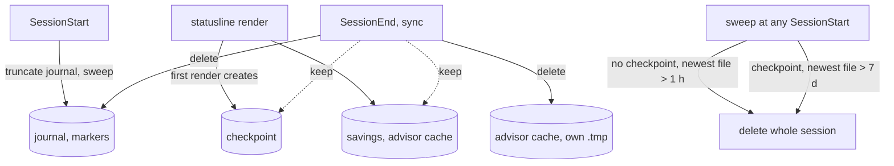

# Temp-file leaks and render snapshot tests - Plan

## Goal Capsule

- **Objective:** The bar cleans up after itself: users no longer find hundreds of stale files in `%TEMP%` to delete by hand, tests no longer leave files in the developer's real temp directory, and today's DOOM and Minecraft output is pinned so later refactors can prove they change nothing on screen.
- **Means:** end-of-session cleanup plus a short TTL for sessions that never rendered (KTD1–KTD3), every per-session file derived from one location (KTD4), and snapshot tests over the pure renderers (KTD7).
- **Authority:** this plan's Requirements win on behaviour; KTDs win on mechanism. Source documents: `docs/ideation/2026-10-31-temp-file-leaks-and-hook-cost.md` (backlog items L-B, L-C, L-E, L-F, L-G) and `docs/ideation/2026-10-31-shared-game-layout-engine.md` (G-1).
- **Execution profile:** one delivery on `master`, units in order U1 → U5, one commit per unit. U1 lands first so every later unit runs against pinned output.
- **Stop conditions:** stop and ask if a change would delete a file outside the session being cleaned or outside the bar's own name patterns; if U1's snapshots cannot be made byte-stable on both Windows and the Linux CI runner; or if the contributor has unpushed work in `src/hook.js` or `src/statusline.js` that conflicts.
- **Finishing:** `ce-work` implements and verifies. Releasing (CHANGELOG version entry, `npm version`) happens only on the owner's go.

---

## Product Contract

### Summary

The hook deletes a session's scratch files when the session ends, and the sweep removes files of sessions that never displayed a bar after an hour instead of a week. Every file a session writes lives next to its checkpoint, so `MUGSHOT_STATE` relocates all of them and the sweep sees all of them. Snapshot tests pin the rendered DOOM presets and the Minecraft hotbar at several widths.

### Problem Frame

Measured on 31.10.2026: about 3,690 bar files in `%TEMP%`, 98 % of them from headless `claude -p` sessions that fire the user-level hooks but never render a bar (about 200 such sessions a day). Nothing deletes a session's files when it ends; the only cleanup is a 7-day sweep at the next SessionStart. `savings_<sid>.json` is never deleted at all, failed atomic renames leave `.tmp` files, and the probe markers and savings file ignore `MUGSHOT_STATE`, so the test suite writes into the developer's real temp directory. The owner had to find and delete these by hand (3,244 files removed manually on 31.10.2026).

Separately, the rename to `claude-game-bar` and the shared-HUD refactor will touch every renderer. Today nothing pins what the bars look like, so a refactor could change the output without any test noticing.

### Requirements

**Cleanup**

- R1. When a session ends, its journal, probe markers, advisor cache and orphaned `.tmp` files are deleted; its checkpoint and savings file are kept (KTD1).
- R2. Files of a session that never rendered a bar are deleted once their newest file is older than 1 hour; files of rendered sessions keep the 7-day rule (KTD3).
- R3. A failed atomic write leaves no `.tmp` file behind.
- R4. The sweep recognises every file the bar writes, including `savings_*`, and never deletes the cross-session shared files (`mugshot_cpu.json`, `mugshot_ratehealth_global.json`, `mugshot_ratelimits_global.json`, `mugshot_reap_tick.json`).

**Location**

- R5. All per-session files (journal, git and msys markers, advisor cache, savings) live in the checkpoint's directory, so `MUGSHOT_STATE` relocates every one of them; `DOOMBAR_SAVINGS_STATE` still overrides the savings path.

**Install**

- R6. `install` registers the end-of-session hook; re-running `install` is idempotent and `uninstall` removes it.

**Pinned output**

- R7. Tests pin the rendered output of the DOOM `full`, `standard` and `minimal` presets and the Minecraft hotbar at several terminal widths, byte for byte, identically on Windows and Linux.

### Key Decisions

- **Keep the checkpoint and savings file at session end; delete the rest.** Governs R1. (session-settled: user-approved — chosen over deleting every file of the session: a resumed session keeps the same id, and its continuity should survive.)
- **Never-rendered threshold is 1 hour since the newest file.** Governs R2. (session-settled: user-approved — chosen over keeping the 7-day rule for all sessions: headless runs never use their files, and an active headless run keeps touching them so it is not swept.)
- **Snapshots pin the pure renderers with fixed inputs, not the statusline process.** Governs R7. (session-settled: user-approved — chosen over snapshotting the full statusline process: CPU, RAM and the clock change on every run.)

### Success Criteria

- After a day of normal use, the bar's files in `%TEMP%` are only the last 7 days of rendered sessions (checkpoint and savings each) plus headless sessions younger than an hour, instead of three files per session for a week.
- `npm test` leaves no `mugshot_*` or `savings_*` file in the real temp directory.

### Scope Boundaries

- Not built: the own directory `%TEMP%/claude-game-bar/<session>/` (L-A) and skipping probes in headless sessions (L-D). Both go with the rename.
- Not built: compacting a long session's journal while it runs. It costs disk, not render time (largest seen 211 KB).
- Not built: fixing how a resumed session folds a truncated journal (see Risks). Considered and left alone because it is today's behaviour and the rename's state redesign replaces it.

#### Deferred to Follow-Up Work

- Release: CHANGELOG entry, version bump, then `install` re-run on the global npm install.

---

## Planning Contract

### Key Technical Decisions

- KTD1. **SessionEnd deletes journal, markers, advisor cache and this session's `.tmp`; keeps checkpoint and savings.** Implements the first Key Decision (R1). Conflict call-out from research: on resume, `SessionStart` truncates the journal and `loadState` then sees `offset > size` and resets the checkpoint, so keeping the checkpoint does not preserve the HUD counters today. Keeping it is harmless. The savings file does carry its running total across a resume (`leanCtxSavings` keeps `saved` and its offset into lean-ctx's log), so it is the part that matters. The checkpoint and savings file still age out through the 7-day sweep. (session-settled: user-approved — chosen over deleting every file of the session: resume continuity.)
- KTD2. **SessionEnd is registered synchronously and does nothing but unlink.** Every other hook entry is `async: true`; an async hook at session end can be cut off when Claude Code exits. The handler returns before the journal append, the git snapshot and the msys probe, so it never spawns a process and never recreates the journal it just deleted.
- KTD3. **The sweep decides per session, from the directory listing.** `staleStateFiles` stays pure: it groups names by session key, treats a session as rendered when `mugshot_<key>.json` is in the listing, and applies 1 hour (unrendered) or `DOOMBAR_JOURNAL_TTL` (rendered) to the newest file of that session. Shared names and the caller's own files stay excluded as today. A grouping per session (not per file) stops a fresh journal from being kept while its stale markers go, or the reverse. (session-settled: user-approved — chosen over one 7-day rule for all sessions.)
- KTD4. **One helper derives every per-session path from `statePaths`.** Markers, advisor cache and savings use `path.dirname(checkpoint)` plus their existing name pattern with `sidKey(sid)`. The advisor cache already normalises the id exactly like `sidKey`, so its name is unchanged. The savings file switches from the raw id to `sidKey(sid)`; old raw-id files are swept as `savings_*` by age. `DOOMBAR_SAVINGS_STATE` keeps precedence. Sharing one helper is what lets SessionEnd and the sweep name exactly the files the writers created.
- KTD5. **One exported list of shared file names.** `SHARED_STATE` in `src/hook.js` gains `mugshot_cpu.json` and `mugshot_ratelimits_global.json`, and `savings_` joins `mugshot_` as a prefix the sweep owns.
- KTD6. **A failed write or rename unlinks its own `.tmp`.** Applies to the checkpoint write in `loadState` and the shared rate-limit write in `syncRateLimits` (both `src/statusline.js`). On Windows a rename fails with `EPERM`/`EBUSY` while another process has the target open.
- KTD7. **Snapshots render the pure functions with a fixed fixture and fixed time.** DOOM: `setValues(fixture)`, `resolvePreset`, `buildBar` with a fixed sprite function and `tick = 0`. Minecraft: `buildHotbar` with the same fixture, a fixed `now`, idle sprite, no reaction. The fixture is `SAMPLE` from `src/render.js` plus the three keys the hotbar and chat need (`loc.added`, `model.effort_level`, `session.title`), extended inside the test. The test sets `process.env.PATH` to empty before its first render, so `loadFace` (`src/face.js`) always falls back to the pre-rendered `.ans` faces: with chafa on PATH (it is on the owner's machine, not on the Linux runner) the mugshot, and through its width the layout, would differ per machine. Snapshot files are stored raw (ANSI included) under `test/snapshots/`, marked `-text` in `.gitattributes` so git never converts line endings (`core.autocrlf=true` on the owner's machine, LF on CI). A missing or differing snapshot fails the test; an environment flag rewrites them on purpose. (session-settled: user-approved — chosen over snapshotting the statusline process.)

### High-Level Technical Design

Which files a session leaves behind, by event:

### Assumptions

- Claude Code passes `session_id` and `hook_event_name: "SessionEnd"` to SessionEnd hooks like other events, and runs a synchronous SessionEnd hook to completion before exiting. U5 verifies this live (see Verification Contract).

### Risks

- **Resume folds a truncated journal against an old offset.** If a resumed session's new journal grows past the old checkpoint's offset before the first render, `loadState` reads from the middle of the new journal. Today's behaviour, rare, out of scope; noted so U5 does not appear to cause it.
- **Contributor activity.** The contributor changed `src/statusline.js` today (0.13.1). Fetch and rebase before each unit.
- **Existing installs** get end-of-session cleanup only after re-running `install`. The 1-hour sweep (U4) covers them until then.

---

## Implementation Units

### U1. Snapshot tests for DOOM presets and the Minecraft hotbar

- **Goal:** Pin today's rendered output before any code changes (G-1).
- **Requirements:** R7; KTD7.
- **Dependencies:** none.
- **Files:** `test/render-snapshot.test.mjs` (new), `test/snapshots/` (new, generated), `.gitattributes` (new), `package.json` (append the test to `scripts.test`).
- **Approach:**
  1. Empty `PATH` in the test process (KTD7), then build the fixture from `SAMPLE` plus the three hotbar keys.
  2. Render each DOOM preset at widths 80, 120 and 200 through `resolvePreset` + `buildBar`, so the fallback chain is pinned too.
  3. Render the Minecraft preset with `buildHotbar` at widths 60, 100 and 160, plus one exhausted case ("You died!") and one reaction case (selected slot after `ouch`).
  4. Compare each against its file; write files when the update flag is set.
- **Execution note:** Generate the snapshots from the current `master` before U2 changes anything, and eyeball one DOOM and one Minecraft file before committing them.
- **Patterns to follow:** test harness style of `test/layout.test.mjs` and `test/theme.test.mjs` (plain `ok()` counter, `ALL PASS`).
- **Test scenarios:**
  - Each preset × width matches its stored snapshot byte for byte.
  - A changed renderer output fails with a message naming the snapshot file.
  - A missing snapshot fails unless the update flag is set; with the flag it is written.
  - The same snapshot passes when the working copy was checked out with `core.autocrlf=true`.
- **Verification:** suite passes locally and on the publish workflow's `npm ci` + test run (Linux).

### U2. Every per-session file follows the checkpoint's directory

- **Goal:** `MUGSHOT_STATE` relocates markers, advisor cache and savings; the sweep knows all of them.
- **Requirements:** R4, R5; KTD4, KTD5.
- **Dependencies:** U1.
- **Files:** `src/fold.js` (path helper next to `statePaths`), `src/hook.js` (`gitMarkerPath`, `msysMarkerPath`, `SHARED_STATE`, `staleStateFiles` prefixes), `src/statusline.js` (`godFlash` cache path, `savingsStatePath`), `test/journal-sweep.test.mjs`, `test/statusline-savings.test.mjs`, `test/msys-event.test.mjs`, `test/theme.test.mjs`, `test/smoke.test.mjs`, `test/hook-tasks.test.mjs`.
- **Approach:**
  1. Add the helper in `src/fold.js`, switch the four writers to it, extend the sweep's prefixes and shared list. No behaviour change when `MUGSHOT_STATE` is unset except the savings file name (raw id → `sidKey`).
  2. Every test that spawns `src/hook.js` or `src/statusline.js` runs it with `TEMP`, `TMP` and `TMPDIR` pointed at the test's own temp directory, as `test/rate-health.test.mjs` already does. Today `test/theme.test.mjs`, `test/smoke.test.mjs` and `test/hook-tasks.test.mjs` render or hook without any redirect and leave `savings_*`, `mugshot_default.json.jsonl` and the shared files in the real temp directory; R5 alone does not reach them.
- **Test scenarios:**
  - With `MUGSHOT_STATE` in a sandbox and `TEMP`, `TMP` and `TMPDIR` pointing elsewhere (Node on Windows reads `TEMP`/`TMP`, not `TMPDIR`), a SessionStart hook run writes git and msys markers in the sandbox and nothing in the other directory.
  - With `MUGSHOT_STATE` in a sandbox, a render writes the savings file and the advisor cache in the sandbox.
  - `DOOMBAR_SAVINGS_STATE` still wins over the sandbox location.
  - The sweep deletes a cold `savings_<id>.json` and keeps a fresh one.
  - The sweep keeps `mugshot_cpu.json` and `mugshot_ratelimits_global.json` even when ancient.
- **Verification:** the "No test residue" gate in the Verification Contract passes.

### U3. Failed atomic writes leave no `.tmp`

- **Goal:** No orphaned `.tmp` from the checkpoint or the shared rate-limit file.
- **Requirements:** R3; KTD6.
- **Dependencies:** U1.
- **Files:** `src/statusline.js` (`loadState`, `syncRateLimits`), `test/journal.test.mjs` (or a new focused test), `test/ratelimit-share.test.mjs`.
- **Approach:** in each write's failure path, unlink the tmp it created, ignoring errors.
- **Test scenarios:**
  - Checkpoint path is an existing directory, so the rename fails: the render still prints, and no `*.tmp` remains next to it.
  - Shared rate-limit path is an existing directory: same outcome, and the session's own limits are still shown.
  - Normal render: checkpoint written, no `.tmp` remains (regression).
- **Verification:** U1 snapshots unchanged; new tests pass on Windows and Linux.

### U4. Short TTL for sessions that never rendered

- **Goal:** Headless sessions' files disappear within about an hour instead of a week.
- **Requirements:** R2, R4; KTD3.
- **Dependencies:** U2.
- **Files:** `src/hook.js` (`staleStateFiles`, the unrendered TTL constant with an env override in the existing `DOOMBAR_*` style), `test/journal-sweep.test.mjs`.
- **Approach:** group names by session key (checkpoint, journal, markers, advisor cache, savings and `.tmp` all map to one key), decide per group by the newest file's age, return every name of a stale group.
- **Test scenarios:**
  - Session with journal and markers only, newest 2 h old: all its files go.
  - Same, newest 30 min old: all kept.
  - Session with a checkpoint, newest 2 h old: all kept (7-day rule).
  - Session with a checkpoint, newest 8 days old: all go, savings included.
  - Unrendered session whose journal is fresh but markers are 2 h old: all kept (grouped by newest).
  - Shared files, the caller's own files and non-bar names: never selected, whatever their age.
  - Name whose age cannot be read: kept (today's rule).
- **Verification:** existing sweep tests still pass with the new grouping; end-to-end sweep test in a temp dir it owns deletes a 2 h unrendered session and keeps a rendered one.

### U5. SessionEnd cleanup and installer registration

- **Goal:** A session's scratch files go when it ends.
- **Requirements:** R1, R6; KTD1, KTD2.
- **Dependencies:** U2, U4.
- **Files:** `src/hook.js` (SessionEnd branch in `main`), `bin/cli.js` (`HOOK_EVENTS`, per-event entry without `async` for SessionEnd, usage text), `test/session-end.test.mjs` (new; add to `scripts.test` in `package.json`), `test/installer.test.mjs`, `README.md` (hooks list / housekeeping note), `CHANGELOG.md` (`[Unreleased]`), `docs/BACKLOG.md` (move L-B, L-C, L-E, L-F, L-G and G-1 to Done).
- **Approach:**
  1. `main` handles SessionEnd first: delete this session's journal, markers, advisor cache and its `.tmp` files via the U2 helper, then exit 0 with no append and no probes.
  2. The installer adds SessionEnd with a synchronous entry; the existing re-point logic and `uninstall` loop cover it.
- **Test scenarios:**
  - SessionEnd for session A removes A's journal, markers, advisor cache and `.tmp`, keeps A's checkpoint and savings, and leaves session B's files untouched.
  - SessionEnd with `MUGSHOT_STATE` in a sandbox touches only the sandbox.
  - SessionEnd with no `session_id` or for a session with no files exits 0 and deletes nothing else.
  - SessionEnd does not recreate the journal (no file exists afterwards).
  - `install` writes a SessionEnd entry without `async`; a second `install` leaves exactly one; `uninstall` removes it and leaves foreign SessionEnd hooks alone.
- **Verification:** installer suite passes; live check per Verification Contract.

---

## Verification Contract

| Gate | How |
|---|---|
| Unit and integration tests | `npm test` (the chained suites in `package.json`, including the new snapshot and SessionEnd tests) |
| No test residue | Run `npm test` with `TEMP`, `TMP` and `TMPDIR` pointed at a fresh empty directory; afterwards that directory holds no top-level `mugshot_*` or `savings_*` file (the tests' own sandbox subdirectories are theirs to clean). A before/after listing of the real temp directory would be confounded by live sessions and by shared files the live bar already keeps there |
| Snapshots byte-stable cross-platform | Suite passes on Windows locally; the publish workflow runs it on Linux at release |
| Live SessionEnd (owner's machine) | Add the SessionEnd entry to this repo's `.claude/settings.local.json`; start and exit a session and a `claude -p` run; their journal and markers are gone afterwards, the checkpoint stays for the interactive one |
| Settings intact | After editing `.claude/settings.local.json`, read it back and confirm `statusLine` and all hook entries are unchanged and still exec form |

---

## Definition of Done

- R1–R7 hold, each proven by a test scenario above or the live check.
- U1's snapshots were generated before U2 and are unchanged at the end, except where a unit's stated purpose changes output (none expected).
- `npm test` passes and leaves no residue in the real temp directory.
- This repo's live wiring includes the SessionEnd hook and still works (statusline renders, hooks run).
- `CHANGELOG.md` `[Unreleased]` describes the cleanup; `docs/BACKLOG.md` moves L-B, L-C, L-E, L-F, L-G and G-1 to Done (version filled in at release).
- No abandoned-attempt code left in the diff.

---

## Deferred / Open Questions

Review items left for the author. They do not block starting implementation.

### From 2026-10-31 review

- **The Linux half of the snapshot check first runs during publish, after the release tag is pushed** — Verification Contract, cross-platform snapshot gate (P1, coherence and feasibility, confidence 75)

  A Windows/Linux snapshot difference would surface as a failed npm release instead of during the work, because the only workflow (`.github/workflows/publish.yml`) runs on version tags and has no test step; tests run on Linux only through `prepublishOnly` inside `npm publish`, after `postversion` has pushed the tag. The stop condition on cross-platform byte stability therefore cannot fire in time. Choosing the remedy is the owner's call because it changes the shared CI the contributor also releases through: a push-triggered `npm ci && npm test` workflow on ubuntu-latest (needs the gh `workflow` scope), or a documented pre-release Linux run.

- **Keeping the checkpoint at session end keeps the resume misfold possible and preserves no counters** — Key Decisions, end-of-session cleanup (P2, adversarial, confidence 75)

  The session-settled choice keeps the checkpoint and the savings file for resume continuity. Research shows the continuity holds for the savings file only: on resume, SessionStart truncates the journal and the checkpoint resets anyway. The kept checkpoint's stale offset is also what makes the "resume folds a truncated journal" risk possible. Deleting the checkpoint at session end and keeping only the savings file would remove that risk at no continuity cost; it changes a decision the owner approved, so it needs the owner's answer.
