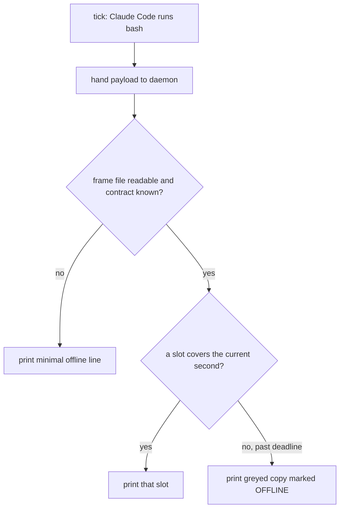
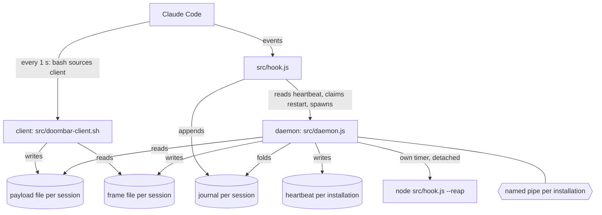
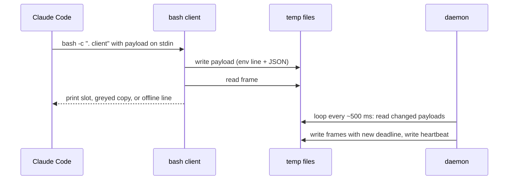
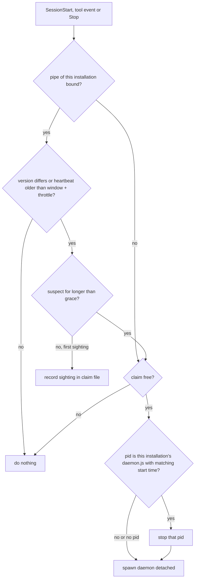
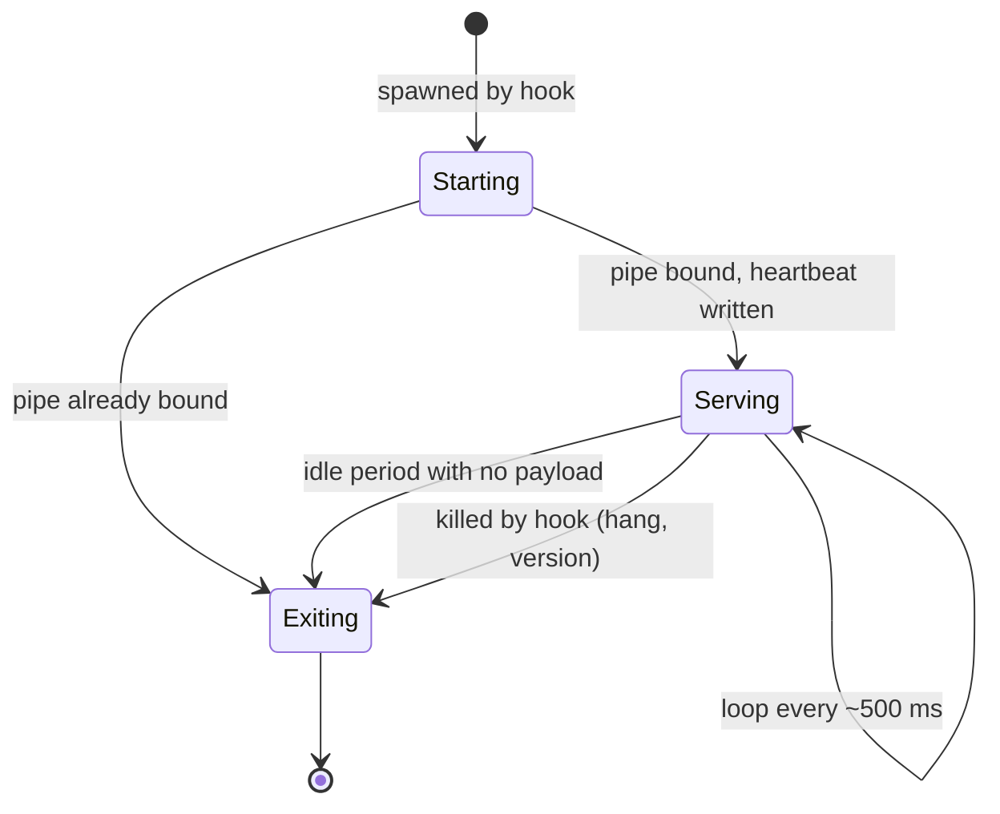

# Frame Deadline Contract - Plan

## Goal Capsule

- **Objective:** The status bar keeps showing everything it shows today while Claude Code pays for nothing but the bash it already starts each tick, and the owner can always tell whether the bar's values are live. A dead render daemon shows as a greyed bar within seconds, a live one does not grey unless it misses its validity window (3 s by default), and the bar adds no measured slowdown to Claude Code.
- **Means:** one long-lived render daemon per install (KTD1) writes versioned frame files with a deadline (KTD4); the statusLine becomes a bash client that only picks a ready frame (KTD5).
- **Product authority:** the owner's decisions in `docs/ideation/2026-11-09-render-daemon-and-minimap.md` ("Owner decisions so far", Part 1) and in this plan's Key Decisions. The minimap, the WC3 layout, hook events without a spawn (D-2) and the multi-slot reel (D-7) are not active scope.
- **Stop conditions:** stop and report if U1's measurements show that a daemon started from a hook dies with the Claude Code window that started it and no breakaway launch works, or that the bash client cannot run without starting a process. Both invalidate the architecture, not just a unit.
- **Execution profile:** one change set on `master`, committed unit by unit in dependency order; released with `npm version` as usual. No pull-request split.
- **Who finishes:** the implementing agent builds and verifies all units; the owner runs the bar-on/bar-off measurement on their own PC before release.

---

## Product Contract

### Summary

A render daemon, one per installation, renders every Claude Code session that uses that installation and keeps each session's frame file fresh. The statusLine becomes a bash client sourced from the package: each tick it hands over the payload and prints the frame for the current moment, a greyed OFFLINE copy once the frame's deadline has passed, or a built-in offline line when there is no usable frame. Hooks that already run start the daemon and restart it when it stops serving. The frame format already allows several time slots, so a multi-slot reel can be tried later without changing the client.

### Problem Frame

Today every tick runs `bash → node → (chafa)` per session: two or three processes per second per session, and every in-process cache dies with each render. On Windows each extra process costs a full MSYS start, and a pile-up of hung Git Bash wrappers has already frozen the owner's bar. The owner's ideation settled the direction: one long-lived renderer, a statusLine that starts nothing, and nothing spawned to stand in for a dead renderer.

That leaves the client with one question it must answer every second without starting a process: is this frame still true? Part 1 of the ideation doc answers it with `[[ payload -nt frame ]]`, which cannot work: the client writes the payload just before the check, so the payload is always newer. A dead daemon would never be noticed, or the bar would show frozen HP, ammo and limits as if they were live.

### Key Decisions

- **This plan builds the whole render daemon (D-1), not only the frame contract.** The contract cannot ship without the only writer of frames. (session-settled: user-directed — chosen over the contract plus a minimal daemon wrapping today's renderer, and over the contract alone shipped later with D-1: build the real backend now.) Governs R12, R13, R14, R15, R16, R17, R18, R19.
- **One daemon per installation.** The owner's machine wires the bar twice (the repo's `.claude/settings.local.json` and the global npm install), and Claude Code runs both installs' hooks; a single machine-wide daemon would be fought over forever. (session-settled: user-directed — chosen over "newer version wins" and over one canonical installation.) Governs R12.
- **Deadline header first, multi-slot reel later.** Smallest version that fixes liveness and settles the client contract; the reel stays an experiment the format must not rule out. (session-settled: user-directed — chosen over building the multi-slot reel from the start: start with the header alone, but keep the door open and try the reel afterwards.) Governs R4.
- **Offline view is the last frame, greyed and marked OFFLINE.** The owner keeps the last known values in sight and still sees that they are stale. (session-settled: user-directed — chosen over a fixed offline frame and over an offline frame with a recovery hint.) Governs R5.
- **Validity window is configurable, default 3 s.** Three missed ticks catch a dead daemon quickly while tolerating a briefly starved one. (session-settled: user-directed — chosen over a fixed 3 s, 5 s or 10 s window.) Governs R6.
- **A hook restarts a dead daemon.** Without it the bar would stay grey until the next session starts. (session-settled: user-directed — chosen over staying grey until the next SessionStart and over a manual restart command.) Governs R8, R9.
- **The client is a script inside the installed package, not text inlined in `settings.json`.** Same pattern as today's `node "<ROOT>/src/statusline.js"`, so upgrades reach the client. (session-settled: user-approved — chosen over a client frozen in `settings.json` forever: upgrades reach it, and the header's versions guard the old-daemon/new-client window.) Governs R3.
- **The reaper's idle blind spot is accepted.** When the daemon is dead and the session is idle, nothing reaps hung Git Bash wrappers until the next prompt or tool call fires a hook. (session-settled: user-directed — chosen over a second reaper home such as a Windows scheduled task.) Governs R11.
- **A minimal built-in offline line covers a missing or unknown frame file.** Needed so the client still prints something on a session's first tick or after a contract change. Governs R7.
- **One failing session does not take the daemon down.** A session whose render keeps failing greys alone; daemon health is judged daemon-wide, so one session, a cold start or a laptop resume cannot trigger restarts for everyone. Governs R8, R15.

### Requirements

**Client, every tick**

- R1. Each tick the client hands the payload to the daemon and prints a frame using bash builtins only; it starts no process.
- R2. The client never renders. It only chooses among text the daemon already prepared, because Claude Code cancels a statusLine script that is still running when the next update arrives.
- R3. The statusLine command sources the packaged client into the bash that Claude Code starts, so it adds no second bash, and upgrading the package updates the client without the user editing `settings.json`, as long as the install location is unchanged.

**Frame contract**

- R4. The frame header carries at least a contract version, the daemon version and a deadline, and lists one or more time slots. The client prints the slot whose time covers the current second, comparing against the deadline at sub-second resolution; the first version of the daemon writes a single live slot.
- R5. With every live frame the daemon also writes a greyed copy of the same frame marked OFFLINE. When no slot covers the current second because the deadline has passed, the client prints that copy.
- R6. The daemon sets the deadline as write time plus a validity window that the owner can configure, default 3 s. The client interprets no configuration; it only forwards its session's environment with the payload.
- R7. When the frame file is missing, unreadable, or declares a contract version the client does not know, the client prints a short built-in offline line.

**Recovery**

- R8. The hooks that already run on `SessionStart`, tool events and `Stop` start the daemon when it is not serving: no daemon process for this installation, no daemon-wide heartbeat for longer than the validity window plus one throttle window after a start-up grace period, or a daemon version that differs from the installed package. A running daemon that is not serving is stopped before the new one starts; nothing is ever started from the statusLine tick.
- R9. The hook restarts the daemon at most once per throttle window across all sessions and processes, so a daemon that keeps crashing is not restarted on every hook event.
- R10. While alive, the daemon renews every active session's deadline at least once per tick interval, even when the payload and the frame body have not changed.
- R11. The reaper that kills hung Git Bash statusLine wrappers recognises the new client's command, and its idle-time trigger survives the removal of the per-tick node renderer without starting anything per tick.

**Render daemon**

- R12. One daemon per installation serves every session that uses that installation; a second daemon for the same installation exits on its own.
- R13. For the same payload, settings and moment, a session's frame shows exactly what today's renderer prints.
- R14. Each session keeps its own settings (terminal width, preset, theme, text overflow, indent, state location), as it does today.
- R15. A render failure in one session greys only that session; the other sessions keep rendering and the failure does not trigger a restart.
- R16. Account- and machine-wide data (shared rate limits, CPU) is gathered once per daemon on its own interval, configurable, default 1 s.
- R17. The daemon exits on its own when no session has sent a payload for a configurable idle period, and stops serving a session once that session has ended.
- R18. The daemon runs at below-normal priority, and its frame renewal never waits on a child process.
- R19. Sessions that were already open before an upgrade keep a working bar through their old command until Claude Code restarts them.

### Key Flows

- F1. Live tick
  - **Trigger:** Claude Code refreshes the statusLine (every 1 s and on its own events).
  - **Steps:** client hands over the payload; reads the frame file; finds the slot covering the current moment; prints it.
  - **Outcome:** the bar shows the frame the daemon rendered from the previous payload (one tick of latency, accepted in the ideation doc).
  - **Covers:** R1, R2, R4.
- F2. Daemon dies and comes back
  - **Trigger:** the daemon process exits or hangs.
  - **Steps:** ticks keep printing the live slot until the deadline; past it they print the greyed copy; the next `SessionStart`, tool-event or `Stop` hook sees the daemon is not serving, stops it if it still runs, and starts a new one; the new daemon renders and writes fresh frames.
  - **Outcome:** the bar returns to live without the owner doing anything.
  - **Covers:** R5, R6, R8, R9, R10.
- F3. First session after boot
  - **Trigger:** a new Claude Code session starts and no daemon runs for this installation.
  - **Steps:** the `SessionStart` hook starts the daemon; the first ticks print the built-in offline line; the daemon finds the session's payload, renders it and writes its frame.
  - **Outcome:** the bar goes live within a few ticks.
  - **Covers:** R7, R8, R12.

### Acceptance Examples

- AE1. **Covers R5, R6.** Given the daemon is killed at time T with the default window, when ticks continue, then the bar shows the last live frame until about T+3 s and the greyed OFFLINE copy from the next tick on.
- AE2. **Covers R6.** Given a heavy build starves the below-normal-priority daemon for 2 s, when ticks continue, then the bar never shows the greyed copy.
- AE3. **Covers R8.** Given the daemon died during a turn in which Claude uses no tools, when the turn ends, then the `Stop` hook starts the daemon and the bar returns to live within a couple of ticks.
- AE4. **Covers R9.** Given a daemon that crashes right after every start, when many hook events fire, then it is started at most once per throttle window and the bar stays greyed in between.
- AE5. **Covers R7.** Given a new session whose daemon has not written a frame yet, when the first tick runs, then the client prints the built-in offline line instead of nothing.
- AE6. **Covers R4.** Given a later daemon writes several slots for the coming seconds, when an unchanged client reads the file, then it prints the slot for the current second.
- AE7. **Covers R8.** Given a daemon whose process is alive but has stopped renewing, when a hook event after the validity window plus one throttle window records it as suspect and a later hook event arrives after the grace period with the heartbeat still not renewed, then that later hook stops it, starts a new one, and the bar returns to live.
- AE8. **Covers R8.** Given a package upgrade while the old daemon keeps running, when the next hook event arrives, then the hook replaces it with the daemon from the installed package.
- AE9. **Covers R10.** Given an idle session whose payload and frame body stay unchanged for 60 s, when ticks continue, then the bar never shows the greyed copy.
- AE10. **Covers R15.** Given two sessions where one session's render throws on every attempt, when ticks continue, then only that session greys and no hook restarts the daemon.
- AE11. **Covers R8.** Given the laptop resumes from sleep with every frame and the heartbeat hours old, when the first hook event arrives and the daemon renews within the grace period after that, then nothing is restarted.
- AE12. **Covers R12.** Given the repo install and the global install each have a session open, when both sessions' hooks fire, then each installation keeps exactly one daemon and neither replaces the other's.
- AE13. **Covers R13.** Given the same payload, preset and moment, when the daemon renders a session, then its frame equals today's `src/statusline.js` output byte for byte.

### Success Criteria

- Killing the daemon greys the bar within 4 s with the default window (3 s plus one tick).
- During a heavy build on the owner's PC, with the daemon at below-normal priority, the default window produces no false grey. *(Not met, 11.11.2026: with every core saturated a below-normal daemon got 3 passes in 40 s, gaps up to 21.8 s; at normal priority 38 passes, largest gap 2.3 s. The spike's 516 ms came from a bare timer, not from a pass that needs CPU. The owner kept below-normal priority: a bar that greys during a build is preferred to one that takes CPU from it.)*
- Per tick, no process starts other than the bash that Claude Code launches (on Windows that is the Git `bin\bash.exe` stub plus the `usr\bin\bash.exe` it re-executes). Measured, not assumed.
- Claude Code runs as fast and as well with the bar as without it (the owner's only hard resource limit), measured with the same workload both ways.

### Scope Boundaries

- Rendering several seconds ahead into multiple slots (D-7 reel): deferred as an experiment; R4 keeps the format ready for it.
- Delivering hook events to the daemon without a process per event (D-2).
- The minimap, the WC3 console and any 3D portrait work (D-5, D-6, G-8): later layers on top of this daemon.
- A free-running renderer at ~10 ms: no display surface can show it yet (ideation Part 1, "The hard limit"); the daemon renders on new data and on renewal only.
- `refreshInterval` stays at 1 s (owner policy).
- A generation number in the header: considered, not built until something reads it; the contract version lets it be added later.
- A backup copy of the previous frame to hide a failed read: considered, not built; the client retries the read once instead (KTD5). Revisit if the owner sees the minimal line flash on a healthy daemon.
- A second reaper home outside hooks and the daemon: considered, not built (Key Decisions).
- The client and daemon on macOS, Linux, or Windows without Git Bash: those keep today's one-shot renderer (KTD14).

<!-- ce-section: work-relationships -->
### How This Work Fits Together

This plan covers the render daemon (D-1) with its frame contract and liveness. The breakdown below is the current understanding, not a committed roadmap.

- D-1 render daemon: **this plan**.
  - D-7 multi-slot reel: **enabled by** this plan; same format, more slots, no client change.
  - D-11 crash-only daemon with a version-named singleton: largely **absorbed** here (state rebuilt from journals, per-installation singleton, version check).
  - P-2 shared producer for account- and machine-wide data: **absorbed** by R16.
  - D-5 minimap, D-6 WC3 console, D-3 built-in glyph renderer: **depend on** this daemon.
- D-2 hook events without a spawn: **shares** the hook process that R8 uses for restarts. **Still to decide:** where the restart lives if D-2 removes the per-event hook.

### Dependencies / Assumptions

- Measured on the owner's PC: Git Bash is bash 5.3.15; `$EPOCHSECONDS` and `printf -v now '%(%s)T' -1` both return the current second, `printf` is a builtin, and `$EPOCHREALTIME` returns microseconds (its decimal separator follows the locale, so only its digits should be used). Whether the whole client stays free of child processes is measured in U1.
- The install location is stable across upgrades; `bin/cli.js` builds the command from an absolute path into the package and rewrites it on reinstall if the package moved.
- A chat-only session still fires `Stop` every turn (installed hook events in `bin/cli.js`), so R8 restarts the daemon at the latest at the end of the next turn.
- Git Bash `/tmp` and Node's `os.tmpdir()` name the same Windows directory on the owner's PC; whether the bash that Claude Code starts for the statusLine sees the same `TEMP` spelling is measured in U1.
- Nothing daemon-, frame- or liveness-related exists in `src/` or `bin/` today.

### Sources

- `docs/ideation/2026-11-09-render-daemon-and-minimap.md`: Part 1 (owner decisions, shape, lifecycle, collector and renderer clocks), Part 6 idea 1 (frame reel with a deadline), idea 5 (crash-only daemon).
- `docs/BACKLOG.md`: D-1, D-2, D-7, D-11, P-1, P-2, L-A.
- Claude Code statusLine docs, https://code.claude.com/docs/en/statusline: `refreshInterval` minimum 1 s, 300 ms debounce, a new update cancels the running script.
- Prior art: ztheme generation ids over gitstatusd (one shared daemon, stale results never overwrite newer ones); Candea and Fox, "Crash-Only Software" (HotOS IX, 2003).

---

## Planning Contract

**Product Contract preservation:** changed: scope extended from the client/frame contract to the whole D-1 daemon (owner decision); R8 now judges liveness by a daemon-wide heartbeat with a start-up grace period and adds `SessionStart` to its triggers (planning finding: one session's frame cannot judge a shared daemon); R6 wording allows forwarding the session's environment; added R12–R19, F3, AE10–AE13; removed the "daemon internals" scope boundary; AE7 and AE11 reworded to the suspect-then-confirm grace rule (KTD3); added a scope boundary keeping non-Windows platforms on the one-shot renderer (KTD14).

### Key Technical Decisions

- KTD1. **One daemon per installation, guarded by a named pipe whose name hashes the install root.** Binding `\\.\pipe\doombar-<rootHash>` is the singleton: "address in use" means one already runs. The pipe answers nothing; hooks only probe whether it exists. Every file of an installation, per session or daemon-wide, carries the same hash (KTD9), so two installations never read or write each other's files. Governs R12 (Key Decision "One daemon per installation"); absorbs D-11.
- KTD2. **The daemon keeps no state that cannot be rebuilt.** Per-session state comes from the existing checkpoint and journal fold (`src/fold.js`); caches are warm-up only. Killing the daemon is always safe, so upgrade, crash and hang recovery share one path: stop by pid, start fresh.
- KTD3. **The pipe says whether a daemon exists; the heartbeat says whether it serves; an identity check gates every kill.** The daemon rewrites `mugshot_daemon_<rootHash>.json` (pid, process start time, version, the largest validity window it uses, last renewal) on every renewal pass and deletes it on idle exit. A hook decides:
  1. Pipe not bound: no daemon; start one and kill nothing.
  2. Pipe bound and version differs, or heartbeat older than its recorded window plus the throttle window: the daemon is suspect. The first hook that sees it suspect records the time in the claim file; a later hook, a grace period after that first sighting, restarts when the heartbeat has still not been renewed or when the version, read again, still differs (a healthy old daemon keeps renewing, so a version mismatch never waits on a stale heartbeat). A daemon that resumes after sleep renews within one loop pass and is left alone.
  3. Before stopping a pid, the hook confirms through the process list (the same Get-CimInstance query shape as `LIST_SHELLS_PS` in `src/hook.js`) that it is a node process running this installation's `src/daemon.js` with the heartbeat's start time; otherwise it kills nothing.

  Default throttle window 15 s, grace 20 s. Governs R8, R15.
- KTD4. **Frame file: plain text, one header line, slot bodies, greyed copy.** Directional shape: a header line `doombar-frame v=1 daemon=<version> deadline=<microseconds> slots=<n>`, then for each slot a `slot <start-microseconds>` line followed by its body lines, then a `grey` line followed by the greyed body. The client accepts every contract version up to its own. Slot rules for v1 and later: before the first slot, print the first; between slots, print the latest slot that has started; past the deadline, print the greyed copy (one per file, of the last slot). Governs R4, R5, R7.
- KTD5. **The client reads with builtins and retries a failed read once.** It extracts `session_id` from the stdin JSON with `[[ =~ ]]`, reproduces `sidKey` (`src/fold.js:21`), derives paths from the temp directory and the install hash that the statusLine command sets in front of the sourced client (KTD9), writes the payload with a redirect, reads the frame with `read -r -d ''` (never branching on its exit status), compares `$EPOCHREALTIME` digits with the deadline, and prints. All stderr of the client is discarded so it never becomes bar output. Governs R1, R2, R7.
- KTD6. **The payload file carries the session's environment.** The client writes the stdin JSON to the payload file preceded by one line with the forwarded variables (`COLUMNS`, `DOOMBAR_PRESET`, `DOOMBAR_THEME`, `DOOMBAR_TEXT_OVERFLOW`, `DOOMBAR_INDENT`, `DOOMBAR_FRAME_WINDOW`, `MUGSHOT_STATE`). The daemon keeps the last payload that parsed and ignores a half-written one. Governs R6, R14.
- KTD7. **Rendering is extracted, not rewritten.** `src/statusline.js` `main()` splits into a pure-as-possible `renderSession(input)` used by both the old one-shot path and the daemon. Sessions render one at a time because `src/render.js` keeps one global `VALUES` (`:55-56`). The snapshot tests prove both paths print the same bytes. Governs R13, R19.
- KTD8. **No synchronous child process inside the daemon.** chafa faces are warmed asynchronously at start and on first need; until a face is warm, the daemon uses the pre-rendered `.ans` fallback that `src/face.js` already has. The reaper runs as today's detached `node src/hook.js --reap`, started by the daemon on its own timer. Governs R18, R11.
- KTD9. **Flat files in the temp directory, prefixed with the install hash, named through `sessionPaths`.** Per session: `mugshot_payload_<rootHash>_<key>.json` and `mugshot_frame_<rootHash>_<key>.json` (the `.json` suffix keeps them inside the sweep even though the frame is text). They live in the temp directory, not next to a relocated `MUGSHOT_STATE` checkpoint, so the daemon always knows where to look; `MUGSHOT_STATE` still travels in the payload and decides where the checkpoint and journal live. Per installation: `mugshot_daemon_<rootHash>.json` (heartbeat) and `mugshot_daemon_<rootHash>.claim` (restart throttle and first suspect sighting). The installer writes the hash into the statusLine command, so the client never computes it. Every new name goes into `sessionPaths`, `sessionKeyOf`, `endSession` and the sweep's shared-file rule; `mugshot_daemon_*` is never treated as a session (today `src/hook.js:224` would match it as a checkpoint). Governs R10, R12, R17.
- KTD10. **Restart throttle is an atomic, expiring claim.** A hook claims a restart by creating the `.claim` file exclusively; a claim older than the throttle window is free and is replaced. The hook re-reads the heartbeat after winning the claim and kills only the pid it judged, never "whatever runs". Governs R9.
- KTD11. **The daemon starts detached, outside the package directory, at below-normal priority.** Same spawn shape as today's `maybeReap` (`src/statusline.js:644-659`), with the working directory set to the temp directory so npm can replace the package while it runs, and `os.setPriority` to below normal. If U1 shows a hook-spawned child dies with its Claude Code window, U1 also picks a breakaway launch. Governs R8, R18.
- KTD12. **The daemon loop runs on its own clock.** Every 500 ms with jitter (avoiding phase lock with Claude Code's 1 s reads): pick up changed payloads, render every active session (the clock, the marquee, mugshot animation and the collector's shared data all change without a new payload), write every active session's frame with a fresh deadline, write the heartbeat. The collector (rate-limit pooling, CPU sample) runs on its own interval, `DOOMBAR_COLLECT_MS`, default 1000. A session is active from its first payload until `SessionEnd` deletes its files or it sends no payload for the idle period. Idle exit after `DOOMBAR_DAEMON_IDLE_MS`, default 10 minutes with no payload from any session. Governs R10, R16, R17.
- KTD13. **Frame writes are temp file plus rename, retried within the window.** A rename that fails because the client has the file open is retried on the next loop pass, well inside the 3 s window; repeated failures are counted in the heartbeat for diagnosis. Governs R10.
- KTD14. **The client and daemon run on Windows with Git Bash only.** The client needs bash 5 builtins (`$EPOCHREALTIME`) and the singleton needs a Windows named pipe; Claude Code falls back to PowerShell when Git Bash is absent, and macOS ships bash 3.2. Everywhere else the installer keeps `node "<ROOT>/src/statusline.js"`, which U4 keeps working unchanged. Governs R3, R19.
- KTD15. **The daemon exits when its own package's source changes.** It watches its `src/` directory (no child process) and exits on a change, so the next hook starts the new code. In the owner's repo checkout the `package.json` version does not change between edits, and without this an edited renderer would keep running until Claude Code closed. Governs R8.

### High-Level Technical Design

Components and files:

One tick:

Hook restart decision:

Daemon lifecycle:

### Assumptions

- Claude Code passes `COLUMNS` to the statusLine bash as it does today to `node`; the daemon receives it through the payload's environment line.
- The `.json` suffix on the frame file does not mislead any reader; nothing parses it as JSON except through the sweep, which only looks at names.

### Sequencing

U1 measures first, because its results can change U3, U6 and U7. U2 and U3 are independent foundations. U4 and U5 make the renderer usable from a long-lived process. U6 builds the daemon on U2–U5. U7 builds the client against U3's format and U2's file names. U8 adds hook-side start and restart. U9 moves the reaper. U10 switches the installation. U11 proves the acceptance examples end to end.

---

## Implementation Units

| U-ID | Title | Files touched | Depends on |
|---|---|---|---|
| U1 | Measure the platform assumptions | `lab/daemon-spike/` (gitignored) | none |
| U2 | Session and daemon file names | `src/fold.js`, `src/hook.js` | none |
| U3 | Frame format module | `src/frame.js` | none |
| U4 | Extract the session render | `src/statusline.js`, `src/fold.js`, `src/theme.js` | none |
| U5 | Faces without blocking | `src/face.js` | none |
| U6 | Render daemon | `src/daemon.js` | U2, U3, U4, U5 |
| U7 | Bash client | `src/doombar-client.sh` | U2, U3 |
| U8 | Hook starts and restarts the daemon | `src/hook.js` | U2, U6 |
| U9 | Reaper transition | `src/hook.js`, `src/daemon.js` | U6, U7 |
| U10 | Installer and upgrade path | `bin/cli.js`, `README.md` | U7, U8 |
| U11 | End-to-end acceptance | `test/daemon-e2e.test.mjs` | U6–U10 |

### U1. Measure the platform assumptions

**Goal:** settle the facts the architecture rests on before building on them.
**Requirements:** R1, R8, R10, R18; Success Criteria (process count).
**Dependencies:** none.
**Files:** `lab/daemon-spike/` (gitignored, like the other lab work); results recorded under Dependencies / Assumptions in this plan.
**Approach:**
1. A throwaway client script that does R1's steps (stdin read, payload write, frame read, slot pick) wired as the statusLine of a scratch Claude Code session; count child processes per tick with the existing `tasklist` gauge pattern (`src/hook.js:86-95`).
2. Start a detached node child from an async hook of session A, close A, and check the child survives while session B stays open; if it dies, try a breakaway launch and record which one works.
3. Rename-replace a file in a tight loop while bash reads it every second; record whether renames fail and how often.
4. Record `TEMP`, `TMP`, `TMPDIR` and `COLUMNS` as seen by the statusLine bash that Claude Code starts.
5. Run a below-normal-priority node loop on a 500 ms timer while a build saturates every core at normal priority; record the longest gap between timer firings next to the 3 s default window.
**Execution note:** measurement only; nothing here ships. Stop per the Goal Capsule if item 1 or 2 fails without a workaround.
**Test expectation:** none -- measurement spike; its outputs become assumptions recorded in this plan.
**Verification:** each of the five questions has a recorded answer, and the plan's assumptions are updated where an answer differs.

### U2. Session and daemon file names

**Goal:** every new file has one name source and is cleaned up by the existing sweep and end-of-session paths.
**Requirements:** R17; KTD9.
**Dependencies:** none.
**Files:** `src/fold.js`, `src/hook.js`, `test/journal-sweep.test.mjs`, `test/session-end.test.mjs`.
**Approach:**
1. Add hash-prefixed payload and frame paths in the temp directory to `sessionPaths` (KTD9).
2. Add the daemon-wide heartbeat and claim names per install hash.
3. Teach `sessionKeyOf` the new per-session names and their temp-file variants; make `mugshot_daemon_*` a shared-file pattern that is never read as a session.
4. Add payload and frame to `endSession`'s delete list; since an ending session may have files under either installation's hash, delete every hash's payload and frame for that session key.
**Patterns to follow:** `sessionPaths` comment at `src/fold.js:31-33`; `staleStateFiles` pure decision half in `src/hook.js:230-255`.
**Test scenarios:**
- A stale payload and frame of a dead session are swept after the unrendered TTL.
- A frame temp file `mugshot_frame_<k>.json.<pid>.tmp` left behind is swept.
- The heartbeat and claim files of any install hash are never swept as a session named `daemon`.
- `endSession` removes the session's payload and frame and keeps its savings file.
**Verification:** the sweep and session-end tests pass with the new names and nothing outside them is deleted.

### U3. Frame format module

**Goal:** one module writes and reads the frame format so the daemon, tests and future reel share it.
**Requirements:** R4, R5, R6, R7; KTD4, KTD13.
**Dependencies:** none.
**Files:** `src/frame.js`, `test/frame.test.mjs`, `package.json` (test list).
**Approach:**
1. Serialise a header, one or more slots and a greyed copy of the last slot.
2. Produce the greyed copy from the rendered lines by mapping every colour to a grey palette and appending an OFFLINE marker.
3. Parse a frame file node-side with the same slot rules the client uses (for tests and diagnostics).
4. Write through a temp file plus rename, returning failure instead of throwing so the loop retries.
**Patterns to follow:** `writeAtomic` in `src/statusline.js:201-210`; ANSI handling in `src/ansi.js`.
**Test scenarios:**
- A one-slot frame round-trips: header fields, slot body and greyed body come back unchanged.
- Covers AE6. A three-slot frame resolves to the second slot for a moment between the second and third start.
- A moment before the first slot resolves to the first slot.
- A moment past the deadline resolves to the greyed copy.
- A header with a higher contract version than the reader knows resolves to "unknown".
- The greyed copy contains no colour codes other than the grey palette and ends with the OFFLINE marker.
- A rename that fails is reported as failure and leaves no temp file behind.
**Verification:** the frame test passes and is listed in the `package.json` test script.

### U4. Extract the session render

**Goal:** the daemon and the old one-shot command render through the same function and print the same bytes.
**Requirements:** R13, R14, R19; KTD7.
**Dependencies:** none.
**Files:** `src/statusline.js`, `src/fold.js`, `src/theme.js`, `src/render.js` (only if `setValues` needs a scoped form), `test/render-snapshot.test.mjs`, `test/statusline-tasks.test.mjs`.
**Approach:**
1. Move the body of `main()` after stdin parsing into `renderSession({ data, env, now })`, reading settings from the passed `env` instead of `process.env`. This includes the two readers outside `statusline.js`: `statePaths` (`MUGSHOT_STATE`, `src/fold.js:27`) and `currentTheme` (`DOOMBAR_THEME`, `src/theme.js:39`) take the environment as an argument, defaulting to `process.env`.
2. Keep `main()` as a thin wrapper: read stdin, call `renderSession` with `process.env`, write output, run `maybeReap`.
3. Keep `setValues` immediately before the builders so sessions rendered one after another cannot see each other's values.
**Execution note:** characterization first: run the snapshot tests before the move and keep them byte-identical after.
**Patterns to follow:** exported pure builders already in `src/statusline.js` (`buildValues`, `activityValues`).
**Test scenarios:**
- Covers AE13. The snapshot suite passes unchanged through `main()`.
- `renderSession` with an `env` whose preset differs from `process.env` renders with the passed preset.
- Two sessions rendered back to back with different payloads each show their own values.
**Verification:** all existing tests pass unchanged; the old command still works for already-open sessions.

### U5. Faces without blocking

**Goal:** a long-lived process never waits on chafa while still showing chafa faces once warm.
**Requirements:** R18; KTD8.
**Dependencies:** none.
**Files:** `src/face.js`, `test/render-snapshot.test.mjs` (faces forced to `.ans` already), `test/face-warm.test.mjs`, `package.json`.
**Approach:**
1. Add an asynchronous warm-up that spawns chafa per sprite and height and fills the existing `_cache`.
2. Add a no-spawn mode: on a cache miss, return the `.ans` fallback and schedule a warm-up instead of `spawnSync`.
3. The one-shot path keeps today's synchronous behaviour.
**Patterns to follow:** `loadFace` and `ansiFace` in `src/face.js:32-39,89-99`.
**Test scenarios:**
- In no-spawn mode a cache miss returns the `.ans` face immediately and starts one warm-up.
- After the warm-up completes, the same request returns the chafa face.
- With chafa absent from `PATH`, the warm-up fails quietly and the `.ans` face stays.
**Verification:** no `spawnSync` call is reachable from the daemon's render path.

### U6. Render daemon

**Goal:** one process per installation renders every active session and keeps frames and the heartbeat fresh.
**Requirements:** R10, R12, R13, R14, R15, R16, R17, R18; KTD1, KTD2, KTD3, KTD6, KTD8, KTD11, KTD12, KTD13.
**Dependencies:** U2, U3, U4, U5.
**Files:** `src/daemon.js`, `test/daemon.test.mjs`, `package.json`.
**Approach:**
1. Bind the per-installation named pipe; exit at once if it is taken.
2. Lower own priority; set the working directory to the temp directory; watch the package's `src/` and exit on a change (KTD15).
3. Loop on a jittered ~500 ms timer: find this installation's payload files (its hash prefix only) whose mtime changed, parse each (keep the last good one), render every active session through `renderSession` with its last good payload, its environment and the collector's latest data (KTD12), write each active session's frame with a fresh deadline, write the heartbeat.
4. Wrap each session's render; a session that throws keeps its previous frame body and stops getting renewed until it renders again, so only it greys.
5. Run the collector on its own interval and hand its results to every render.
6. Drop a session when its payload file disappears or after the idle period; exit when no session remains for the idle period.
**Technical design:** the loop never awaits a child process; warm-ups and the reaper run detached or in the background.
**Patterns to follow:** fold and checkpoint reuse from `loadState` (`src/statusline.js:208-247`); env-number pattern `envNum` (`src/hook.js:114`).
**Test scenarios:**
- A payload file for a new session produces a frame for it within one loop pass.
- Covers AE9. With an unchanged payload for 60 simulated seconds, every pass renews the deadline.
- With an unchanged payload, the frame body still follows the clock and a new collector value (for example a changed shared rate limit) within one pass.
- Covers AE10. One session whose render throws keeps its old body without renewal while a second session keeps renewing.
- A half-written payload is ignored and the previous payload is used.
- A second daemon for the same install root exits without writing anything.
- Covers AE12. A daemon for another install root runs beside it with its own heartbeat, and neither renders nor writes a frame for a payload carrying the other's hash.
- With no payload for the idle period, the daemon exits and removes its pipe and heartbeat, nothing else.
- Touching a file under the daemon's own `src/` makes it exit.
- The collector runs once per interval regardless of the number of sessions.
**Verification:** the daemon test passes with fake payloads in a sandboxed temp directory; frames match U4's output for the same input.

### U7. Bash client

**Goal:** the statusLine prints the right frame for the current moment without starting any process.
**Requirements:** R1, R2, R3, R4, R5, R6, R7; KTD4, KTD5, KTD6.
**Dependencies:** U2, U3.
**Files:** `src/doombar-client.sh`, `test/client.test.mjs`, `package.json`.
**Approach:**
1. Read stdin into a variable; extract `session_id`; derive the session key exactly as `sidKey`; derive paths from the temp directory and the install hash the command provides.
2. Write the payload file: one line of forwarded environment, then the JSON.
3. Read the frame; on failure retry once; parse the header; pick the slot, the greyed copy or the built-in offline line.
4. Print; send all stderr to nowhere.
**Execution note:** test-first against frames produced by U3, run through the real Git Bash, not `cmd.exe`.
**Patterns to follow:** the sandbox and subprocess style of `test/e2e-tasks.test.mjs`; timing assertion in `test/msys-event.test.mjs:131-143`.
**Test scenarios:**
- A live one-slot frame prints its body exactly.
- Covers AE1. A frame whose deadline passed prints the greyed copy.
- Covers AE5. No frame file prints the built-in offline line.
- An unknown contract version prints the built-in offline line.
- Covers AE6. A three-slot frame prints the slot for the current moment.
- A session id with characters outside `[A-Za-z0-9_-]` and longer than 48 characters maps to the same file name `sidKey` produces.
- The payload file holds the forwarded `COLUMNS` and `DOOMBAR_PRESET` followed by the stdin JSON.
- With `MUGSHOT_STATE` set, payload and frame stay in the temp directory under the install hash, and the payload's environment line carries `MUGSHOT_STATE`.
- A run prints nothing to stderr even when the payload directory is unwritable.
**Verification:** the client test passes under Git Bash; U1's process count shows no extra process per tick.

### U8. Hook starts and restarts the daemon

**Goal:** a dead, hung or outdated daemon comes back without the owner doing anything, at most once per throttle window.
**Requirements:** R8, R9; KTD3, KTD10, KTD11.
**Dependencies:** U2, U6.
**Files:** `src/hook.js`, `test/daemon-restart.test.mjs`, `package.json`.
**Approach:**
1. On `SessionStart`, tool events and `Stop`, probe this installation's pipe and read its heartbeat, judging per KTD3; the healthy path stays at one pipe probe and one file read.
2. On a first suspect sighting, record it in the claim file and stop.
3. When a restart is due, claim it exclusively; on success confirm the pid's identity, stop it only if confirmed, then spawn the daemon detached.
4. Run only where the client is installed (KTD14).
5. Everything stays inside the existing `try`/`catch` so the hook still exits 0.
**Patterns to follow:** `maybeReap` spawn (`src/statusline.js:644-659`); `shouldSnapshotGit` gating (`src/hook.js:172-183`).
**Test scenarios:**
- With the pipe unbound and no heartbeat, a `SessionStart` event spawns one daemon and kills nothing.
- Covers AE4. Ten concurrent hook processes against a dead daemon spawn exactly one.
- Covers AE7. A bound pipe with a stale heartbeat: the first hook only records the sighting; a hook after the grace period, with the heartbeat still stale, stops the confirmed daemon pid and spawns a new daemon.
- Covers AE11. A stale heartbeat that is renewed within the grace period after the first sighting causes no restart.
- Covers AE8. A daemon with a different version and a heartbeat that keeps renewing is replaced by the first hook after the grace period that still reads the different version.
- A stale heartbeat left from before a reboot, whose pid now belongs to an unrelated live process, never kills that process; with the pipe unbound the hook only spawns.
- A heartbeat pid that is alive but not this installation's `daemon.js` is not killed.
- A claim older than the throttle window is taken over; a fresh claim blocks.
- A hook whose restart path throws still exits 0.
**Verification:** the restart test passes; the hook's added latency on a healthy daemon stays within one file read.

### U9. Reaper transition

**Goal:** hung Git Bash wrappers keep getting reaped after the per-tick node renderer is gone.
**Requirements:** R11; KTD8.
**Dependencies:** U6, U7.
**Files:** `src/hook.js`, `src/daemon.js`, `test/msys-event.test.mjs`.
**Approach:**
1. Extend `stalePids` to match the client's file name as well as `statusline.js`.
2. Have the daemon start the existing detached `hook.js --reap` on the `DOOMBAR_REAP_TICK` interval, Windows only, honouring `DOOMBAR_MSYS_REAP=0`.
3. Keep `maybeReap` in the old one-shot path for sessions still on the old command.
**Test scenarios:**
- `stalePids` keeps an old bash whose command runs `doombar-client.sh` and one that runs `statusline.js`.
- `stalePids` rejects a node daemon process and a young bash.
- The daemon's reap timer starts at most one reaper per interval and none when reaping is disabled.
**Verification:** the msys tests pass; the reaper still runs while only the new client is installed.

### U10. Installer and upgrade path

**Goal:** `install` wires the client, `uninstall` removes it and stops the daemon, and open sessions keep working through an upgrade.
**Requirements:** R3, R19; Key Decision "The client is a script inside the installed package".
**Dependencies:** U7, U8.
**Files:** `bin/cli.js`, `test/installer.test.mjs`, `test/smoke.test.mjs`, `README.md`.
**Approach:**
1. On Windows with Git Bash present, the statusLine command sets the install hash and sources the client, with a guard that prints the offline line when the file is missing, still without a process; everywhere else it keeps `node "<ROOT>/src/statusline.js"` (KTD14).
2. Add the client path to `SL_MARKS` and point the install guard at the client.
3. `uninstall` stops this installation's daemon by its confirmed pid (KTD3) and removes its files; `uninstall --project` leaves another installation's daemon alone.
4. Keep `src/statusline.js` runnable for sessions on the old command.
5. Update the README's architecture and troubleshooting notes.
**Patterns to follow:** numbered blocks in `test/installer.test.mjs`; re-pointing logic in `bin/cli.js:144-152`.
**Test scenarios:**
- Install on Windows with Git Bash writes the sourced client command with the install hash; reinstall is idempotent.
- Install with Git Bash absent (simulated) writes the old `node` command.
- Uninstall removes the client command and reports nothing left behind.
- An existing settings file with the old `statusline.js` command is upgraded in place.
- The smoke test runs the installed command through Git Bash and gets the offline line when no daemon runs.
**Verification:** installer and smoke tests pass; the owner's `.claude/settings.local.json` is re-wired and checked with a script that reads it back.

### U11. End-to-end acceptance

**Goal:** prove the liveness promises with a real daemon, real hooks and the real client.
**Requirements:** R5, R6, R8, R9, R10, R15; Success Criteria.
**Dependencies:** U6, U7, U8, U9, U10.
**Files:** `test/daemon-e2e.test.mjs`, `package.json`.
**Approach:** in a sandboxed temp directory, start a daemon through a `SessionStart` hook, feed payloads, run the client on a 1 s rhythm, and drive the failure cases.
**Test scenarios:**
- Covers AE1. Killing the daemon greys the client's output within 4 s.
- Covers AE3. After a kill, a `Stop` hook brings the client's output back to live within two ticks.
- Covers AE7. A daemon suspended (no renewals) is recorded as suspect by the first hook after window plus throttle and replaced by the first hook after the grace period.
- Covers AE9. An idle session stays live for 60 s.
- Covers AE2. With the daemon artificially delayed 2 s, the output never greys.
**Verification:** the e2e test passes on Windows; the owner's bar-on/bar-off measurement shows no difference outside noise.

---

## Verification Contract

| Gate | Command or check | When |
|---|---|---|
| Unit and integration tests | `npm test` (every new test file added to the explicit list in `package.json`) | after each unit |
| Snapshot parity | `test/render-snapshot.test.mjs` unchanged | U4, U6 |
| Client under Git Bash | `test/client.test.mjs` spawns Git Bash, not `cmd.exe` | U7, U10 |
| Process count per tick | U1's measurement repeated with the real client | U7, before release |
| Settings integrity | read `.claude/settings.local.json` back after re-wiring and confirm the statusLine and hooks | U10 |
| Bar on / bar off | same Claude Code workload timed with and without the bar on the owner's PC | before release |
| Code review | `ce-code-review` on the change set | before release |

## Definition of Done

- Every unit's verification holds and `npm test` passes on Windows.
- The owner's live bar runs on the client and daemon, with the old command still working for sessions opened before.
- Killing the daemon greys the bar within 4 s and the next hook brings it back.
- No process per tick beyond Claude Code's own bash, measured.
- `docs/BACKLOG.md` updated: D-1 done, D-11 and P-2 absorbed.
- Spike code stays in the gitignored `lab/`; no abandoned experiments remain in `src/`, `bin/` or `test/`.
