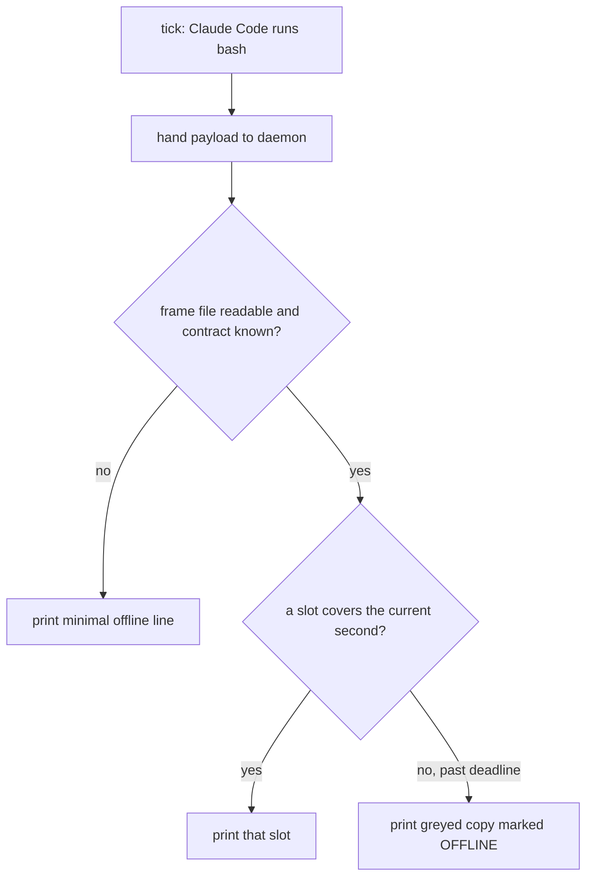

# Frame Deadline Contract - Plan

## Goal Capsule

- **Objective:** The owner can always tell from the status bar whether its values are live. A dead render daemon shows as a greyed bar within seconds, a live one does not grey unless it misses its validity window (3 s by default), and the bar adds no measured slowdown to Claude Code.
- **Means:** a versioned frame file whose header carries a deadline, read each tick by the bash statusLine client with builtins only.
- **Product authority:** the owner's decisions in `docs/ideation/2026-11-09-render-daemon-and-minimap.md` ("Owner decisions so far") and in this brainstorm. This plan covers only the client/frame contract and liveness inside D-1; the daemon's internals are not active scope.
- **Open blockers:** none for planning. Shipping needs the D-1 daemon to exist, since it is the only writer of frames.

---

## Product Contract

### Summary

The statusLine client and the render daemon agree on one frame file. Its header carries a contract version, the daemon version and a deadline. Past the deadline the client prints a greyed copy of the last frame marked OFFLINE. A dead daemon is restarted by a hook that already runs, never by the statusLine tick. The format already allows several time slots, so a multi-slot reel can be tried later without changing the client.

### Problem Frame

The planned render daemon (D-1) moves all rendering out of the per-tick process. The statusLine client becomes a thin bash script that hands over the payload and prints whatever the daemon prepared. That leaves the client with one question it must answer every second, without starting any process: is this frame still true?

Part 1 of the ideation doc answers it with `[[ payload -nt frame ]]`. That test cannot work. The client writes the payload just before the check, so the payload is always newer than the frame. A dead daemon would either never be noticed, or the bar would show frozen HP, ammo and limits as if they were live. The owner's rule that a dead daemon must not be replaced by anything spawned per tick means the client is the only place where staleness can be detected, and it has only the frame file and the shell's clock to do it with.

### Key Decisions

- **Deadline header first, multi-slot reel later.** Smallest version that fixes liveness and settles the client contract; the reel stays an experiment the format must not rule out. (session-settled: user-directed — chosen over building the multi-slot reel from the start: start with the header alone, but keep the door open and try the reel afterwards.) Governs R4.
- **Offline view is the last frame, greyed and marked OFFLINE.** The owner keeps the last known values in sight and still sees that they are stale. (session-settled: user-directed — chosen over a fixed offline frame and over an offline frame with a recovery hint.) Governs R5.
- **Validity window is configurable, default 3 s.** Three missed ticks catch a dead daemon quickly while tolerating a briefly starved one. (session-settled: user-directed — chosen over a fixed 3 s, 5 s or 10 s window.) Governs R6.
- **A hook restarts a dead daemon.** Without it the bar would stay grey until the next session starts. (session-settled: user-directed — chosen over staying grey until the next SessionStart and over a manual restart command.) Governs R8, R9.
- **The client is a script inside the installed package, not text inlined in `settings.json`.** Same pattern as today's `node "<ROOT>/src/statusline.js"`, so upgrades reach the client. (session-settled: user-approved — chosen over a client frozen in `settings.json` forever: upgrades reach it, and the header's versions guard the old-daemon/new-client window.) Governs R3.
- **A minimal built-in offline line covers a missing or unknown frame file.** Needed so the client still prints something on a session's first tick or after a contract change. Governs R7.

### Requirements

**Client, every tick**

- R1. Each tick the client hands the payload to the daemon and prints a frame using bash builtins only; it starts no process.
- R2. The client never renders. It only chooses among text the daemon already prepared, because Claude Code cancels a statusLine script that is still running when the next update arrives.
- R3. The statusLine command sources the packaged client into the bash that Claude Code starts, so it adds no second bash, and upgrading the package updates the client without the user editing `settings.json`, as long as the install location is unchanged.

**Frame contract**

- R4. The frame header carries at least a contract version, the daemon version and a deadline, and lists one or more time slots. The client prints the slot whose time covers the current second, comparing against the deadline at sub-second resolution; the first version of the daemon writes a single live slot.
- R5. With every live frame the daemon also writes a greyed copy of the same frame marked OFFLINE. When no slot covers the current second because the deadline has passed, the client prints that copy.
- R6. The daemon sets the deadline as write time plus a validity window that the owner can configure, default 3 s. The client reads no configuration.
- R7. When the frame file is missing, unreadable, or declares a contract version the client does not know, the client prints a short built-in offline line.

**Recovery**

- R8. A hook that already runs on tool events and on `Stop` restarts the daemon when it is not serving this session: no daemon process, a frame deadline that expired more than one throttle window ago, or a daemon version that differs from the installed package. A running daemon that is not serving is stopped before the new one starts; nothing is ever started from the statusLine tick.
- R9. The hook restarts the daemon at most once per throttle window, so a daemon that keeps crashing is not restarted on every hook event.
- R10. While alive, the daemon renews every active session's deadline at least once per tick interval, even when the payload and the frame body have not changed.
- R11. The reaper that kills hung Git Bash statusLine wrappers recognises the new client's command, and its idle-time trigger survives the removal of the per-tick node renderer without starting anything per tick.

### Key Flows

- F1. Live tick
  - **Trigger:** Claude Code refreshes the statusLine (every 1 s and on its own events).
  - **Steps:** client hands over the payload; reads the frame file; finds the slot covering the current second; prints it.
  - **Outcome:** the bar shows the frame the daemon rendered from the previous payload (one tick of latency, accepted in the ideation doc).
  - **Covers:** R1, R2, R4.
- F2. Daemon dies and comes back
  - **Trigger:** the daemon process exits or hangs.
  - **Steps:** ticks keep printing the live slot until the deadline; past it they print the greyed copy; the next tool-event or `Stop` hook sees the daemon is not serving, stops it if it still runs, and starts a new one; the new daemon renders and writes a fresh frame.
  - **Outcome:** the bar returns to live without the owner doing anything.
  - **Covers:** R5, R6, R8, R9, R10.

### Acceptance Examples

- AE1. **Covers R5, R6.** Given the daemon is killed at time T with the default window, when ticks continue, then the bar shows the last live frame until about T+3 s and the greyed OFFLINE copy from the next tick on.
- AE2. **Covers R6.** Given a heavy build starves the below-normal-priority daemon for 2 s, when ticks continue, then the bar never shows the greyed copy.
- AE3. **Covers R8.** Given the daemon died during a turn in which Claude uses no tools, when the turn ends, then the `Stop` hook starts the daemon and the bar returns to live within a couple of ticks.
- AE4. **Covers R9.** Given a daemon that crashes right after every start, when many hook events fire, then it is started at most once per throttle window and the bar stays greyed in between.
- AE5. **Covers R7.** Given a new session whose daemon has not written a frame yet, when the first tick runs, then the client prints the built-in offline line instead of nothing.
- AE6. **Covers R4.** Given a later daemon writes several slots for the coming seconds, when an unchanged client reads the file, then it prints the slot for the current second.
- AE7. **Covers R8.** Given a daemon whose process is alive but has stopped writing frames, when the first hook event arrives after the deadline plus one throttle window, then the hook stops it, starts a new one, and the bar returns to live.
- AE8. **Covers R8.** Given a package upgrade while the old daemon keeps running, when the next hook event arrives, then the hook replaces it with the daemon from the installed package.
- AE9. **Covers R10.** Given an idle session whose payload and frame body stay unchanged for 60 s, when ticks continue, then the bar never shows the greyed copy.

### Success Criteria

- Killing the daemon greys the bar within 4 s with the default window (3 s plus one tick).
- During a heavy build on the owner's PC, with the daemon at below-normal priority, the default window produces no false grey.
- Per tick, no process starts other than the bash that Claude Code launches. Measured, not assumed.
- Claude Code runs as fast and as well with the bar as without it (the owner's only hard resource limit), measured with the same workload both ways.

### Scope Boundaries

- Rendering several seconds ahead into multiple slots (D-7 reel): deferred as an experiment; R4 keeps the format ready for it.
- Daemon internals: single instance, upgrades, the render pipeline, payload parsing and tolerance of half-written payloads (D-1, D-11).
- Delivering hook events to the daemon without a process per event (D-2).
- `refreshInterval` stays at 1 s (owner policy).
- A generation number in the header: considered, not built until something reads it; the contract version lets it be added later.

<!-- ce-section: work-relationships -->
### How This Work Fits Together

This plan covers the client/frame contract and liveness, one piece of D-1. The breakdown below is the current understanding, not a committed roadmap.

- D-1 render daemon: this plan **depends on** it as the only writer of frames.
  - D-7 multi-slot reel: **enabled by** this plan; same format, more slots, no client change.
  - D-11 crash-only daemon with a version-named singleton: **shares** the daemon version field; **can proceed independently** of this plan.
- D-2 hook events without a spawn: **shares** the hook process that R8 uses for restarts. **Still to decide:** where the restart lives if D-2 removes the per-event hook.

### Dependencies / Assumptions

- Measured on the owner's PC: Git Bash is bash 5.3.15; `$EPOCHSECONDS` and `printf -v now '%(%s)T' -1` both return the current second, `printf` is a builtin, and `$EPOCHREALTIME` returns microseconds (its decimal separator follows the locale, so only its digits should be used). Whether the whole client stays free of child processes is still an assumption until measured.
- The install location is stable across upgrades; `bin/cli.js` builds the command from an absolute path into the package and rewrites it on reinstall if the package moved.
- A chat-only session still fires `Stop` every turn (installed hook events in `bin/cli.js`), so R8 restarts the daemon at the latest at the end of the next turn.
- Nothing daemon-, frame- or liveness-related exists in `src/` or `bin/` today.

### Outstanding Questions

**Deferred to Planning**

- How the header and slots are encoded so builtins can parse them cheaply, and how the frame file is replaced so a tick never reads half of it.
- How the hook checks that the daemon is alive without slowing the hook, and how it starts the daemon detached.
- The throttle window for R9.
- Where the owner configures the validity window (preset file or environment), given that only the daemon reads it.
- How the greyed copy is produced (palette swap or colour strip) and what it costs per write.
- Where the reaper's idle-time trigger lives once the node renderer is gone (daemon or elsewhere), decided with D-1.
- How a frame replace that fails because the client has the file open (Windows rename) is retried within the validity window, so a live daemon does not grey.

### Sources

- `docs/ideation/2026-11-09-render-daemon-and-minimap.md`: Part 1 (shape, thin client, broken `-nt` test), Part 6 idea 1 (frame reel with a deadline).
- `docs/BACKLOG.md`: D-1, D-2, D-7, D-11.
- `bin/cli.js:31-33`, `bin/cli.js:116-117`: statusLine command built from an absolute path into the package, `refreshInterval` 1.
- `bin/cli.js:59-63`: installed hook events (SessionStart, PreToolUse, PostToolUse, PostToolUseFailure, PermissionDenied, Stop, SubagentStart, SubagentStop, TaskCreated, TaskCompleted, SessionEnd).
- `src/hook.js:110-123`: the reaper kills only bash wrappers whose command line runs `statusline.js`; `src/statusline.js:644-659` `maybeReap` triggers it from the per-tick renderer.
- `src/statusline.js:201-210`: `writeAtomic` (temp file plus rename), today used for the checkpoint and savings file.
- Claude Code statusLine docs, https://code.claude.com/docs/en/statusline: `refreshInterval` minimum 1 s, 300 ms debounce, a new update cancels the running script.
- Prior art: ztheme generation ids over gitstatusd (one shared daemon, stale results never overwrite newer ones).
