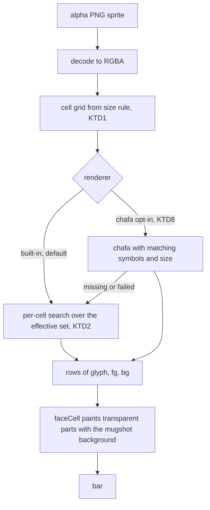
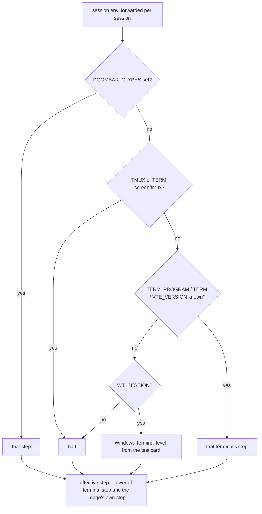

# Built-in Glyph Renderer - Plan

## Goal Capsule

- **Objective:** by default the bar draws its images (today the DOOM mugshot, later the WC3 head and minimap) without starting any external process, at a quality the owner judges by eye to match chafa's. The optional chafa setting of R12 is the only exception.
- **Means:** a built-in pixel-to-glyph conversion inside the bar, with a glyph set per image, capped by what the terminal can draw (KTD2, KTD4).
- **Product authority:** the owner (Petr Skypala). This plan covers only the conversion and its quality gate for the DOOM mugshot. The minimap resolver, the WC3 portrait hook-up and on-demand asset download are not active scope. Product Contract wins on behaviour; KTDs win on mechanism.
- **Execution profile:** one pull request from a feature branch, committed often, merged into `master` once the Definition of Done holds (the owner merges directly; no PR review is required by the project).
- **Owner gates inside the work:** the test card verdict after U4 sets the Windows Terminal level (KTD4); the side-by-side verdict after U7 decides D-4 and therefore what U9 does.
- **Stop conditions:** stop and ask when the measured one-shot cost exceeds the chafa process it replaces even with the KTD10 disk cache. A negative D-4 verdict does not stop the work: U9 records it and hands the chafa-wasm question to the owner.
- **Who finishes:** `ce-work` implements U1–U10 (order: U1, U2, U3, U4 gate, U5, U10, U6, U7 gate, U8, U9); the owner runs the two gates and merges.
- **Open blockers:** none.

---

## Product Contract

### Summary

A built-in converter turns an image into terminal glyphs by searching, for every cell, the glyph and colour pair with the smallest error, the way chafa does. Each image gets its own glyph set, and the terminal type caps it. A test card and an error score measured against chafa inform the owner, who decides by eye whether chafa can leave the DOOM bar.

### Problem Frame

The DOOM mugshot is drawn by chafa, an external program. The render daemon has to start it as a process, and on the owner's PC starting any process costs 1 to 4 seconds idle and up to 50 seconds under load (measured 2026-11-11, `lab/daemon-spike/RESULTS.md`). Without chafa the bar falls back to 546 pre-rendered `.ans` faces at fixed heights 4 to 16.

The WC3 bar will need the same step for every animated frame of a 3D-rendered head (lab prototype, `docs/ideation/2026-11-09-render-daemon-and-minimap.md` Part 5). Spawning chafa per frame costs about 35 ms, ten times the render itself. Without an in-process conversion there is no way to show those heads.

A second problem shows on weak terminals. Today every user gets chafa's full glyph set, sextants and octants included. The owner once saw the bar in the legacy Windows console host (cmd outside Windows Terminal), where it looked broken. A status line cannot ask the terminal what it can draw.

### Key Decisions

- **This plan owns the conversion for the DOOM mugshot, with the test card and score as its gate.** (session-settled: user-directed — chosen over the test card and score alone, and over building the minimap cell grid (D-12) in the same plan: one delivery with clear value, the daemon stops starting chafa.) Governs R1–R5, R10–R13.
- **Per-cell search, chafa-style, including wedge glyphs.** (session-settled: user-directed — chosen over "two colours first, then a pattern table" and over "half blocks first, richer sets later": the only option with a real chance of replacing chafa on the mugshot.) Governs R2.
- **The glyph level follows the terminal type, read from the environment.** (session-settled: user-directed — chosen over one set for everyone and over a choice made once at install time: a terminal cannot be queried from the status line, and an install-time answer is wrong when Claude Code later runs in another terminal.) Governs R7, R8.
- **The owner decides by eye; the score informs.** (session-settled: user-directed — chosen over the eye alone and over an automatic threshold: the score measures ideal glyph masks, not how a font draws them.) Governs R10, R11.
- **Each image has its own glyph set, and the terminal level caps it.** Owner's requirement: the WC3 head wants the richest set including wedges, the minimap a simpler one. Governs R3, R4.
- **The built-in conversion becomes the default at once, before the D-4 verdict.** (session-settled: user-approved — proposed with the trade-off that users who have chafa installed will see the new conversion; the owner confirmed.) Governs R5, R12.
- **The pre-rendered `.ans` faces go.** (session-settled: user-approved — the conversion draws any height, so the fixed-height fallback has no remaining job.) Governs R13.
- **Every platform, not only the Windows daemon.** (session-settled: user-approved — the one-shot renderer on Linux and macOS stops starting chafa too.) Governs R5.
- **If the built-in conversion is good enough, chafa leaves entirely.** Carried from the owner's decision in the ideation doc: "better still, a built-in renderer that is good enough to be the full one." Governs R12.

### Requirements

**Conversion**

- R1. The bar converts an RGBA image to a grid of terminal cells (glyph, foreground, background) inside its own process, at any requested height in rows, without starting a process.
- R2. For every cell the conversion picks the glyph and colour pair with the smallest error among the glyphs the image may use.
- R3. Every image the bar draws is converted with its own glyph set, named by the element that draws it.
- R4. No image ever uses a glyph class above the terminal's level (R6), whatever its own set allows.
- R5. The DOOM mugshot uses the built-in conversion by default on every platform, at its current cadence of about one frame per second.

**Terminal glyph level**

- R6. The terminal level is one step of a ladder of glyph classes, from half blocks only up to the richest classes the test card (R9) shows drawn correctly on the owner's Windows Terminal.
- R7. The default level follows the terminal type read from the session's environment: Windows Terminal and known modern terminals get the richest level that passed the test card; an unknown terminal or the Windows console host gets half blocks.
- R8. A setting overrides the level. One daemon serving sessions in different terminals draws each session at that session's own level.
- R9. A command prints the test card, every glyph class labelled with its ladder step, in any terminal window, so a user can judge by eye which level to set.

**Quality gate and chafa**

- R10. An error score renders a glyph output back to pixels from the glyph masks and compares it with the source image. It scores the built-in conversion and chafa on the 42 DOOM face sprites at heights 4 to 16, both limited to the same glyph set, and it measures the error differently from the per-cell error the search of R2 minimises, for example on a slightly blurred render-back.
- R11. The owner sees the built-in and chafa faces side by side on their own terminal and gives the D-4 verdict; the scores from R10 sit beside the pictures as advisory evidence, because the built-in search optimises an error close to the one being measured.
- R12. Until the verdict, chafa draws the mugshot only when a setting asks for it. A positive verdict removes chafa from the bar; a negative one keeps it as that optional setting.
- R13. The pre-rendered `.ans` faces are removed once the built-in conversion is the default.

### Acceptance Examples

- AE1. **Covers R3, R4, R7.** **Given** a session in the Windows console host, **when** an image whose own set allows wedges and octants is drawn, **then** it is drawn with half blocks only.
- AE2. **Covers R7, R8.** **Given** one daemon serving a session in Windows Terminal and another in the console host, **when** both draw the mugshot, **then** the first uses the test-card level and the second half blocks.
- AE3. **Covers R8.** **Given** Windows Terminal with a font that lacks octants, **when** the user sets the level to sextants, **then** no octant appears in any image of that user's sessions.
- AE4. **Covers R5, R12.** **Given** chafa is installed and the setting does not ask for it, **when** the mugshot is drawn, **then** no chafa process starts.

### Success Criteria

- The D-4 verdict is reached from the side-by-side faces and the R10 scores, and recorded in `docs/BACKLOG.md`.
- With the bar running and the optional chafa setting of R12 off, no process starts to draw a face, at any height (checked on the owner's PC).
- Claude Code runs as fast as without the bar (owner's hard limit, `docs/ideation/2026-11-09-render-daemon-and-minimap.md`). Where the render daemon runs (Windows with Git Bash), the conversion runs inside it at below-normal priority and adds no measurable cost. Where it does not (Linux, macOS), the one-shot renderer's face conversion costs no more per tick than the chafa process it replaces, measured at the richest terminal level.

<!-- ce-section: work-relationships -->
### How This Work Fits Together

This plan covers the built-in conversion and its quality gate, used by the DOOM mugshot. The breakdown below is the current understanding, not a committed roadmap.

- WC3 portrait hook-up: **depends on** this plan; the 3D renderer in `lab/wc3-portraits/render/` produces RGBA frames that go through the same conversion with the richest per-image set (R3).
- Cell-space compositor and lookup resolver for the minimap (D-12): **depends on** the cell grid from R1 and **shares** the terminal level (R6); still to decide whether it adds a second resolver beside the search.
- Animation cadence per element (D-10): **can proceed independently of** this plan.
- On-demand asset download and removal by settings: **can proceed independently of** this plan; removing the `.ans` faces (R13) shrinks what the DOOM bar ships.

### Scope Boundaries

- The minimap, its lookup resolver and layer priority (D-12).
- Wiring the WC3 3D renderer into the daemon, and the WC3 layout itself (G-8).
- Faster-than-one-second animation (D-10) and the frame reel (D-7).
- On-demand download and removal of assets by settings (new backlog item).
- Asking the terminal for its capabilities: the status line has no channel to it.
- The fine bars elsewhere in the HUD also use octants and stay unchanged; in the Windows console host they still draw wrongly (backlog S-5).

### Dependencies / Assumptions

- A PNG decoder exists in the lab prototype (`lab/wc3-portraits/render/png-decode.js`, built-in `zlib`, 8-bit, no interlace) and can be reused for the face sprites in `assets/images/mugshot/alpha/`.
- Terminal type is a guess from environment variables such as `WT_SESSION` and `TERM_PROGRAM`. A terminal reached over SSH, or Windows Terminal with an old font, can get the wrong default; R8 is the remedy.
- The bash client forwards a fixed list of variables today (`src/doombar-client.sh`), without the terminal-identifying ones; R8 needs them per session.

### Sources / Research

- `docs/ideation/2026-11-09-render-daemon-and-minimap.md`: Part 2 (renderer), Part 5 (3D prototype and the 35 ms chafa cost), Part 6 ideas 2 and 6.
- `src/face.js`: chafa call with the set `block+half+quad+sextant+wedge+legacy`, `.ans` fallback clamped to heights 4–16, no-spawn mode with an asynchronous chafa warm-up in the daemon.
- `lab/daemon-spike/RESULTS.md`: process start cost and starvation measurements, 2026-11-11.
- `docs/BACKLOG.md`: D-3, D-4, D-8, D-12.

### Product Contract preservation

Changed: Scope Boundaries gained the fine-bars non-goal, confirmed with the owner before the plan was written; the three questions deferred to planning are resolved by KTD3 (ladder order), KTD4 (terminals and the `DOOMBAR_GLYPHS` override) and KTD9 (OKLab score) and were removed. Requirements, Key Decisions and their IDs are unchanged.

---

## Planning Contract

### Key Technical Decisions

- KTD1. **The face keeps chafa's size rule, at every level and for both renderers.** Rows used = the smaller of the requested rows and half the sprite height rounded up; columns = the smaller of the sprite width and `ceil(rows_used × 2 × width / height)`; missing rows are padded as `toFace` does today. The rule reproduces every shipped `.ans` size (24×29 px: 4 rows → 7 columns, 8 → 14, 16 → 15 lines × 24; 26×30 px at 16 rows → 15 × 26). Face width feeds column widths and preset choice (`src/render.js`), so a width that changed with the level or the renderer would make the terminal type pick a different preset. Governs R1, R5.
- KTD2. **Exhaustive per-cell search on an 8×8 sub-grid, chafa's fit and error.** Each cell box-samples its part of the sprite to 8×8 pixels; for each allowed glyph mask the foreground is the mean of covered pixels and the background the mean of the rest; the error is the summed squared sRGB difference; the lowest error wins, evaluated over every allowed mask (chafa's default only scores the five nearest). Alpha below 128 counts as transparent; a cell's transparent part gets a `null` colour so the existing `faceCell` paints it with the preset's `[mugshot].background`. Inverse mask pairs are searched once with colours swapped. (session-settled: user-directed — chosen over "two colours first, then a pattern table" and over "half blocks first, richer sets later": the only option with a real chance of replacing chafa on the mugshot.) Governs R2.
- KTD3. **The ladder is half ⊂ quadrant ⊂ sextant ⊂ wedge ⊂ octant, each level including the ones below.** Space and full block are always allowed. Half: U+2580, U+2584, U+258C, U+2590. Quadrant: U+2596–U+259F. Sextant: U+1FB00–U+1FB3B. Wedge: U+1FB3C–U+1FB6F (U+1FB9A/B left out: Windows Terminal's built-in glyphs stop at U+1FB94). Octant: U+1CD00–U+1CDE5 plus the four eighth blocks the reused octant patterns map to, U+2582, U+2586, U+1FB82 and U+1FB85 (the other reused patterns map to half and quadrant characters already allowed); the six patterns that would need U+1CEA0/A3/A8/AB or U+1FBE6/7 are left out of the search. Masks come from the Unicode cell layouts (bit = row × 2 + column) and, for wedges, the polygon vertices rasterised onto 8×8. Governs R6.
- KTD4. **The terminal level comes from forwarded environment variables, in this order:** the override `DOOMBAR_GLYPHS` (a ladder step name); `TMUX` or a `TERM` of `screen*`/`tmux*` → half (the outer terminal is unknown); `TERM_PROGRAM` `vscode` → wedge, `WezTerm` → wedge, `ghostty` → octant; `TERM` `xterm-kitty` or `xterm-ghostty` → octant; `VTE_VERSION` → wedge, or octant from the first VTE release that draws octants itself (U5 takes that version from VTE's release notes); then `WT_SESSION` → the Windows Terminal level set at the U4 gate; anything else, the Windows console host included → half. The terminal-specific variables come before `WT_SESSION` because every process started from a Windows Terminal tab inherits it, VS Code included, while Windows Terminal itself sets no `TERM_PROGRAM`. Windows Terminal exposes no version, so its level is one value chosen by the owner's test card, not detected per version. (session-settled: user-directed — chosen over one set for everyone and over an install-time choice: the status line cannot query the terminal.) Governs R7, R8.
- KTD5. **The per-image set lives in the preset, the cap is the terminal level.** `[mugshot] glyphs = "<step>"` next to the existing `background`; when absent it means the richest step. The effective set of an image is the lower of its own step and the terminal level. Governs R3, R4.
- KTD6. **The session's effective step reaches face loading through the existing per-render slot.** `renderSession` already sets module-level values right before the builders run, one session at a time (`setValues` in `src/statusline.js`); the glyph step joins that slot instead of being threaded through `buildBar`, `resolvePreset`, `planLayout` and `layoutContext`. The face cache key becomes sprite, rows, step and renderer. Governs R8.
- KTD7. **The client forwards `WT_SESSION`, `TERM_PROGRAM`, `TERM`, `VTE_VERSION`, `TMUX`, `DOOMBAR_GLYPHS` and `DOOMBAR_FACE_RENDERER`.** They join the client loop in `src/doombar-client.sh` and `FORWARDED_ENV` in `src/daemon.js`, so a session unset stays unset and never inherits the daemon's own environment. Governs R8.
- KTD8. **Chafa is opt-in through `DOOMBAR_FACE_RENDERER=chafa`, and it obeys the same step and size.** It gets `--symbols` for the session's effective step and the exact KTD1 size; when chafa is missing or fails, the built-in conversion draws the face. Governs R5, R12.
- KTD9. **The score and the side-by-side view are one developer script, not shipped.** `scripts/compare-faces.mjs` (outside the package `files` list) runs chafa live per step with matching `--symbols`, renders both outputs back from the glyph polygons at 4× supersampling, scores mean and worst-cell OKLab distance in linear light, and prints both faces next to each other with the numbers. Scoring in OKLab on a finer render-back keeps the score from rewarding the built-in search for minimising its own error. Governs R10, R11.
- KTD10. **On Linux and macOS, measure first; add a disk cache only if the measurement fails the target.** One one-shot render may convert the face once per preset it tries, so the comparison is the cold render with built-in faces against the same render with chafa. It runs where the criterion applies: on the `ubuntu-latest` and `macos-latest` GitHub Actions runners with chafa installed from the system package manager. A measurement on the owner's Windows PC does not count, because there starting chafa alone costs seconds and the built-in render would always win. If the built-in render is slower, converted faces go to a small cache file next to the existing state files, keyed by sprite, rows, step and package version. Governs R5 and the cost criterion in Success Criteria.
- KTD11. **The PNG decoder moves from the lab into `src/png.js`.** `lab/` is gitignored; the decoder (built-in `zlib`, 8-bit, no interlace) covers all 42 sprites, which are 8-bit RGBA without interlace. Governs R1.

### High-Level Technical Design

From sprite to the bar:

How a session's effective step is decided:

### Assumptions and Constraints

- The daemon runs at below-normal priority and renders one session at a time; the per-render slot of KTD6 relies on that.
- Tests run on a machine whose own terminal must not leak into results: every test that renders a face pins the step through the environment.
- Resource caution on the owner's PC: run the test suite at below-normal priority and the end-to-end test alone.

### Risks

- **One Windows Terminal level for every Windows Terminal.** The level comes from the owner's terminal and font; an older Windows Terminal (before the 1.25 built-in sextants and wedges) or a font without octants shows boxes. Accepted: `DOOMBAR_GLYPHS` is the remedy and the test card shows which step to set.
- **Wedge masks are approximations.** Rasterising the polygons onto 8×8 differs from how a terminal draws them; chafa's hand-drawn masks differ by about 3 of 64 pixels. Accepted: the U7 render-back uses the exact polygons, so the owner's verdict sees the real error.
- **The one-shot cost on Linux and macOS is unmeasured.** Decided by KTD10: measure in U6 on Linux and macOS runners, cache only if needed.

---

## Implementation Units

### U1. Glyph table and ladder

**Goal:** one module that knows every allowed glyph, its 8×8 mask and its ladder step.

**Requirements:** R2, R6 (KTD3).

**Dependencies:** none.

**Files:** `src/glyphs.js` (new), `test/glyphs.test.mjs` (new), `package.json` (test list).

**Approach:**
1. Generate masks for half, quadrant, sextant and octant characters from their cell layouts (bit = row × 2 + column; sextant rows on the 8-pixel grid as 3, 2, 3; octant rows as 2, 2, 2, 2).
2. Rasterise the wedge polygons (vertices on x ∈ {0, ½, 1}, y ∈ {0, ⅓, ⅔, 1}) onto 8×8 by pixel centre.
3. Expose the ladder steps in order and, for a step, the list of glyphs with masks; drop the six octant patterns KTD3 excludes.

**Patterns to follow:** plain ESM module with frozen tables, like the lookup tables in `src/render.js`.

**Test scenarios:**
- Sextant code point formula: masks 1, 20, 22, 41, 43, 62 map to U+1FB00, U+1FB13, U+1FB14, U+1FB27, U+1FB28, U+1FB3B; masks 21 and 42 map to U+258C and U+2590.
- Octant table holds 230 code points in U+1CD00–U+1CDE5 with no duplicates, and none of the six excluded characters appears at any step.
- Each step's glyph set is a superset of the step below it.
- Every mask has between 1 and 63 set pixels except space and full block, and no two glyphs at one step share a mask.
- Wedge U+1FB3C covers only the lower-left triangle (rows 5–7 near column 0).

**Verification:** the test file passes on its own and the table loads in under a few milliseconds.

### U2. PNG decoder in the package

**Goal:** decode the face sprites without any external tool.

**Requirements:** R1 (KTD11).

**Dependencies:** none.

**Files:** `src/png.js` (new, from `lab/wc3-portraits/render/png-decode.js`), `test/png.test.mjs` (new), `package.json` (test list).

**Approach:** copy the lab decoder as is; it returns width, height and RGBA bytes and throws on unsupported formats.

**Test scenarios:**
- `assets/images/mugshot/alpha/STFST01.png` decodes to 24×29 with RGBA length 24 × 29 × 4.
- A pixel known to be transparent in that sprite has alpha 0, and a face pixel has alpha 255.
- A 16-bit or interlaced PNG built in the test throws a clear error.

**Verification:** all 42 alpha sprites decode in the test without error.

### U3. Built-in converter

**Goal:** turn RGBA plus a row count and a step into face rows of glyph, foreground and background.

**Requirements:** R1, R2, R5 (KTD1, KTD2).

**Dependencies:** U1, U2.

**Files:** `src/glyph-render.js` (new), `test/glyph-render.test.mjs` (new), `package.json` (test list).

**Approach:**
1. Compute the cell grid with the KTD1 rule.
2. Box-sample each cell to 8×8 RGBA; mark transparent pixels.
3. For each cell, score every allowed mask with the closed-form error (sum of squares minus the two mean terms), keep the best, and emit `null` for the part of a cell that is fully transparent.
4. Return rows in the shape `toFace` returns today, so `faceCell` needs no change.

**Execution note:** start with the size-rule test against the shipped `.ans` dimensions while they still exist.

**Test scenarios:**
- Size rule: STFST01 at 4, 8 and 16 rows gives 4×7, 8×14 and 15 lines × 24 columns padded to 16 rows; STFTL00 at 16 rows gives 15 × 26; STFDEAD0 at 8 rows gives 8 × 13.
- The grid size is identical at every step for the same sprite and rows.
- A synthetic image drawing exactly one sextant pattern per cell converts back to that sextant at the sextant step.
- A uniformly coloured cell yields a space or full block with that colour.
- A fully transparent cell yields `null` colours; a cell half transparent keeps the opaque colour and `null` for the rest.
- Mean error over all 42 sprites never rises from one step to the next (ladder monotonicity).
- The same input converts to identical output twice.

**Verification:** tests pass; converting one 16-row face at the octant step takes a measured time recorded in the unit's commit message.

### U4. Test card command

**Goal:** a command that shows every glyph class, labelled with its ladder step.

**Requirements:** R6, R9 (KTD3).

**Dependencies:** U1.

**Files:** `bin/cli.js` (new `test-card` branch in `parseArgs` and an early return in `main`), `src/glyphs.js` (card rows), `test/test-card.test.mjs` (new), `package.json` (test list), `README.md` (command).

**Approach:** for each step print its new class as rows of characters with a sample of solid colour behind, and one line naming the step. The line naming this terminal's step comes with U5.

**Execution note:** owner gate. After this unit the owner runs the card in Windows Terminal and in the console host; the highest step drawn correctly in Windows Terminal becomes the KTD4 Windows Terminal level before U5 is finished.

**Test scenarios:**
- The card output contains one labelled block per ladder step, in ladder order.
- The card contains every glyph of each class and no excluded octant character.

**Verification:** the owner's verdict is recorded in KTD4 (the Windows Terminal level) and in `docs/BACKLOG.md` (D-8).

### U5. Terminal level and per-image set

**Goal:** resolve a session's effective step from its environment and the image's own step.

**Requirements:** R3, R4, R7, R8 (KTD4, KTD5).

**Dependencies:** U1, U4 gate (Windows Terminal level).

**Files:** `src/glyph-level.js` (new), `presets/full.toml`, `presets/standard.toml`, `presets/minimal.toml` (`[mugshot] glyphs`), `src/glyphs.js` and `bin/cli.js` (the test card's detected-step line), `test/glyph-level.test.mjs` (new), `test/test-card.test.mjs`, `package.json` (test list).

**Approach:**
1. A pure function from an environment object and an image step to the effective step, following the KTD4 order; presets state their mugshot step explicitly.
2. Look up in VTE's release notes the first version that draws octants itself and use it as the KTD4 boundary.
3. The test card prints which step this terminal gets and how to override it with `DOOMBAR_GLYPHS`.

**Test scenarios:**
- Covers AE1. `WT_SESSION` absent and nothing else set (console host), image step octant → half.
- Covers AE3. `WT_SESSION` set and `DOOMBAR_GLYPHS=sextant` → sextant, even when the Windows Terminal level is octant.
- `TMUX` set together with `WT_SESSION` → half.
- `WT_SESSION` and `TERM_PROGRAM=vscode` both set → wedge.
- `TERM_PROGRAM=vscode` → wedge; `TERM=xterm-kitty` → octant.
- `VTE_VERSION` just below the octant boundary → wedge; at the boundary → octant.
- With `DOOMBAR_GLYPHS=sextant` in the environment the test card names sextant as the active step.
- An unknown `DOOMBAR_GLYPHS` value is ignored and detection continues.
- Image step quadrant on a terminal at octant → quadrant.

**Verification:** tests pass; every DOOM preset parses with the new key.

### U6. Built-in face in the bar, per session

**Goal:** the mugshot uses the built-in converter at the session's effective step on every platform, with chafa only on request.

**Requirements:** R5, R8, R12 (KTD6, KTD7, KTD8, KTD10).

**Dependencies:** U3, U5, U10.

**Files:**
- `src/face.js` (built-in default, chafa opt-in with matching symbols and size, cache key)
- `src/render.js`, `src/statusline.js` (step in the per-render slot)
- `test/render-session.test.mjs`, `test/render-snapshot.test.mjs` and `test/snapshots/doom-*.txt`, `test/face-warm.test.mjs`, `test/resolve-preset.test.mjs`, `test/preset-bands.test.mjs`
- `.github/workflows/` (a manually triggered job for the KTD10 measurement on `ubuntu-latest` and `macos-latest`; pushing a workflow file needs the `workflow` scope on the owner's `gh` token)

**Approach:**
1. `loadFace` takes the step from the per-render slot, converts with U3 and caches by sprite, rows, step and renderer.
2. With `DOOMBAR_FACE_RENDERER=chafa`, run chafa (asynchronously in the daemon, as the warm-up does today) with the step's symbols and the KTD1 size; fall back to the built-in face.
3. Every face-rendering test pins `DOOMBAR_GLYPHS`; regenerate the nine DOOM snapshots at a pinned step.
4. Measure the cold one-shot render with built-in faces against the same render with chafa on the Linux and macOS runners (KTD10), both at `DOOMBAR_GLYPHS=octant`, record the numbers in the commit, and add the KTD10 disk cache only if the built-in render is slower there.

**Test scenarios:**
- Covers AE2. Two sessions in one daemon, one with `WT_SESSION` and one without, render the same sprite at the same height: the first face contains sextant or richer glyphs, the second only half blocks.
- Covers AE4. With chafa on `PATH` and `DOOMBAR_FACE_RENDERER` unset, rendering a face starts no chafa process (spawn counter stays 0).
- With `DOOMBAR_FACE_RENDERER=chafa` and chafa missing, the face is the built-in one at the same size.
- With `DOOMBAR_FACE_RENDERER=chafa` and the console-host step, chafa receives only half-block symbols.
- The DOOM snapshots render identically on any terminal once the step is pinned; their mugshot column widths equal the old ones.
- `resolve-preset` and `preset-bands` expectations still hold (turn sprites one column wider than idle).

**Verification:** `npm test` passes at below-normal priority; `npm run test:e2e` passes on its own; the one-shot cost measurement meets the Success Criteria line, with or without the cache.

### U10. Forward the terminal variables per session

**Goal:** the daemon sees each session's own terminal variables and glyph settings, never its own.

**Requirements:** R8 (KTD7).

**Dependencies:** none; lands before U6.

**Files:** `src/doombar-client.sh` (loop and header comment), `src/daemon.js` (`FORWARDED_ENV`), `test/client.test.mjs`, `test/daemon.test.mjs`.

**Approach:**
1. Add the KTD7 names to the client loop with builtins only, keeping the unset-stays-absent contract.
2. Add the same names to `FORWARDED_ENV`.
3. Tests that copy `process.env` scrub these names so results do not depend on the terminal that runs them.

**Patterns to follow:** the existing forwarded names and the unset-stays-unset test in `test/daemon.test.mjs`.

**Test scenarios:**
- The client's env line contains `WT_SESSION=…` and `TERM_PROGRAM=…` when set, and neither name when unset.
- A forwarded value containing a TAB or newline arrives with those characters stripped.
- A session that does not forward `WT_SESSION` renders without it even when the daemon's own environment has one.

**Verification:** `test/client.test.mjs` and `test/daemon.test.mjs` pass in Windows Terminal and in the console host alike.

### U7. Side-by-side comparison and score

**Goal:** give the owner the D-4 pictures and numbers.

**Requirements:** R10, R11 (KTD9).

**Dependencies:** U3, U6.

**Files:** `scripts/compare-faces.mjs` (new), `test/compare-faces.test.mjs` (new, for the scoring maths), `package.json` (`compare-faces` script entry, test list).

**Approach:**
1. For each of the 42 sprites at every height from 4 to 16, convert with the built-in renderer and run chafa with the same symbols and size.
2. Render both back from the glyph polygons at 4× supersampling, composite on the mugshot background, and compute mean and worst-cell OKLab distance against the source.
3. Print both faces side by side with the two scores and a summary per step.

**Execution note:** owner gate. The owner runs the script on Windows Terminal and gives the verdict; record it in `docs/BACKLOG.md` (D-4) before U9.

**Test scenarios:**
- OKLab of pure white is L≈1, a≈0, b≈0; of pure black L=0.
- Two identical images score 0; a one-cell difference raises the worst-cell score more than the mean.
- The render-back of a full block in red is uniformly red.

**Verification:** the script runs end to end on the owner's PC with chafa installed and prints and scores all 42 sprites at every height from 4 to 16.

### U8. Remove the pre-rendered faces and update the docs

**Goal:** the package no longer carries or reads the `.ans` faces, and the docs describe the new behaviour.

**Requirements:** R13.

**Dependencies:** U6.

**Files:** `assets/images/mugshot/ans/` (delete), `src/face.js` (drop the `.ans` path), `README.md` (requirements, env knobs `DOOMBAR_GLYPHS` and `DOOMBAR_FACE_RENDERER`, test card), `CHANGELOG.md` (Unreleased), `bin/cli.js` (the post-install chafa hint), `test/face-warm.test.mjs`.

**Approach:** delete the directory and the code path that reads it. A daemon still running old code exits on its own when the package's `src/` changes and the next hook starts the new one.

**Test scenarios:**
- Rendering any of the 42 sprites at heights 4–16 works with the `.ans` directory absent.
- `face-warm` tests cover only the opt-in chafa path.

**Verification:** `npm pack --dry-run` lists no `.ans` file; `npm test` passes.

### U9. Act on the verdict

**Goal:** carry out the owner's D-4 decision.

**Requirements:** R12.

**Dependencies:** U7 gate.

**Files:**
- Positive verdict: `src/face.js`, `bin/cli.js` (post-install hint), `src/doombar-client.sh` and `src/daemon.js` (stop forwarding `DOOMBAR_FACE_RENDERER`), `README.md`, `CHANGELOG.md`, `test/face-warm.test.mjs`, `test/render-session.test.mjs`, `test/client.test.mjs`, `test/daemon.test.mjs` (remove the chafa opt-in tests).
- Both verdicts: `docs/BACKLOG.md`.

**Approach:** positive → remove the chafa path, its setting, its forwarding and its tests; negative → keep the opt-in, record the verdict and hand the chafa-wasm question (Deferred / Open Questions) to the owner at the end of the work.

**Test scenarios:**
- Positive verdict: no code path references `chafa`, and `DOOMBAR_FACE_RENDERER=chafa` is ignored with the built-in face drawn.
- Test expectation for a negative verdict: none — nothing changes in code.

**Verification:** `docs/BACKLOG.md` records the verdict and D-4 is moved to Done or kept open with the reason.

---

## Verification Contract

| Gate | How | When |
|---|---|---|
| Unit and integration tests | `npm test`, started at below-normal priority on the owner's PC | after every unit |
| End-to-end daemon test | `npm run test:e2e`, alone, nothing else running | after U6 and U8 |
| Test card | owner runs `claude-doom-statusbar test-card` in Windows Terminal and the console host | U4 gate |
| Face quality | owner runs `npm run compare-faces` and judges by eye | U7 gate |
| One-shot cost | cold one-shot render with built-in faces vs the same with chafa, both with `DOOMBAR_GLYPHS=octant` (the richest step), on the `ubuntu-latest` and `macos-latest` GitHub Actions runners (KTD10) | U6 |
| Package contents | `npm pack --dry-run` lists no `.ans` and no `scripts/` | U8 |

---

## Definition of Done

- Every unit's verification holds and `npm test` and `npm run test:e2e` pass.
- With no chafa setting active, no process starts to draw a face in a live Windows Terminal session (checked with the process list during a minute of use).
- The test card and D-4 verdicts are recorded in `docs/BACKLOG.md`: D-8 and D-3 move to Done, D-4 to Done or stays open with the reason.
- README and CHANGELOG describe the built-in face, the test card and `DOOMBAR_GLYPHS`; they describe `DOOMBAR_FACE_RENDERER` only after a negative verdict, and mention no chafa setting after a positive one.
- No experimental or abandoned code from approaches that did not pan out is left in the diff, and no scratch measurement script lands in `src/` or `test/`.

---

## Deferred / Open Questions

These are review items left for the author. They do not block implementation.

### From 2026-11-11 review

- **No in-process route if the built-in conversion loses the chafa comparison** — Goal Capsule (Objective) and R12 (chafa until and after the D-4 verdict) (P2, adversarial, confidence 75)

  If the owner's verdict goes against the built-in conversion, the only way left to reach chafa's quality is starting chafa as a process, which the animated WC3 heads cannot afford. chafa also exists as a WebAssembly build that runs inside the process (`chafa-wasm` on npm, 0.3.3, LGPL-3.0). Decide after a negative verdict whether it becomes the fallback, weighing the LGPL licence beside this MIT package, its maturity and its start-up cost in the one-shot renderer.
