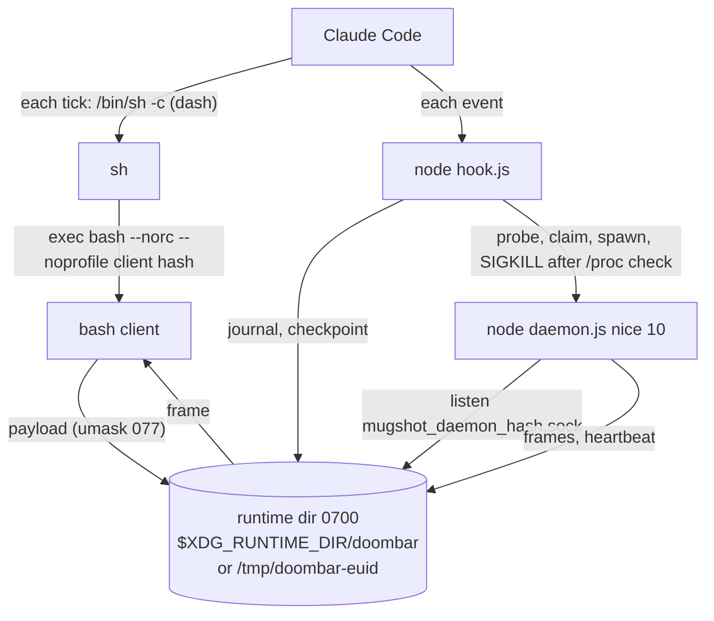
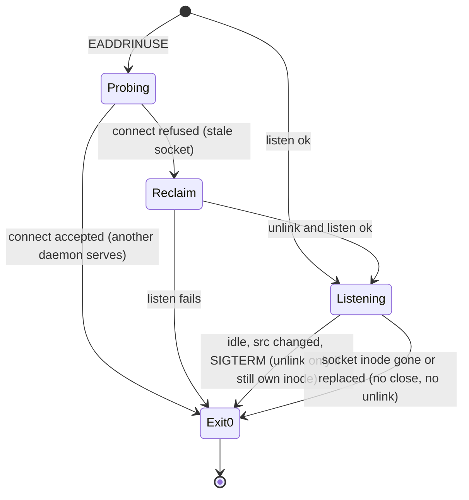

# Render Daemon on Linux - Plan

## Goal Capsule

- **Objective:** on Linux and macOS, wherever a bash 5 or newer is found, the bar stays live at the 1-second refresh, and each tick costs about as much as starting bash, not a Node process. The bar's data is readable by its own user only.
- **Means:** the Windows design, ported: a builtins-only bash client, one render daemon per installation, and hook supervision, all running in a private per-user runtime directory (KTD1, KTD3, KTD4).
- **Product authority:** the owner (Petr Skypala). The Product Contract wins on behaviour, and the KTDs win on mechanism.
- **Execution profile:** one branch (`feat/linux-render-daemon`), committed often, merged into `master` by the owner. No PR review is required by the project. This Windows session is the only writer. The Raspberry Pi 5 session only verifies (R13).
- **Verification gates on the Pi:** after U2 (suite and client on real Linux), after U6 (e2e on Linux), and the live switch after U8. The live switch needs the owner's explicit OK because it edits the Pi's Claude Code settings.
- **Stop conditions:** stop and ask if a client tick on the Pi measures above 10 ms, or if the daemon cannot be made a single instance per installation and runtime directory without a process spawn per tick.
- **Who finishes:** `ce-work` implements U1–U8 in order. The Pi session runs the gates. The owner approves the live switch and merges.
- **Open blockers:** none.

---

## Product Contract

### Summary

Linux gets the render daemon and the bash client that Windows has had since 0.14.0. The installer writes a client command that hands the tick from `/bin/sh` to bash. On Linux and macOS, every file the bar keeps moves into a private directory of the user. Windows does not change.

### Problem Frame

On Linux and macOS the status line runs `node src/statusline.js` on every tick. On the owner's Raspberry Pi 5 that costs about 250 ms per tick, of which about 130 ms is Node starting. At the 1-second refresh that is a quarter of a core spent on the bar. The same tick through a bash client costs about 1.5–2 ms (measured 11.11.2026, `docs/ideation/2026-11-11-render-daemon-on-linux.md`).

Windows already solved this in 0.14.0 with a render daemon and a bash client, but every piece of it is gated on Windows: the installer looks for Git Bash, the singleton is a named pipe, the hooks identify a stale daemon through PowerShell and kill it with `taskkill`.

Linux also differs in a way Windows never had to handle. `%TEMP%` belongs to one user. `/tmp` is shared by every user of the machine, so the bar's files there are readable by other users, and some can be planted by them. Examples are the payload with the forwarded environment line, the account rate-limit files and the face cache, whose text goes straight to the terminal.

### Key Decisions

- **All of the bar's files on Linux and macOS live in a private per-user directory, not only the daemon's.** This covers journals, checkpoints, savings, the global rate files and the face cache. The user loses HUD state at logout where the directory is cleared, which on Debian 13 already happens at reboot because `/tmp` is tmpfs. (session-settled: user-approved — chosen over moving only the daemon's files: one private place closes every cross-user read and plant on shared `/tmp`.) Governs R5, R6.
- **The client is used only where a bash 5 or newer is found; elsewhere the one-shot stays.** macOS's stock bash 3.2 lacks `EPOCHREALTIME` and `read -N`. (session-settled: user-approved — chosen over requiring bash 5: macOS keeps working without a Homebrew bash.) Governs R1.
- **An existing installation switches to the client only when `install` runs again.** This is the same as on Windows. (session-settled: user-approved — chosen over switching on package upgrade: settings are only ever written by `install`.) Governs R3.
- **The refresh stays at 1 second and the daemon stays at below-normal priority.** (session-settled: user-directed — chosen over a slower refresh and normal priority: the owner wants a live clock, and a bar that yields to real work.) Governs R9.

### Requirements

**Client and installer**

- R1. On Linux and macOS, where a bash of major version 5 or newer is found, `install` writes the client command. Where no such bash is found, it writes the one-shot command as today.
- R2. A tick through the client starts no process besides the bash it runs in, and costs on the Pi about as much as a bash start.
- R3. Re-running `install` moves an existing one-shot installation to the client. `install --local` does the same for a project's `.claude/settings.local.json`.
- R4. When the bash or the package that the command names is gone, the bar prints `doombar: offline` and nothing on stdout breaks.

**Private files**

- R5. On Linux and macOS no file the bar writes is readable or replaceable by another user. They live in one private directory per user and environment.
- R6. Every process of the bar resolves that directory to the same path from the same environment: client, hooks, one-shot render, daemon and installer. If the directory cannot be made private, no process reads or writes anything in it, and the bar shows `doombar: offline`. That holds for the client and the one-shot render alike.
- R7. Windows keeps its directory (`%TEMP%`), its file names and its behaviour.

**Daemon and supervision**

- R8. At most one render daemon runs per installation (on Linux and macOS, per installation and runtime directory), including after a daemon was killed and left its socket file behind.
- R9. The daemon renders every session about twice a second at below-normal priority and exits after the idle time, as on Windows.
- R10. Hooks start a missing daemon, replace one that hangs or is outdated, and leave it alone while the machine is busy, as on Windows. Before killing a process, they confirm that it is this installation's daemon.
- R11. Each session's glyph step follows that session's own terminal, including VTE terminals (`VTE_VERSION`) and `TERM`.
- R12. `uninstall` stops this installation's daemon and removes its files on Linux and macOS too.

**Verification**

- R13. Each stage is verified on real Linux by the Raspberry Pi session. The Pi's live settings change only with the owner's OK.

### Acceptance Examples

- AE1. **Covers R6.** Given `XDG_RUNTIME_DIR=/run/user/1000`, owned by the user, every process uses `/run/user/1000/doombar`.
- AE2. **Covers R6.** Given no `XDG_RUNTIME_DIR` (ssh without pam_systemd, cron), every process uses `/tmp/doombar-<euid>`.
- AE3. **Covers R5, R6.** Given `XDG_RUNTIME_DIR` set to another user's directory (`su` without `-`, `sudo -E`), every process uses `/tmp/doombar-<euid>`.
- AE4. **Covers R6.** Given `/tmp/doombar-<euid>` already created by another user and holding planted files, nothing is read from or written there, the bar prints `doombar: offline`, and no process falls back to shared `/tmp`.
- AE5. **Covers R6.** Given an ssh session under tmux whose `/run/user/<uid>` was removed at logout, the bar shows `doombar: offline` and does not move to another directory mid-session.
- AE6. **Covers R8.** Given the daemon was killed with SIGKILL and its socket file remains, the next hook event starts a new daemon, and it serves frames within a few seconds.
- AE7. **Covers R8.** Given a running daemon whose socket file was deleted or replaced, that daemon exits within a few seconds, so only its replacement keeps running.

### Success Criteria

- On the Pi, with the client wired, the statusLine process tree per tick is `sh` → `bash` with no `node`, and the median tick is under 10 ms.
- On the Pi, one `node …/daemon.js` runs at nice 10. Killing it greys the bar within about 4 s, and the next hook event brings it back.
- After a session on the Pi, `/tmp` holds no `mugshot_*`, `savings_*` or `doombar_faces_*` files of this user, and the private directory is mode 0700.

### Scope Boundaries

- No HTTP hooks (D-2), no multi-slot frame reel (D-7), no rename (R-0…R-4).
- No migration of 0.14.0 files from shared `/tmp`. Debian clears tmpfs `/tmp` at reboot. A resumed session after the upgrade starts with an empty HUD state.
- The forwarded environment list grows by `TERM` and `VTE_VERSION` only. Other render settings that the daemon takes from the session that started it (`DOOMBAR_TASKS_DIR`, `DOOMBAR_RATELIMITS`…) stay as on Windows.

**Considered and not built:**

- **A reason suffix on the offline line (`doombar: offline (bash)`)**, or a `doctor` command. The README troubleshooting names the checks. It would be worth building if users report Linux setups they cannot debug.
- **An opt-out flag for the daemon on POSIX.** Windows has none. A user can keep the one-shot by not re-running `install`. It would be worth building if someone asks for it.
- **Moving persistent state to `XDG_STATE_HOME` to survive logout.** It costs journal writes in home, which wears the Pi's SD card. It would be worth building if losing state at logout bothers users.
- **Surviving `KillUserProcesses=yes`** (`systemd-run --user`). Debian's default is no. Where it is yes, the next hook restarts the daemon.
- **Supervising only on a fresh payload.** A payload left by an earlier client setup can start a daemon that only idles out after 10 minutes. The claim throttle limits that to one start per window. The check would also change Windows hook behaviour, which R7 keeps. It would be worth building if idle-only daemons are reported.
- **A lock around the stale-socket reclaim.** Two daemons reclaiming at once settle within about 2 s through the inode self-check and the inode-conditional unlink (KTD3). It would be worth building if the U3 race test shows a gap.
- **A mode-bit check in the client.** Bash builtins cannot read permission bits. Only the owner can loosen a directory they own, and every hook, one-shot and daemon start puts it back to 0700 (KTD2).

### Sources / Research

- Pi measurements and Linux facts: `docs/ideation/2026-11-11-render-daemon-on-linux.md`.
- Windows design being ported: `src/daemon.js`, `src/doombar-client.sh`, `src/hook.js` (`superviseDaemon`, `probePipe`, `confirmedDaemonPid`, `restartDaemon`, `spawnDaemon`), `src/fold.js` (`statePaths`, `sessionPaths`, `daemonPaths`, `pipePath`), `bin/cli.js` (`gitBash`, `useClient`, `CLIENT_CMD`, `stopDaemon`), `docs/plans/2026-11-09-2142-feat-frame-deadline-contract-plan.md`.

---

## Planning Contract

### Key Technical Decisions

- KTD1. **One resolver names the runtime directory, from the environment and at most one stat.** Node (`runtimeDir()` in `src/fold.js`) and the client implement the same rule:
  1. `DOOMBAR_RUNTIME_DIR` when set (tests, custom setups; honoured on Windows too).
  2. On Windows: the temp directory as today (`os.tmpdir()`, and `TEMP`, `TMP`, `TMPDIR`, `/tmp` in the client).
  3. `$XDG_RUNTIME_DIR/doombar` when `XDG_RUNTIME_DIR` is absolute and either does not exist or is owned by the effective uid.
  4. On macOS: `$TMPDIR/doombar` when `TMPDIR` is absolute and owned by the effective uid. macOS gives every user a private `$TMPDIR` and has no `XDG_RUNTIME_DIR`.
  5. Otherwise `/tmp/doombar-<euid>`.

  A missing directory never redirects the choice. It makes the bar fail closed (KTD2) rather than move elsewhere mid-session, which prevents flip-flopping between directories at ssh logout and login. Only an existing `XDG_RUNTIME_DIR` owned by someone else (`su`, `sudo -E`) sends the choice on. The effective uid is used everywhere: `geteuid()` in Node, `$EUID` and `-O` in bash.
- KTD2. **Node creates and checks the directory; the client only checks it.** Creators are the hooks, the one-shot render and the daemon, never the installer: under `sudo -E install` it would create a root-owned directory that locks the user out.
  - Creation is a non-recursive `mkdir` with mode 0700, so a missing `/run/user/<uid>` is never created and fails closed.
  - The check is: a real directory (not a symlink, by `lstat`), owned by the euid. A directory the user owns with a group or world bit gets `chmod 0700`.
  - Anything else is unsafe. No process reads or writes anything in it: the hook skips its journal, sweep and probes, and the one-shot render prints `doombar: offline` instead of reading its checkpoint, face cache or rate files. The client prints `doombar: offline`.
  - The client tests `[[ -d $d && ! -h $d && -O $d ]]` and sets `umask 077` before it writes the payload.
  - On Windows the check is skipped, which keeps R7.
- KTD3. **The POSIX singleton is a path Unix socket in the runtime directory**, named `mugshot_daemon_<hash>.sock` so the existing prefix cleanup covers it. It was chosen over an abstract socket, which has no permissions, is shared per network namespace, and could be bound first by another user. Three rules come with it:
  - A probe that gets `ECONNREFUSED` or `ENOENT` means nothing is bound.
  - A daemon that gets `EADDRINUSE` connects once. If that is refused, it removes the stale socket and listens again.
  - Every 2 s, in the existing source-check slot, the daemon compares its socket path's dev and inode with the ones it bound, and exits when the path is gone or replaced (AE7). On that path it exits without closing the server.
  - On every exit the daemon unlinks the socket path only while `lstat` still shows its own dev and inode. Two daemons that reclaim at once therefore settle on the later one within about 2 s, and neither removes the other's socket.
- KTD4. **The installed POSIX command execs a baked bash and passes the hash as an argument.** The shape is: if the client is readable and the bash is executable, unset `BASH_ENV` and `exec <bash> --norc --noprofile <client> <hash>`, else print `doombar: offline`.
  - The bash path is the one the install-time probe found, not resolved through symlinks, so a Homebrew upgrade does not break it.
  - The probe checks `DOOMBAR_BASH`, then the usual locations and `PATH`, and accepts the first bash whose `BASH_VERSINFO[0]` is 5 or more. It is a one-time spawn at install.
  - dash does not exec the last command of `-c` on its own, so `exec` is required.
  - On Windows the client stays sourced, exactly as today. The client reads the hash from `DOOMBAR_ROOT_HASH` (Windows) or `$1` (POSIX), and picks the directory rule by `$OSTYPE`.
- KTD5. **The daemon's identity on Linux is its raw start time from `/proc/self/stat`, compared exactly.** It was chosen over epoch milliseconds with a 2 s slack, because a hook started under load on the Pi can take longer than that, and a hung daemon would then never be replaced.
  - The daemon writes this value into the heartbeat. A hook confirms a pid when `/proc/<pid>/stat` has the same value and `/proc/<pid>/cmdline` runs this package's `src/daemon.js`. The value is field 22 (starttime): split the text after the last `)` on spaces and take the 20th value, because the command name before it may contain spaces and `)`.
  - macOS uses `ps -o lstart=,command= -p <pid>` with the existing slack. That is a spawn, but only on the restart and uninstall path.
  - Restart kills with SIGKILL. Uninstall sends SIGTERM, which the daemon handles by removing its heartbeat and closing its socket.
- KTD7. **`TERM` and `VTE_VERSION` join the forwarded environment.** Three lists must change together: the client loop and header, `FORWARDED_ENV` in `src/daemon.js`, and `FORWARDED` in `test/client.test.mjs`.
- KTD8. **Tests isolate the runtime directory through `DOOMBAR_RUNTIME_DIR`**, set by one shared helper next to `test/_temp-sandbox.mjs`, not by editing about 19 env literals in different ways. On the Pi the suite then never touches the live bar's directory, and uninstall tests never stop the live daemon.

### High-Level Technical Design

Where the processes meet on Linux. Every arrow into the runtime directory goes through KTD1's resolver.

How each process resolves the directory (KTD1, KTD2):

| Environment | Chosen directory | If unsafe or missing |
|---|---|---|
| `DOOMBAR_RUNTIME_DIR` set | that path | offline, no reads or writes |
| Windows | `%TEMP%` (today's rule) | unchanged behaviour |
| `XDG_RUNTIME_DIR` absolute, owned by euid | `$XDG_RUNTIME_DIR/doombar` | Node creates it 0700. The client is offline until then. |
| `XDG_RUNTIME_DIR` absolute, missing (`/run/user` removed mid-session) | `$XDG_RUNTIME_DIR/doombar` | offline, nothing created. Never moves to another candidate. |
| macOS, `TMPDIR` absolute and owned by euid | `$TMPDIR/doombar` | Node creates it 0700 |
| `XDG_RUNTIME_DIR` unset, relative, or an existing directory owned by someone else | `/tmp/doombar-<euid>` | Node creates it 0700. If another user created it: offline, no reads or writes |

The daemon's socket lifecycle (KTD3):

### Assumptions and Constraints

- Claude Code on Linux runs the statusLine through `/bin/sh -c`, observed on Claude Code 2.1.322 on the Pi. If a later version runs it through bash directly, the `exec` form still works.
- Hooks, client and daemon all inherit Claude Code's environment, so they see the same `XDG_RUNTIME_DIR`. A terminal that strips it (tmux started without it) gets its own directory and its own daemon, which is correct, if not shared.
- Process starts on the owner's Windows PC are slow. Tests run at below-normal priority, and `test/daemon-e2e.test.mjs` never runs together with anything else.

### Risks

| Risk | Mitigation |
|---|---|
| libuv may not unlink the socket on `server.close()` on every platform, and the idle test asserts a clean directory | U3 asserts it on CI (ubuntu) and on the Pi. After close, the daemon unlinks the path itself only while it still carries its own dev and inode (KTD3). |
| macOS has no verification gate: CI is ubuntu only and the Pi is Linux, so the `ps` identity check and the `$TMPDIR` rule ship unobserved | Both are covered by unit tests on pure functions. The one-shot stays the default on stock macOS. The CHANGELOG says macOS with bash 5 is untested. |
| `sun_path` limit (108 bytes Linux, 104 macOS) with a long `DOOMBAR_RUNTIME_DIR` in tests | Test sandboxes use short `mkdtemp` names. The daemon reports `ENAMETOOLONG` as offline instead of crashing. |
| A daemon started by an ssh session's hook dies at that session's logout where `KillUserProcesses=yes` | Accepted (see Scope Boundaries). The next hook restarts it. Documented in the README. |
| The owner's two wirings (global npm and repo `settings.local.json`) on one machine | Each install hashes its own root, so their daemons and files never mix. U5's `--local` rewires the repo. |

---

## Implementation Units

### U1. Private runtime directory

- **Goal:** one resolver and one check name and guard the bar's directory for every Node process.
- **Requirements:** R5, R6, R7, AE1–AE5.
- **Dependencies:** none.
- **Files:**
  - `src/fold.js`
  - `src/statusline.js`
  - `src/face.js`
  - `src/daemon.js` (directory default only)
  - `src/hook.js` (`spawnDaemon` cwd only)
  - `test/runtime-dir.test.mjs` (new)
  - `test/_temp-sandbox.mjs`
  - the tests that set `TEMP`/`TMP`/`TMPDIR`, which move to the shared helper (KTD8)
  - `package.json` (test script)
- **Approach:**
  1. Add `runtimeDir(env)` and `ensureRuntimeDir(env)` to `src/fold.js` per KTD1 and KTD2. Memoize the check per process and directory.
  2. Route `statePaths`' default, `sessionPaths`' payload and frame, `daemonPaths`, `statusline.js`'s `TMP` (as a lazy getter, since it is read at import), the face disk cache, the daemon's default directory and the spawn cwd through `runtimeDir()`.
  3. Call `ensureRuntimeDir()` before the first read or write in the hook, the one-shot render and the daemon. When it fails, the hook and the daemon do nothing more, and the one-shot prints `doombar: offline` without reading any file there (KTD2).
  4. `MUGSHOT_STATE` keeps relocating the checkpoint and its siblings, as today.
- **Patterns to follow:** `sessionPaths` as the single namer of per-session files, and `test/_temp-sandbox.mjs`.
- **Test scenarios:** `test/runtime-dir.test.mjs` exercises the resolver and check against fake environments and real temp dirs. It catches rule and permission bugs. It misses how the client resolves the directory, which U2 covers against the same table.
  - The override wins over everything, on every platform.
  - On win32 the result equals `os.tmpdir()`, and no check or chmod runs.
  - XDG absolute and owned → `$XDG_RUNTIME_DIR/doombar`, created with mode 0700.
  - XDG unset, or relative → the resolver returns `/tmp/doombar-<euid>`. This is checked as a pure function of the environment and euid, without creating anything in the real `/tmp`.
  - XDG owned by another uid → the fallback. Skip where tests cannot create a foreign-owned directory, and note the skip.
  - XDG set to a missing absolute path → the resolver returns `<XDG>/doombar`, nothing is created, and the hook writes nothing (AE5).
  - On darwin with an owned absolute `TMPDIR` → `$TMPDIR/doombar` (pure-function case).
  - A directory the user owns with mode 0755 is set to 0700.
  - A symlink at the directory path is refused, and nothing is written through it.
  - A removed `doombar` directory under an existing parent is re-created by the next writer at the same path.
  - With a refused directory holding a planted face cache and rate file, the hook writes nothing, and a one-shot render prints `doombar: offline` and nothing of the planted content (AE4).
- **Verification:** the whole suite passes on Windows and on ubuntu CI. Running the suite leaves the machine's real temp dir and the real runtime dir unchanged. Check by listing before and after.

### U2. Client: directory rule, exec form, forwarded terminal

- **Goal:** the bash client resolves the same directory with builtins and runs both sourced (Windows) and exec'd with the hash as `$1` (POSIX).
- **Requirements:** R2, R4, R6, R11, AE4, AE5.
- **Dependencies:** U1.
- **Files:**
  - `src/doombar-client.sh`
  - `src/daemon.js` (`FORWARDED_ENV`)
  - `test/client.test.mjs`
- **Approach:**
  - Hash from `DOOMBAR_ROOT_HASH`, else `$1` (KTD4).
  - Directory by KTD1, choosing the Windows branch through `$OSTYPE` (`msys*`/`cygwin*`).
  - Gate per KTD2. `umask 077` before writing the payload.
  - A `BASH_VERSINFO` check prints offline below major 5.
  - Add `TERM` and `VTE_VERSION` to the forwarded list and header (KTD7).
- **Patterns to follow:** the existing builtins-only client and the static and runtime no-externals check in `test/client.test.mjs`.
- **Test scenarios:**
  - Each row of the KTD1 table resolves to the same path that `runtimeDir()` returns for the same environment, including a missing absolute `XDG_RUNTIME_DIR`. Drive both from one list of cases.
  - A missing directory, a symlinked one and one owned by another user (where testable) each print exactly `doombar: offline` and write nothing.
  - Run as a script with the hash as `$1`, under `PATH=/no-such-dir`, the client prints the frame, so it uses no external command.
  - Sourced with `DOOMBAR_ROOT_HASH` set, as on Windows, the client behaves as today. The existing Windows cases still pass.
  - The payload file it writes has mode 0600 on POSIX.
  - `TERM` and `VTE_VERSION` appear in the env line when set, and are absent when unset.
- **Verification:** Pi gate 1. The Pi session pulls the branch and runs `npm test` and the client cases on real Linux.

### U3. Daemon singleton on POSIX

- **Goal:** one daemon per installation and runtime directory on Linux and macOS, recovering from a stale socket and stepping aside when its socket is gone.
- **Requirements:** R8, R9, AE6, AE7.
- **Dependencies:** U1.
- **Files:**
  - `src/fold.js` (socket path next to `pipePath`)
  - `src/daemon.js`
  - `test/daemon.test.mjs`
- **Approach:**
  - Listen on the KTD3 socket on POSIX and on the pipe on Windows.
  - Stale-socket reclaim, the inode self-check in the source-check slot, and the inode-conditional unlink on exit (KTD3).
  - A SIGTERM handler that removes the heartbeat and closes the server.
  - On Linux the heartbeat gains the raw start time (KTD5).
  - Keep below-normal priority and the idle exit unchanged.
- **Patterns to follow:** `srcSnapshot` in `src/daemon.js` for the periodic self-check.
- **Test scenarios:**
  - The real-process cases now skipped off Windows run on POSIX: singleton, two installs, exit on a source change, idle exit, package rename.
  - On POSIX only: with a different `DOOMBAR_RUNTIME_DIR`, a second daemon of the same install runs. On Windows the existing assertion stays: a second daemon of the same install exits, whatever its directory.
  - A daemon killed with SIGKILL leaves its socket. A new daemon reclaims it and serves (AE6).
  - Two daemons started together on a stale socket leave exactly one listening within about 3 s, and that one keeps its socket.
  - Deleting the socket file of a running daemon makes it exit within about 3 s (AE7).
  - After the idle exit or SIGTERM, the runtime directory holds no socket and no heartbeat.
  - On Linux the heartbeat's start time equals field 22 of `/proc/<pid>/stat`.
- **Verification:** these cases pass on ubuntu CI and on Windows (pipe path unchanged).

### U4. Hook supervision on POSIX

- **Goal:** hooks start, replace and leave alone the daemon on Linux and macOS exactly as on Windows.
- **Requirements:** R10, AE6.
- **Dependencies:** U1, U3.
- **Files:**
  - `src/hook.js`
  - `test/daemon-restart.test.mjs`
- **Approach:**
  - Remove the win32 gate from `superviseDaemon`.
  - `probePipe` treats `ECONNREFUSED` like `ENOENT`.
  - Confirm the pid by platform: Windows unchanged, Linux `/proc`, macOS `ps` (KTD5).
  - Kill with `taskkill` on Windows and SIGKILL elsewhere.
  - The release wait accepts a refused socket as released.
- **Patterns to follow:** the existing `claimRestart`, `suspectStep` and `machineBusy`, unchanged.
- **Test scenarios:**
  - The pure identity check accepts a matching `/proc` stat and cmdline. It rejects:
    - a different start time,
    - another script,
    - a comm containing spaces and `)`, parsed after the last `)`.
  - With a stale socket and no daemon, a hook event spawns a daemon. The fake daemon logs a bind.
  - With a hung fake daemon (heartbeat stale past the grace period), a hook confirms its identity, kills it and spawns a new one.
  - A heartbeat naming another process's pid is never killed.
  - With the machine busy, a stale daemon is left alone.
  - The fake daemon imports the socket path builder instead of hardcoding the pipe string.
  - The cleanup in the test uses `process.kill` off Windows instead of PowerShell.
- **Verification:** the restart cases run on ubuntu CI.

### U5. Installer, `--local`, and uninstall on POSIX

- **Goal:** `install` wires the client wherever bash 5 exists and can target `settings.local.json`. `uninstall` cleans up on POSIX.
- **Requirements:** R1, R3, R4, R12.
- **Dependencies:** U2, U4.
- **Files:**
  - `bin/cli.js`
  - `test/installer.test.mjs`
  - `test/smoke.test.mjs`
- **Approach:**
  1. Replace `gitBash()` with a bash finder per platform: Git Bash on Windows as today, and on POSIX the KTD4 probe. `useClient()` follows.
  2. Build the POSIX command per KTD4. The Windows command stays byte-identical.
  3. Add `--local` to write `./.claude/settings.local.json` with the same merge logic and backup.
  4. `stopDaemon` runs on POSIX:
     - with `DOOMBAR_RUNTIME_DIR` set, it reads and cleans only that directory (KTD1 rule 1), so a sandboxed test never reaches the live bar,
     - otherwise it reads the heartbeat from every candidate directory of KTD1 rules 3 to 5,
     - it confirms the pid per KTD5 and sends SIGTERM,
     - it removes this hash's files in each,
     - it removes the directory when it is empty.
  5. The install output names the renderer and the runtime directory.
- **Patterns to follow:** the existing `install`/`uninstall` merge and backup logic, and the Git Bash detection with its test override.
- **Test scenarios:**
  - On POSIX with `DOOMBAR_BASH` pointing at a bash 5, `install` writes a command that contains `exec`, the bash path, the client path and the hash, and no `node`.
  - With `DOOMBAR_BASH` pointing at a fake bash that reports major version 3 and no other bash 5 reachable, `install` writes the one-shot command.
  - Re-running `install` is byte-identical. Running it over a one-shot install rewires to the client.
  - `--local` writes `.claude/settings.local.json` and leaves `.claude/settings.json` untouched.
  - The smoke test runs the installed command through `/bin/sh -c` with a payload on stdin, as Claude Code does, and gets `doombar: offline` before any daemon exists.
  - With the bash path removed, the same command prints `doombar: offline` and exits 0.
  - `uninstall` stops a real sandboxed daemon on POSIX, after the identity check, and leaves no file of this hash in the runtime directory.
  - `uninstall` with `DOOMBAR_RUNTIME_DIR` set leaves a heartbeat planted in a second fake candidate directory untouched.
  - The Windows cases (`DOOMBAR_ROOT_HASH=` prefix, sourcing form) still pass on Windows.
- **Verification:** suite green on Windows and ubuntu CI.

### U6. End-to-end on Linux

- **Goal:** the existing real-process e2e test runs on Linux, so the Pi can prove the whole loop.
- **Requirements:** R8, R9, R10, R13.
- **Dependencies:** U5.
- **Files:** `test/daemon-e2e.test.mjs`.
- **Approach:**
  - Keep the Windows path.
  - On Linux, find the sandbox's processes by scanning `/proc/*/cmdline` for the sandbox path, and kill with `process.kill`.
  - Build the command through the installer's builder instead of duplicating `CLIENT_CMD`.
  - Run each tick through `/bin/sh -c`.
  - The test stays outside `npm test` (`npm run test:e2e`).
- **Patterns to follow:** the existing `exclusive` one-child runner and watchdog.
- **Test scenarios:**
  - Existing phases on Linux: start, live for 60 s, pause, kill → grey within 4 s, restart on Stop, hung daemon replaced.
  - New phase: SIGKILL the daemon, leaving its socket, and the next hook event reclaims it.
- **Verification:** Pi gate 2. The Pi session runs `npm run test:e2e` alone and reports the phase timings. On Windows it still passes when run alone.

### U7. Measurement on the client path

- **Goal:** the cost script measures what a Linux tick costs through the client, so the success criterion has a number.
- **Requirements:** R2.
- **Dependencies:** U5.
- **Files:**
  - `scripts/measure-oneshot.mjs`, or a sibling `scripts/measure-client.mjs`. The implementer picks one.
  - `.github/workflows/oneshot-cost.yml` sandbox environment.
- **Approach:**
  - Time `/bin/sh -c <installed command>` against a running sandboxed daemon, as a median of N, next to the one-shot number.
  - Sandbox through `DOOMBAR_RUNTIME_DIR` (KTD8).
- **Test expectation:** none, because this is a measurement script. Its output is the evidence for the success criterion.
- **Verification:** the Pi session reports both numbers. The client median is under 10 ms.

### U8. Docs and the live switch on the Pi

- **Goal:** the docs describe Linux, and the owner's Pi runs the client live.
- **Requirements:** R13, all user-facing ones.
- **Dependencies:** U1–U7.
- **Files:**
  - `README.md`: Requirements, Updating, How it works, Troubleshooting the daemon, uninstall note.
  - `CHANGELOG.md` (Unreleased).
  - `docs/BACKLOG.md` (D-15 and the L-A note).
  - `docs/ideation/2026-11-11-render-daemon-on-linux.md`: a line that the private directory replaces its fact 2.
- **Approach:**
  - The README names the runtime directory, the bash 5 requirement, `install --local`, the offline causes and how to check each.
  - The CHANGELOG notes the move out of shared `/tmp` and that old files there are not migrated.
  - Live switch, with the owner's OK only:
    1. the Pi session runs `node bin/cli.js install --local` in its clone (or the global install, as the owner chooses),
    2. restarts Claude Code,
    3. checks the success criteria: process tree, tick median, one daemon at nice 10, grey and back after killing it, no bar files in `/tmp`, directory mode 0700.
- **Test expectation:** none for the docs. The live switch is the gate.
- **Verification:** Pi gate 3 reports every success criterion as met.

---

## Verification Contract

| Gate | Command or check | Where | When |
|---|---|---|---|
| Unit and integration suite | `npm test` at below-normal priority | Windows (this PC) | after every unit |
| Linux suite | GitHub Actions `Test` workflow (ubuntu, Node 22) | CI | after every push |
| Pi gate 1 | `npm test` and the client cases | Pi (Debian 13, bash 5.2, Node 20) | after U2 |
| Windows e2e | `npm run test:e2e`, run alone | Windows | after U4 and U6 |
| Pi gate 2 | `npm run test:e2e`, run alone | Pi | after U6 |
| Cost | client and one-shot medians from U7 | Pi | after U7 |
| Pi gate 3 | live switch and every Success Criterion | Pi, with the owner's OK | after U8 |

---

## Definition of Done

- All Requirements hold, and every Acceptance Example is covered by a test or by Pi gate 3.
- `npm test` passes on Windows and on ubuntu CI. `npm run test:e2e` passes on Windows and on the Pi, each run alone.
- The Windows statusLine command and behaviour are byte-identical to 0.14.0, as the installer tests assert.
- The suite leaves no file in the real temp or runtime directory of the machine it runs on.
- README, CHANGELOG and BACKLOG describe the Linux client. The backlog marks D-15 done (unreleased).
- No temporary diagnostic code or abandoned attempts remain in the diff.
