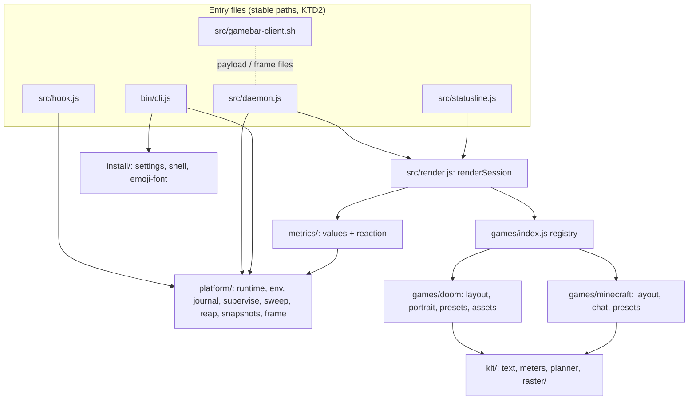
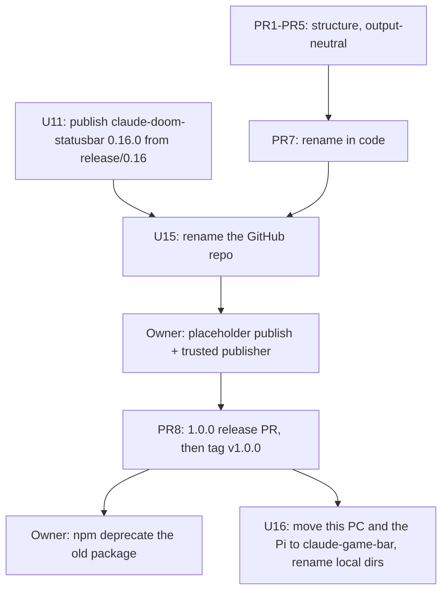

# claude-game-bar 1.0.0 - Plan

## Goal Capsule

- **Objective:** A new game for the bar is added as that game alone, without touching shared code, under a project name that belongs to no single game, while every existing user's bar keeps looking and working exactly as before.
- **Means:** restructure the repository into one general part and separate game parts, then rename the project to `claude-game-bar` (GitHub, npm, local directory) and release it as 1.0.0 (Key Decisions; KTD1).
- **Product authority:** the owner's decisions of 2026-11-13 (Key Decisions below). The second contributor has agreed to the rename.
- **Execution profile:** seven pull requests into protected `master`, one per step (PR1–PR5, PR7, PR8; KTD1), plus PR6 into a `release/0.16` branch for the old package's final 0.16.0 (U11). Inside PR3 the order is U6, U7, then U5. The owner's npm steps and the local and Pi re-wiring follow the runbook in Documentation / Operational Notes.
- **Stop conditions:** stop and ask the owner when:
  - a snapshot in `test/snapshots/` would have to change in PR1–PR5 or PR7;
  - a merged step leaves a live bar offline for longer than a daemon restart;
  - the Pi's settings would change without the owner's OK.
- **Who finishes:** this session builds and merges every PR and publishes through CI. The owner runs the npm account steps (runbook B–D) and confirms the Pi switch.
- **Open blockers:** none for implementation. Before the 1.0.0 tag, the owner bootstraps the `claude-game-bar` package and its trusted publisher (R15; runbook B).

---

## Product Contract

**Product Contract preservation:**
- **Changed:** R9 now also covers the internal protocol names: the runtime directory, the daemon pipe, the frame and payload tags and the client's function names. The owner decided this on 2026-11-13.
- **Added Key Decisions:** that one, the accepted grey window, and the release order.
- **Resolved:** the four Outstanding Questions went into KTD2, KTD12, KTD13 and U16.

### Summary

`claude-game-bar` 1.0.0 is a platform. One general part collects data from Claude Code and renders the bar, and each game (DOOM, Minecraft) is a separate part beside it, so Warcraft III arrives as a new part rather than a change to the core.
The bar looks and behaves the same as 0.15.0, existing installations move over through `install` without going dark, and the old package's last release tells its users where the bar went.

### Problem Frame

The bar started as a DOOM HUD, and the shape of the repository still says so. Every module that matters mixes general work with DOOM:
- the metric engine shares a file with DOOM sprite selection and layout dispatch;
- the general drawing primitives share a file with the DOOM box layout;
- the reaction channel between engine and games is spelled in DOOM sprite names, which the Minecraft layout parses back out.

A second game proved it can be done, and showed the cost: Minecraft duplicated primitives and went around the shared width planner.
The owner's next game is Warcraft III. On today's structure it would have to edit shared code in several places and speak DOOM sprite names to show a portrait.
The name is the same problem in public: a multi-game bar published as `claude-doom-statusbar` tells new users it is something else.
The full findings, with file-level evidence, are in `docs/ideation/2026-11-13-repo-structure-audit.md` (section 2).

### Key Decisions

- **1.0.0 contains the restructure, the neutral reaction state, the per-session render context, the game registry and the rename. It changes nothing a user can see.** Governs R1, R3, R5, R6, R8. (session-settled: user-directed — chosen over a rename-only 1.0.0 and over a 1.0.0 that waits for Warcraft III: the new structure should be in place before the next game, and the release should not wait for one.)
- **Structure first, rename last, each step its own pull request into master.** The bar is unchanged after every step, so the Raspberry Pi, which runs from master, checks each step live. Governs R6, R7. (session-settled: user-approved — chosen over renaming first, which churns files about to be split, and over one integration branch merged once, which leaves the live check to the very end.)
- **DOOM is only a look: the internal protocol names lose "doom" in 1.0.0 as well.** Governs R9. (session-settled: user-directed — chosen over keeping the internal names until a later release: the owner wants nothing but the DOOM game part to carry DOOM.)
- **A few seconds of grey while a daemon restarts on new code is accepted. It is not "offline" in the sense of R7.** Governs R7. (session-settled: user-directed — the owner accepted it on checkouts, which see it after each merged step.)
- **New games are added in this repository for now. The game interface is shaped so external game packages can be opened up in 1.x without a major version.** Governs R4. (session-settled: user-directed — chosen over keeping games repo-only for good, and over a public game API frozen at 1.0.)
- **Old names keep working for a few 1.x releases, not all of 1.x.** This covers the old preset paths as well. The release that removes them calls it a breaking change in the changelog. Governs R9, R11. (session-settled: user-directed — chosen over keeping the fallbacks until 2.0.0.)
- **The local directory is renamed with 1.0.0, not later.** Governs R12. (session-settled: user-directed — chosen over leaving the directory name for a separate later step.)
- **The old package gets a final release, then `npm deprecate`. That release ships before the GitHub repository is renamed.** Governs R16. (session-settled: user-approved — chosen over a deprecation message alone, and over publishing after the rename, which the old package's trusted publisher would refuse.)
- **That final release shows the move notice permanently in the bar.** Governs R16. (session-settled: user-directed — chosen over a temporary notice and over notices in npm and the CLI only: most users never run the CLI again and only ever see the bar.)
- **The README is rewritten in full for the new project.** Governs R13. (session-settled: user-directed — the owner added it to the scope.)

### Requirements

**Platform shape**

- R1. The general part (data collection, the metric engine, drawing primitives, the render daemon and client, hooks, the installer) holds no knowledge of any particular game. Each game keeps its layout, presets, assets and game-specific chrome in its own part. The target layout is the Output Structure below.
- R2. Adding a game means adding its part and one registry entry. Nothing in the general part changes for it.
- R3. Engine and games exchange a game-neutral reaction state. Only the DOOM part turns it into DOOM sprites.
- R4. The game interface is internal in 1.0.0 and is described in a short contributor guide in the repository.
- R5. Every session is rendered from its own explicit context. No session's frame depends on state another session's render left behind in the daemon.

**No visible change**

- R6. Every preset renders byte-identically to 0.15.0 at every tested width and reaction state, and hooks, daemon, client and installer behave as before apart from names.
- R7. A live installation never goes offline while the steps land or during the 1.x fallback period: installed settings, and the daemon identity check, keep finding the files they point at.

**Rename**

- R8. The package, the CLI and the GitHub repository are named `claude-game-bar`. The old CLI name still works as an alias.
- R9. These carry game-neutral names:
  - the environment variables;
  - the theme choice file;
  - the preset paths;
  - file names in the runtime directory;
  - the client;
  - the internal protocol names (runtime directory, daemon pipe, frame and payload tags, client function names);
  - the offline line.

  The old names a user can have set or installed (environment variables, the theme file, preset paths, the client path) are still honoured during the fallback period.
- R10. `claude-game-bar install` moves an existing installation over in place:
  - it rewrites the settings entries, the environment variable names, the preset path and the theme file;
  - it never registers a second set of hooks;
  - it leaves the old global package installed and prints how to remove it.
- R11. The stale-file sweep and `uninstall` recognise both old and new file names during the fallback period, including the old runtime directory.
- R12. The local working directory is renamed with 1.0.0. This repo's own live wiring and the Claude auto-memory move with it, so neither breaks. The Raspberry Pi's clone and its global settings change only with the owner's explicit OK.

**Documentation**

- R13. The README is rewritten for `claude-game-bar`. It presents the platform first and the games as equal parts, with DOOM as one of them. It keeps everything a user needs today:
  - install and update;
  - Windows with Git Bash;
  - themes and presets;
  - the glyph test card;
  - the OFFLINE state;
  - daemon troubleshooting;
  - uninstall.

  It adds a section on moving from `claude-doom-statusbar`, and keeps each game's credit with that game.
- R14. The package description and keywords, `CLAUDE.md` and `CONTRIBUTING.md` describe the game-neutral project. `CONTRIBUTING.md` carries the guide for adding a game (R4).

**Release**

- R15. 1.0.0 is published as `claude-game-bar` through the protected-master release flow, once the owner has set up the package and its trusted publisher on npmjs.com.
- R16. `claude-doom-statusbar` gets a final 0.16.0: 0.15.0 plus a permanent row in the bar saying the bar has moved to `claude-game-bar` and how to switch. The package is then deprecated with the same message.

**Quality**

- R17. The test suite runs every test file and reports a summary even when one fails. The daemon end-to-end test runs on its own.

### Acceptance Examples

- AE1. **Covers R10.**
  - **Given:** a settings file wired by `claude-doom-statusbar`: hooks, statusLine, and `DOOMBAR_PRESET` pointing at `presets/full.toml`, plus a saved Minecraft theme.
  - **When:** the user runs `claude-game-bar install`.
  - **Then:**
    - every entry points at the new package;
    - the variable is renamed and its preset path is the new one;
    - exactly one set of hooks remains;
    - the Minecraft theme is still selected;
    - the output says how to remove the old global package.
- AE2. **Covers R9.** **Given** a user who still sets only the old variable for the theme or preset, or whose settings still name an old preset path, **when** the bar renders under 1.0.0, **then** it honours that setting exactly as 0.15.0 did.
- AE3. **Covers R7.** **Given** the Pi running its live bar from master, **when** it pulls any merged 1.0.0 step, **then** the bar is live again within a daemon restart and exactly one daemon runs.
- AE4. **Covers R16.**
  - **Given:** a user who updates `claude-doom-statusbar` to 0.16.0.
  - **When:** the bar renders in any theme.
  - **Then:** the normal bar appears together with a row saying the bar has moved to `claude-game-bar` and how to switch, and the row stays until the user moves.
- AE5. **Covers R11.** **Given** runtime files left by 0.15.0, **when** a 1.0.0 hook sweeps or the user uninstalls, **then** those files are cleaned up exactly like the new ones.

### Success Criteria

- The snapshot tests (9 DOOM, 5 Minecraft, plus the reaction snapshots U2 adds) stay byte-identical from the first step to 1.0.0.
- The owner's PC and the Pi keep a live bar through every merged step and through the move to the new package.
- A test-only game can be registered and rendered without editing any file in the general part. This proves R2 before Warcraft III depends on it.

### Scope Boundaries

**Deferred for later (1.x):**
- the Warcraft III game (G-8, D-5);
- moving Minecraft onto the shared width planner and kit (G-4, G-5);
- the user preset overlay (G-3);
- chat as data (G-6, G-7);
- line art (D-17);
- loading games from external packages;
- removing the old-name fallbacks.

**Not in this work:**
- any visual or behavioural change, including fixes that would alter output;
- rewriting history: dated docs and old changelog entries keep their wording;
- changing the Pi's settings without the owner's OK.

**Considered and not built:**
- **Dual-name payload and frame files during the fallback.** Client and daemon always ship together, and a renamed package or directory gets a new install hash and a new daemon anyway. Evidence that would change this: an install path that runs an old client against a new daemon.
- **Sweeping the old `doombar_faces_*` cache from the old runtime directory on POSIX.** The directory is a tmpfs cleared at logout or reboot. `uninstall` removes the old directory as a whole (U13).

### Dependencies / Assumptions

- The name `claude-game-bar` is still free on npm and GitHub (checked 2026-11-13: both return 404).
- The second contributor has no open branch or pull request (checked 2026-11-13), and has agreed to the rename.
- `master` is protected: every change is a pull request with green `test` and `e2e` checks, merged with a merge commit.
- Git Bash started from tool shells on the owner's PC is failing for now (an open issue). Linux verification relies on GitHub Actions and the Pi session.
- npm cannot attach a trusted publisher to a package that does not exist yet, so the owner publishes a placeholder first. A new trusted publisher entry should be used soon after it is created (sources below).

### Sources

- `docs/ideation/2026-11-13-repo-structure-audit.md`:
  - findings S1–S10;
  - the public API at 1.0;
  - the migration hazards;
  - phasing.
- `docs/ideation/2026-10-31-shared-game-layout-engine.md`:
  - the three-layer proposal;
  - the HUD kit;
  - the rename inventory.
- `docs/BACKLOG.md`, section *Rename to `claude-game-bar` and restructure (1.0.0)*: rows R-0 to R-8.
- `CONTRIBUTING.md`, the protected-master pull request and release flow.
- npm trusted publishing:
  - https://docs.npmjs.com/trusted-publishers/;
  - the placeholder-first bootstrap: https://github.com/npm/cli/issues/8910 and https://github.com/tunnckoCoreHQ/monarch/issues/165.

---

## Planning Contract

### Key Technical Decisions

- KTD1. **Eight step PRs into master, each output-neutral, structure before rename.** This instantiates the Key Decision on step-by-step delivery (Governs R6, R7). (session-settled: user-approved — chosen over rename-first and over one integration branch.) The snapshots and the Pi gate prove each step.
- KTD2. **The entry files keep their paths. The client is renamed and the old path becomes a shim.**
  - `src/hook.js`, `src/statusline.js` and `src/daemon.js` stay where they are. Installed settings and the daemon identity check (`hook.js:174` `DAEMON_JS`, `isOurDaemon` and its Linux and `ps` variants) point at them.
  - `src/doombar-client.sh` becomes a shim that sources `src/gamebar-client.sh` and passes `"$@"` on. It starts no process, so the Windows sourced path and the POSIX exec path both keep working (R7).
- KTD3. **The package root is anchored in one top-level module.** The root is not derived from each file's depth.
  - Today `PACKAGE_ROOT` (`fold.js:93`) and the `REPO` constants in `render.js`, `face.js`, `statusline.js` and `theme.js` come from the file's own location.
  - Moving them would change the install hash, so the hook would never start the daemon, and it would also change `DAEMON_JS` and the version.
  - A top-level `src/package-root.js` owns the root, and a regression test pins `rootHash()` to `rootHash(bin/..)`.
- KTD4. **The daemon's self-restart watches `src/` recursively.** `srcSnapshot` (`daemon.js:171-177`) reads only the top level. After the move, code in subfolders would not reach running daemons without a version bump (AE3).
- KTD5. **Old preset paths resolve by basename to the new location.** `install` writes the absolute preset path into user settings (`cli.js:208`; this repo's `.claude/settings.local.json`). When that path no longer exists, a preset named `full`, `standard`, `minimal` or `minecraft` resolves through the game registry. `install` rewrites the path to the new one.
- KTD6. **One environment helper reads `GAMEBAR_x`, then `DOOMBAR_x`, and keeps each call site's semantics.**
  - Today there are 44 direct reads across 8 files, with different semantics per site: `||`, `??` (`INDENT`), `!== "0"`, `=== "1"`, `=== "off"`.
  - The client's forwarding list (`doombar-client.sh:171-172`) and `FORWARDED_ENV` (`daemon.js:43-47`) carry both spellings, so `sessionEnv` never mixes the daemon's values with a session's.
  - The test sandbox (`test/_sandbox-env.mjs`) sets both.
  - `MUGSHOT_STATE` becomes `GAMEBAR_STATE`.
- KTD7. **The neutral reaction is `{expr, exprAge, hp, god, dead}`. The DOOM part picks the idle glance from the clock.**
  - The hotbar needs the raw `expr` and `exprAge` for its 6 s hold.
  - The DOOM portrait needs `hp` and `now` for the 1.5 s decay and the idle glance.
  - `hpRow` moves to the metrics side because it reads only values.
- KTD8. **A render context replaces the module-level session state.** `VALUES`/`setValues` (`render.js:55-56`) and `_opts`/`setFaceOptions` (`face.js:22-29`) become a context passed to the layout. Content caches stay module-level, because their keys already include step and background.
- KTD9. **The internal protocol names are renamed in the rename PR, with no dual protocol.** The runtime directory becomes `gamebar`, the pipe `gamebar-<hash>`, the tags `gamebar-env` and `gamebar-frame`, and the client functions `__gamebar_*`. This instantiates the "DOOM is only a look" Key Decision (Governs R9). (session-settled: user-directed — chosen over keeping them until a later release.)
  - Checkouts see a few seconds of grey while the daemon restarts.
  - npm users get a new install path, so a new hash and a fresh daemon.
- KTD10. **Learned state is read under the old name when the new one is missing.** That state is the rate-limit pool, rate-health `k` and the savings totals. On Windows the old name is the old prefix in `%TEMP%`. On POSIX it is the same file in the old runtime directory. This passes the "stored data" test in Phase 3.8.
- KTD11. **The final 0.16.0 is built on a `release/0.16` branch from `v0.15.0` and tagged there, before the GitHub rename.** This instantiates the Key Decision on the old package (Governs R16). The branch is outside the default-branch ruleset, and the old package's trusted publisher still matches the old repository name. (session-settled: user-approved.)
- KTD12. **Tests move into per-layer folders in the move PR, as a commit of their own.** The runner (U1) finds test files recursively, so the move does not touch the runner.
- KTD13. **The 0.16.0 notice is one line after the bar, added where every layout's lines are returned.** The daemon renders through `renderSession`, so one place covers DOOM boxes, the Minecraft hotbar, the daemon frame and the one-shot render.

### High-Level Technical Design

The layers after 1.0.0. Arrows mean "imports".



Release order. The last three steps change things outside this repository.



### Output Structure

The structure as of 1.0.0. The per-unit Files lists are authoritative.

```
bin/cli.js                       claude-game-bar CLI (bins: claude-game-bar, claude-doom-statusbar)
src/
  hook.js  statusline.js  daemon.js        entry files, stable paths
  gamebar-client.sh                        client
  doombar-client.sh                        shim, sources gamebar-client.sh (fallback period)
  package-root.js                          the one root anchor (KTD3)
  render.js                                renderSession: metrics -> registry -> layout
  platform/  runtime.js env.js journal.js supervise.js sweep.js reap.js snapshots.js frame.js
  install/   settings.js shell.js emoji-font.js
  metrics/   index.js session.js activity.js tasks.js system.js savings.js ratelimits.js reaction.js
  kit/       ansi.js text.js meters.js planner.js raster/{glyphs,glyph-level,glyph-render,png}.js
  games/
    index.js                               registry
    doom/      layout.js portrait.js face.js presets/*.toml assets/mugshot/{alpha,wad}/
    minecraft/ layout.js chat.js presets/minecraft.toml
test/ platform/ metrics/ kit/ games/ install/ e2e/ snapshots/ _sandbox-env.mjs
scripts/run-tests.mjs              the test runner (R17)
assets/images/                     README images only
```

### Assumptions

- Each merged step reaches running daemons on checkouts within a daemon restart (KTD4). The owner accepts the brief grey (Key Decisions).
- Tests that need Git Bash may fail on the owner's PC while the open bash issue lasts. The Linux CI jobs and the Pi decide merges then. A local failure in a bash-dependent test is reported, not ignored.

### Sequencing

PR1 → PR2 → PR3 → PR4 → PR5 → PR7 → PR8, each merged and Pi-checked before the next starts. PR6 (0.16.0, U11) can be built at any time, but it must be published before the GitHub rename in U15.

---

## Implementation Units

### PR1: Safety net

Waits on: nothing.

### U1. Test runner that runs everything

- **Goal:** `npm test` runs every test file, reports pass and fail per file, and exits non-zero if any failed. The daemon end-to-end test stays separate.
- **Requirements:** R17.
- **Dependencies:** none.
- **Files:** `scripts/run-tests.mjs` (new), `package.json` (`test`, `test:e2e`), `CONTRIBUTING.md` (test command line).
- **Approach:**
  1. Discover `test/**/*.test.mjs` recursively in a stable sorted order, excluding `daemon-e2e`.
  2. Run each file serially as its own node process.
  3. Print one line per file and a summary.
  4. Exit 1 when any file failed.
  - `test:e2e` keeps running the e2e file alone.
  - CI (`.github/workflows/test.yml`) is unchanged because it already calls `npm test` and `npm run test:e2e`.
- **Patterns to follow:** the existing chain order in `package.json` `test`; runner scripts in `scripts/`.
- **Test scenarios:**
  - A run where every file passes prints a summary with zero failures and exits 0.
  - A run where one early file fails still runs every later file, lists the failing file in the summary and exits 1.
  - `daemon-e2e.test.mjs` is not run by `npm test`.
- **Verification:** CI `test` runs the same set of files as the old chain (compare file lists in the PR description). A deliberately failing local file does not stop the rest.

### U2. Pin reactions and the install identity

- **Goal:** characterization tests that pin what the refactor must not change and that today's snapshots miss.
- **Requirements:** R6, R7.
- **Dependencies:** none.
- **Files:** `test/render-snapshot.test.mjs`, new `test/snapshots/doom-full-120-{ouch,god,dead,kill}.txt`, `test/package-root.test.mjs` (new).
- **Approach:**
  - Add DOOM snapshots for the reaction faces at one width, generated from 0.15.0 code.
  - Add a test that `rootHash()` from the runtime module equals `rootHash` of `bin/..`.
  - Add a test that the daemon path the hook confirms is `<root>/src/daemon.js`.
- **Execution note:** characterization first. Generate the new snapshot files from unmodified 0.15.0 code before anything else in this plan changes.
- **Test scenarios:**
  - DOOM `full` at 120 columns with reaction `ouch` matches its snapshot. The same holds for `god`, `dead` and `kill`.
  - `rootHash()` equals the hash baked into an `install` statusLine command.
  - The confirmed daemon path ends in `src/daemon.js` under the package root.
- **Verification:** the new snapshots are byte-identical on Windows and on CI, with no CR.

### U3. Anchor the package root and watch subfolders

- **Goal:** moving a file can no longer change the install hash, the daemon path, the version or the asset paths, and running daemons restart when code in subfolders changes.
- **Requirements:** R7.
- **Dependencies:** U2.
- **Files:**
  - new `src/package-root.js`;
  - modified `src/fold.js`, `src/render.js`, `src/face.js`, `src/statusline.js`, `src/theme.js`, `src/daemon.js`;
  - tests `test/daemon.test.mjs` and `test/package-root.test.mjs`.
- **Approach:** per KTD3 and KTD4.
  1. Every root or `REPO` constant imports the anchor.
  2. `srcSnapshot` walks `src/` recursively.
  3. The `face.js` converter stamp lists its converter files by path from the anchor, not by sibling name (`face.js:47-48`).
- **Patterns to follow:** `fold.js` `rootHash` and `packageVersion`; the daemon's existing snapshot comparison.
- **Test scenarios:**
  - After a file in a new subfolder of a copied package changes, the copy's daemon stops on its own within the source-check interval.
  - Touching a top-level file still restarts it, as `daemon.test.mjs` does today.
  - `rootHash()` is unchanged after `src/fold.js` imports the anchor (U2's test).
- **Verification:** all snapshots are identical, and the Pi's bar stays live after the merge with one daemon (AE3).

### PR2: Layers

Waits on: PR1. Its build needs U3's root anchor, so PR1 must merge first. It is a separate PR because each step is verified live on the Pi before the next one starts (KTD1).

### U4. Move files into the layers

- **Goal:** every file that is wholly one layer moves to its layer, the entry files stay put, and the output does not change.
- **Requirements:** R1, R6, R7.
- **Dependencies:** U1, U3.
- **Files:**
  - `git mv` of `src/ansi.js`, `src/glyphs.js`, `src/glyph-level.js`, `src/glyph-render.js`, `src/png.js` → `src/kit/` (the last four under `src/kit/raster/`);
  - `src/frame.js` → `src/platform/`;
  - `src/emoji-font.js` → `src/install/`;
  - `src/face.js` → `src/games/doom/`;
  - `src/hotbar.js` → `src/games/minecraft/layout.js`;
  - `src/chat.js` → `src/games/minecraft/`;
  - every importer updated: `src/*.js`, `bin/cli.js`, `scripts/*.mjs`;
  - `.github/workflows/oneshot-cost.yml` path filters;
  - tests moved into `test/<layer>/` (KTD12).
- **Approach:**
  1. Commit 1 is the moves only.
  2. Commit 2 fixes imports and paths.
  3. Commit 3 moves the tests.
  - `src/render.js`, `src/fold.js`, `src/hook.js`, `src/statusline.js` and `src/theme.js` are split later (U5–U7, U10), not moved here.
  - `face.js` loads its sprites through the anchor (U3), so it still finds `assets/images/mugshot/`.
- **Patterns to follow:** the static `./x.js` imports used everywhere in `src`. No dynamic paths exist (research).
- **Test scenarios:**
  - Test expectation: no new behaviour. The existing suite and the snapshots pass unchanged, including the moved snapshot harness.
  - `face.test.mjs`'s source-reading and second-process import cases still find `face.js` at its new path.
- **Verification:** the full suite passes with identical snapshots, `oneshot-cost.yml` triggers on the moved files, and the Pi stays live.

### PR3: Split the mixed files

Waits on: PR2 (merge order only). It is a separate PR because each step is verified live on the Pi before the next one starts (KTD1).

### U5. Split the metric engine out of statusline.js

- **Goal:** `src/statusline.js` becomes a thin one-shot entry, the metric engine lives in `src/metrics/`, and `renderSession` lives in `src/render.js`.
- **Requirements:** R1.
- **Dependencies:** U7. `src/render.js` must first be freed by the kit split.
- **Files:**
  - new `src/metrics/{index,session,activity,tasks,system,savings,ratelimits}.js` and the new `src/render.js`;
  - modified `src/statusline.js` and `src/daemon.js`;
  - tests under `test/metrics/`.
- **Approach:**
  1. Move the code without changing behaviour:
     - `buildValues` and the advisor → `session`;
     - `activityValues` → `activity`;
     - disk tasks → `tasks`;
     - CPU, RAM and the clock → `system`;
     - lean-ctx and LLMLingua → `savings`;
     - rate limits and rate health → `ratelimits`.
  2. `metrics/index.js` assembles the values.
  3. `renderSession` moves to `src/render.js` and keeps its signature. `spriteFor` stays with it until U8.
  4. `daemon.js` imports `renderSession` from `render.js`.
  5. `statusline.js` keeps `main()`, the `ensureRuntimeDir` guard and `maybeReap`.
- **Patterns to follow:** the existing exported helpers in `statusline.js` (`buildValues`, `loadState`, `rateHeadroom` and others) keep their names.
- **Test scenarios:**
  - Every existing test that imports these helpers passes against the new modules.
  - A one-shot render through `src/statusline.js` prints the same lines as before (smoke and render-session tests).
- **Verification:** identical snapshots, and `src/statusline.js` contains no metric code.

### U6. Split the platform out of hook.js, fold.js and cli.js

- **Goal:** each platform job has its own module, and the entry files only parse input and call them.
- **Requirements:** R1.
- **Dependencies:** U4.
- **Files:**
  - new `src/platform/{runtime,journal,supervise,sweep,reap,snapshots}.js` and `src/install/{settings,shell}.js`;
  - modified `src/hook.js` and `bin/cli.js`;
  - `src/fold.js` removed after its parts move;
  - tests under `test/platform/` and `test/install/`.
- **Approach:**
  - From `fold.js`:
    - runtime dir, paths, sockets, process identity and `writeAtomic` → `runtime`;
    - the event reducer → `journal`.
  - From `hook.js`:
    - claims, identity and restart → `supervise`;
    - the stale state sweep and session end → `sweep`;
    - the shell reaper → `reap`;
    - git and MSYS snapshots → `snapshots`.
  - From `cli.js`:
    - settings read, merge and write plus entry detection → `install/settings`;
    - bash detection and the client command → `install/shell`.
  - `daemon.js` keeps spawning `src/hook.js` for the reaper (`daemon.js:86`).
- **Patterns to follow:** today's exported names (`claimRestart`, `confirmedDaemonPid`, `staleStateFiles` and others) stay exported from their new modules.
- **Test scenarios:**
  - The daemon-restart, journal-sweep, session-end, installer and runtime-dir tests pass against the new modules.
  - A hook event through `src/hook.js` still appends to the journal and supervises the daemon (hook-tasks, daemon-restart).
- **Verification:**
  - the Windows suite passes, and the daemon e2e passes run alone;
  - CI `test` and `e2e` are green;
  - the Pi stays live.

### U7. Split render.js into the kit and the DOOM layout

- **Goal:** the drawing primitives and the width planner live in `src/kit/`, and the DOOM box layout lives in `src/games/doom/layout.js`.
- **Requirements:** R1.
- **Dependencies:** U4.
- **Files:**
  - new `src/kit/{text,meters,planner}.js` and `src/games/doom/layout.js`;
  - `src/render.js` emptied for U5;
  - tests under `test/kit/` and `test/games/doom/`.
- **Approach:**
  - `vlen`, links, `marquee` and `scrollWindow` → `text`.
  - Bars, ammo, icons, spark, equalizer and colour stops → `meters`.
  - `planLayout`, `resolvePreset`, `textCapFor` and `metricFixedWidth` → `planner`.
  - `buildBar`, `layoutContext` and `hpRow` → DOOM layout. `hpRow` moves on to metrics in U8.
  - The module-level `VALUES` stays where `setValues` puts it until U9.
  - The preview CLI (`render.js main`) moves with the layout.
- **Patterns to follow:** existing exported names.
- **Test scenarios:**
  - The render-scroll, render-equalizer, layout, preset-bands and resolve-preset tests pass with only their imports changed.
- **Verification:** identical snapshots.

### PR4: Neutral reaction and render context

Waits on: PR3 (merge order only). It is a separate PR because each step is verified live on the Pi before the next one starts (KTD1).

### U8. Neutral reaction state

- **Goal:** the engine hands games a game-neutral reaction, and only the DOOM part knows sprite names.
- **Requirements:** R3, R6.
- **Dependencies:** U5, U7.
- **Files:**
  - new `src/metrics/reaction.js` and `src/games/doom/portrait.js`;
  - modified `src/render.js`, `src/games/doom/layout.js`, `src/games/minecraft/layout.js`, `src/kit/planner.js`;
  - tests `test/metrics/reaction.test.mjs` and `test/games/render-snapshot.test.mjs`.
- **Approach:** per KTD7.
  1. `reaction.js` computes `{expr, exprAge, hp, god, dead}` from the folded state, the values, the god flash and exhaustion. Today that happens in `spriteFor` and `hpRow`.
  2. `portrait.js` maps the reaction plus `now` to the `STF*` sprite and the idle glance.
  3. The hotbar reads `god`, `dead`, `expr` and `exprAge` directly. `spriteExpr` goes.
  4. The planner and the layouts take the reaction instead of a `spriteFor` callback, and the kit's `STFST…` defaults go.
  5. The snapshot harness passes reactions instead of sprite callbacks. The `.txt` files do not change.
- **Test scenarios:**
  - Each folded expression (`ouch`, `kill`, `evl`, `tl`, `tr`) within 1.5 s yields that `expr` with its age.
  - After 1.5 s the DOOM portrait shows the idle glance and the hotbar still holds its slot for 6 s.
  - Exhausted limits yield `dead`, and an active god flash yields `god`. `dead` wins over `god`, as today.
  - DOOM maps `{expr: "ouch", hp: 2}` to `STFOUCH2`, and `{dead: true}` to `STFDEAD0`.
  - All U2 reaction snapshots and the Minecraft ouch and exhausted snapshots are unchanged.
- **Verification:** `grep -r STF src` finds hits only under `src/games/doom/`.

### U9. Per-session render context

- **Goal:** each session renders from a context passed in, so two sessions' renders can no longer leak values or face options into each other.
- **Requirements:** R5, R6.
- **Dependencies:** U8.
- **Files:**
  - modified `src/render.js`, `src/kit/*.js`, `src/games/doom/{layout,face}.js`, `src/games/minecraft/layout.js`, `src/daemon.js`;
  - the roughly 9 tests that call `setValues` or `setFaceOptions` (render-snapshot, preset-bands, render-equalizer, render-scroll, resolve-preset, layout, theme, statusline-savings and others).
- **Approach:** per KTD8.
  1. The context carries values, glyph step, background, tick, overflow and the reaction.
  2. Layouts and kit functions read it instead of `VALUES` and `_opts`.
  3. `setValues` and `setFaceOptions` go.
  4. The daemon's `runPass` passes one context per session.
- **Test scenarios:**
  - Two sessions rendered one after the other with different values and glyph steps each get exactly their single-session output. This is the daemon case.
  - Rendering session B between building and printing session A does not change A's lines.
  - Snapshots are unchanged.
- **Verification:** `grep` finds no module-level `let` holding session data in `src/`.

### PR5: Game registry

Waits on: PR4 (merge order only). It is a separate PR because each step is verified live on the Pi before the next one starts (KTD1).

### U10. Game registry, per-game presets and assets

- **Goal:** games register in one place, carry their own presets and assets, and a new game needs only its folder and one registry entry.
- **Requirements:** R1, R2, R4, R7, R14 (contributor guide).
- **Dependencies:** U8, U9.
- **Files:**
  - new `src/games/index.js`;
  - modified `src/theme.js` (it reads the registry);
  - modified `src/render.js` (layout comes from the registry, not `if layout === "hotbar"`);
  - `git mv presets/*.toml` → `src/games/doom/presets/` and `src/games/minecraft/presets/`;
  - `git mv assets/images/mugshot` → `src/games/doom/assets/mugshot`;
  - `bin/cli.js` (test-card asset path, preset path);
  - `package.json` `files`;
  - `CONTRIBUTING.md` (adding a game);
  - tests `test/games/registry.test.mjs`, `test/games/fixture-game/` (test only), `test/install/installer.test.mjs`.
- **Approach:**
  - Each registry entry carries a name, a blurb, aliases, a layout and presets.
  - `THEMES` and `themePreset` derive from the registry.
  - `loadPreset` keeps the KTD5 fallback: an old `<root>/presets/<name>.toml` path resolves by basename.
  - `install` writes the new preset path.
  - README images stay in `assets/images/`.
  - The guide in `CONTRIBUTING.md` describes the interface as internal (R4).
- **Execution note:** add the fixture-game test first. It is the proof for R2 and the Success Criteria.
- **Test scenarios:**
  - A fixture game registered in a test, with its own layout and preset, renders without any change outside its folder and the registry call.
  - Covers AE2: a settings path `<root>/presets/full.toml` still renders DOOM `full` identically.
  - `theme next` cycles doom → minecraft → doom as before, and the `minecraft-hud` alias still resolves.
  - `install` writes `src/games/doom/presets/full.toml`.
  - The test card finds the mugshot PNG at its new path.
- **Verification:**
  - snapshots are identical;
  - `npm pack --dry-run` lists the moved presets and assets;
  - the Pi, whose settings name `presets/full.toml`, stays live.

### PR6: Final release of the old package (branch `release/0.16`, not into master)

Waits on: nothing. It is a separate PR because it ships a different package line from `v0.15.0`, and the final release must be published before the GitHub rename (KTD11).

### U11. claude-doom-statusbar 0.16.0 with the move notice

- **Goal:** users of the old package see, permanently in their bar, that it moved and how to switch.
- **Requirements:** R16.
- **Dependencies:** none (built from tag `v0.15.0`).
- **Files:**
  - `src/statusline.js` (`renderSession` appends the notice line, KTD13);
  - `bin/cli.js` (`install` and `uninstall` print the notice);
  - `README.md` (moved banner);
  - `CHANGELOG.md`;
  - `package.json` (0.16.0);
  - `test/snapshots/*` regenerated on this branch only;
  - `test/render-session.test.mjs`.
- **Approach:**
  1. One dim line after the bar: `claude-doom-statusbar has moved to claude-game-bar: npm i -g claude-game-bar && claude-game-bar install`. Every layout returns it, and so does the daemon frame.
  2. A pull request into `release/0.16` with the checks green.
  3. Tag `v0.16.0` on that branch, as KTD11 describes. `publish.yml` publishes it.
- **Test scenarios:**
  - Covers AE4: the DOOM `full`, `minimal` and Minecraft renders each end with the notice line, and every other line is unchanged.
  - The one-shot render and the daemon frame both carry the notice.
- **Verification:**
  - `npm view claude-doom-statusbar version --prefer-online` shows 0.16.0;
  - an install of 0.16.0 in a sandbox shows the notice row.

### PR7: Rename

Waits on: PR5 (merge order only). It is a separate PR because each step is verified live on the Pi before the next one starts (KTD1).

### U12. Game-neutral names with fallbacks

- **Goal:** every name in code, files and protocol is game-neutral, and every old name a user can have set or installed still works.
- **Requirements:** R8, R9, R7.
- **Dependencies:** U10.
- **Files:**
  - new `src/platform/env.js`, `src/gamebar-client.sh` (renamed from `doombar-client.sh` with `git mv`) and the shim `src/doombar-client.sh`;
  - modified `src/platform/runtime.js`, `src/platform/frame.js`, `src/daemon.js`, `src/hook.js`, `src/statusline.js`, `src/render.js`, `src/theme.js`, every module with a `DOOMBAR_` read;
  - `package.json` (name, bins, description, keywords, repository, homepage, bugs);
  - `test/_sandbox-env.mjs`, `test/platform/*`, `test/client.test.mjs`, `scripts/measure-client.mjs`, `.github/workflows/oneshot-cost.yml`.
- **Approach:** per KTD2, KTD6, KTD9 and KTD10.
  - Environment variables:
    - `env.js` reads `GAMEBAR_x`, then `DOOMBAR_x`;
    - every read site keeps its semantics;
    - the client and `FORWARDED_ENV` forward both spellings.
  - Runtime names:
    - the prefixes become `gamebar_*` (for `mugshot_*` and `doombar_faces_*`);
    - the runtime directory becomes `gamebar`, the pipe `gamebar-<hash>`, the tags `gamebar-env` and `gamebar-frame`, and the functions `__gamebar_*`;
    - the offline line reads `gamebar: offline`.
  - Learned state is read under the old name when the new one is missing.
  - The theme file becomes `~/.claude/gamebar-theme.json`, read from the old file when the new one is missing.
  - Binaries: `claude-game-bar`, plus `claude-doom-statusbar` as an alias.
- **Test scenarios:**
  - Covers AE2: with only `DOOMBAR_THEME=minecraft` set, the bar renders Minecraft. With both names set, `GAMEBAR_THEME` wins.
  - `DOOMBAR_INDENT=""` and `GAMEBAR_INDENT=""` keep the `??` semantics, and `DOOMBAR_RATELIMITS_SHARE=0` still turns sharing off.
  - A session forwarding `DOOMBAR_PRESET` renders with it in the daemon, even when the daemon inherited a different `GAMEBAR_PRESET`.
  - The shim at `src/doombar-client.sh`:
    - sourced with `DOOMBAR_ROOT_HASH` (Windows form), it prints the live frame;
    - exec'd with the hash as `$1` (POSIX form), it prints the live frame;
    - it starts no process.
  - With only `mugshot_ratelimits_global.json` present, the shared rate limits load. With only the old theme file, the saved theme is used.
- **Verification:**
  - snapshots are identical;
  - `grep -ri doom src` finds hits only under `src/games/doom/`, in the shim and in the fallback name lists;
  - the Pi turns live again after the merge with one daemon.

### U13. Installer migration, sweep and uninstall for old and new names

- **Goal:** `claude-game-bar install` takes over an old installation cleanly, and leftovers under old names are cleaned up.
- **Requirements:** R10, R11.
- **Dependencies:** U12.
- **Files:**
  - `src/install/settings.js`, `src/install/shell.js`, `bin/cli.js`;
  - `src/platform/sweep.js`, `src/platform/reap.js`;
  - tests `test/install/installer.test.mjs`, `test/platform/journal-sweep.test.mjs`, `test/platform/session-end.test.mjs`.
- **Approach:**
  - The entry marks recognise old and new hook, client and statusline paths, including another package root such as the old global npm path.
  - Old hook entries are re-pointed, never duplicated.
  - `env.DOOMBAR_*` is renamed to `GAMEBAR_*`, and the old preset path is rewritten.
  - The old theme file is migrated.
  - When a `claude-doom-statusbar` global package is found, the installer prints `npm uninstall -g claude-doom-statusbar`.
  - The sweep and `uninstall` match old and new prefixes, and `uninstall` also removes the old runtime directory candidates.
  - The reaper matches both client names.
- **Test scenarios:**
  - Covers AE1: a settings file wired by 0.15.0 from another package root, with `DOOMBAR_PRESET` and a Minecraft theme file, ends up after `install` with:
    - new entries;
    - exactly one hook set per event;
    - `GAMEBAR_PRESET` at the new path;
    - Minecraft still selected;
    - the removal hint printed.
  - Re-running `install` changes nothing.
  - Covers AE5: `mugshot_*` and `doombar_faces_*` files older than the TTL are swept like `gamebar_*` files, and `uninstall` removes the old-prefix daemon files.
  - `uninstall` after the migration removes every entry and the env names.
- **Verification:** the installer test passes on Windows and on CI, and this PC's `.claude/settings.local.json` migrates in a dry run against a copy.

### U14. README, CLAUDE.md and CONTRIBUTING rewritten for the new project

- **Goal:** the documentation describes `claude-game-bar` as a platform with games as equal parts.
- **Requirements:** R13, R14.
- **Dependencies:** U12, U13.
- **Files:** `README.md`, `CLAUDE.md`, `CONTRIBUTING.md`, `RELEASING.md`, `package.json` description and keywords (if not already done in U12), `docs/BACKLOG.md`.
- **Approach:**
  - The README covers:
    - the platform in one paragraph, with what it shows;
    - games as equal sections (DOOM, Minecraft), each with its credit;
    - install and update;
    - Windows with Git Bash;
    - themes, presets and the test card;
    - how it works (daemon and client);
    - OFFLINE;
    - troubleshooting;
    - moving from `claude-doom-statusbar`;
    - uninstall.
  - The README images stay.
  - `CLAUDE.md` gets the new title and overview and keeps its language rules. The claude-evolve managed block is untouched.
- **Test scenarios:**
  - Test expectation: none. This is documentation only.
  - Check every command in the README against the CLI's actual commands and flags.
- **Verification:** the README contains no `claude-doom-statusbar` except in the migration section and the alias note. Every command it shows exists.

### PR8: Release 1.0.0

Waits on: PR7, and U15's GitHub rename and the owner's runbook step B. The rename and the npm setup must be in place before the tag can publish.

### U15. GitHub rename and the 1.0.0 release

- **Goal:** `claude-game-bar` 1.0.0 is published from master through CI.
- **Requirements:** R8, R15.
- **Dependencies:** U11 published, U14 merged.
- **Files:** `CHANGELOG.md`, `package.json`, `package-lock.json`, `docs/BACKLOG.md`.
- **Approach:**
  1. `gh repo rename claude-game-bar`. Then update the `origin` URL locally and ask the Pi session to do the same, with no change to its settings. This happens after U11 is published.
  2. The owner runs runbook B and confirms.
  3. Release PR per `CONTRIBUTING.md`, *Releasing*:
     - the changelog as its own commit, covering 1.0.0 with migration notes and the fallback list;
     - `npm version major --no-git-tag-version`;
     - merge once green.
  4. Tag `v1.0.0` on master and push only the tag.
  5. Watch `publish.yml`, then check the registry with `--prefer-online`.
  6. Move the backlog rows R-1 to R-8 to Done.
- **Test scenarios:** Test expectation: none beyond the release workflow's own `prepublishOnly` run.
- **Verification:**
  - `npm view claude-game-bar version --prefer-online` shows 1.0.0, with provenance from `99LevelsUp/claude-game-bar`;
  - `gh repo view 99LevelsUp/claude-game-bar` works, and the old URL redirects.

### U16. Move the owner's machines and directories

- **Goal:** this PC and the Pi run `claude-game-bar`, and the local directory, the wiring and the Claude memory carry the new name.
- **Requirements:** R12, R10.
- **Dependencies:** U15.
- **Files:**
  - outside the repo: `~/.claude/settings.json`, this repo's `.claude/settings.local.json`, and the Claude auto-memory directory for this project;
  - in the repo: none.
- **Approach:** the order below keeps the bar on this PC from ever pointing at a missing path.
  1. `npm i -g claude-game-bar`, then `claude-game-bar install` for the global wiring.
  2. Verify the bar, then `npm uninstall -g claude-doom-statusbar`.
  3. Close the sessions that run from this checkout. The owner does this.
  4. Rename `D:\Smeti\Dev\Claude\claude-doom-statusbar` to `D:\Smeti\Dev\Claude\claude-game-bar`.
  5. Run `node bin/cli.js install --local` from the new path.
  6. Move the auto-memory directory to the slug of the new path.
  7. Reopen.
  8. For the Pi, with the owner's OK: rename its clone directory, run `install` from it, and confirm the bar is live with exactly one daemon.
- **Test scenarios:** Test expectation: none. This is an operational step, checked by the verifications below.
- **Verification:**
  - both machines show a live bar with exactly one daemon;
  - `settings.json` differs from its backup only in the bar's entries;
  - the memory index loads in a new session at the new path.

---

## Verification Contract

| Gate | How | Applies to |
|---|---|---|
| Unit and integration suite | `npm test` (U1 runner). On the owner's PC run it at below-normal priority, with the scratchpad runner `runtests.ps1` | every PR |
| Daemon end to end | `npm run test:e2e`, alone, never at the same time as anything else | PR1–PR5, PR7 |
| Snapshot freeze | `git diff --exit-code -- test/snapshots` against the branch base after the run | PR1 (after U2 adds files), PR2–PR5, PR7 |
| CI | GitHub Actions `test` and `e2e` green (they are required by the ruleset) | every PR into master and `release/0.16` |
| Live check | after each merge, the Pi session pulls master and reports: bar live, exactly one `daemon.js`, nice 10 | PR1–PR5, PR7, PR8 |
| Registry | `npm view <pkg> version --prefer-online` and `gh run watch` on `Publish to npm` | U11, U15 |
| Leftover names | `grep -rniE "doom|STF" src` hits only `src/games/doom/`, the client shim and the fallback name lists | after U12 |

---

## Definition of Done

- Every unit's Verification holds, and the Success Criteria hold: snapshots unchanged, live bars throughout, and the fixture game rendered with no change to the general part.
- `claude-game-bar` 1.0.0 is on npm, the repository is `99LevelsUp/claude-game-bar`, and `claude-doom-statusbar` 0.16.0 is published and deprecated.
- This PC and the Pi run `claude-game-bar`. The local directory and the memory use the new name.
- `docs/BACKLOG.md` lists R-1 to R-8 as done in 1.0.0, and the CHANGELOG lists every fallback with the note that it will be removed in a later 1.x release marked breaking.
- No dead code from abandoned approaches remains in the diff. Shims and fallbacks exist only where KTD2, KTD5, KTD6 or KTD10 name them.

---

## Documentation / Operational Notes

### Owner runbook (npm steps need the owner's npm login)

**A. Before U15:** nothing. Wait for the go.

**B. Create the `claude-game-bar` package and its trusted publisher.** Do this after the GitHub rename, just before the 1.0.0 tag.

```powershell
npm login
$d = Join-Path $env:TEMP "cgb-bootstrap"; New-Item -ItemType Directory -Force $d | Out-Null; Set-Location $d
@'
{
  "name": "claude-game-bar",
  "version": "0.0.1",
  "description": "Placeholder. The first release is 1.0.0.",
  "license": "MIT",
  "repository": { "type": "git", "url": "git+https://github.com/99LevelsUp/claude-game-bar.git" }
}
'@ | Set-Content -Encoding utf8 package.json
npm publish --access public
npm view claude-game-bar version
```

Then on npmjs.com:
1. Open package **claude-game-bar** → **Settings** → **Trusted Publisher** → **GitHub Actions**.
2. Fill in:
   - Organization or user: `99LevelsUp`
   - Repository: `claude-game-bar`
   - Workflow filename: `publish.yml`
   - Environment name: `npm`
3. If allowed actions are offered, keep **publish** allowed, not stage only.
4. Save and report back.

**C. Deprecate the old package, after 1.0.0 is out.**

```powershell
npm deprecate claude-doom-statusbar "Moved to claude-game-bar. Run: npm i -g claude-game-bar; claude-game-bar install"
npm view claude-doom-statusbar deprecated
```

**D. Close the sessions running from this checkout** when U16 asks for the directory rename.

### Second contributor

Tell `mostodont01` before PR2 lands: the tree moves, and later the repository name and package name change. GitHub redirects the old URL, and `git remote set-url origin https://github.com/99LevelsUp/claude-game-bar.git` updates a clone.
