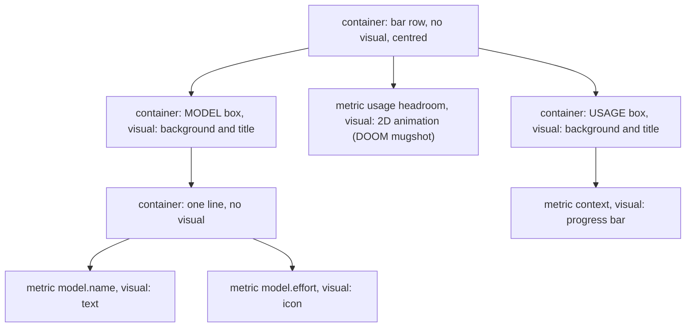

# Games as Skins - Plan

## Goal Capsule

- **Objective:** a new look for the bar, whether a new game such as Warcraft III or a user's own mix, is made from data, scripts and assets alone, out of one shared set of bar elements, without writing a new layout in the platform. A user can compose, name and keep their own bar, and only the assets the chosen skins need are installed.
- **Product authority:** the owner (Petr Skypala), in the brainstorm of 2026-11-16.
- **Open blockers:** none.

---

## Product Contract

### Summary

The bar becomes a tree of shared elements: containers that lay out their children, with or without a visual of their own, and metric elements that always draw a value in one of a defined set of visuals. A skin describes that tree as data, binds metrics, sets the visual parameters and attaches scripts that may change any element before it is drawn. A game is a folder of assets, scripts, conversation libraries and bundled skins; standard assets are published to npm and installed on demand.

### Problem Frame

Today a game is code. `src/games/doom/layout.js` draws a row of boxes around the mugshot and uses the kit's width planner and preset fallback chain; `src/games/minecraft/layout.js` draws hearts, hunger, the XP bar, a 9-slot hotbar and the chat with its own fitting, its own width logic and a hard-coded palette, glyphs and frame characters, and uses neither the planner nor the fallback chain. The two games show the same metrics and react to the same game-neutral reaction, yet each draws its own elements.

That costs three things. Every new game (Warcraft III is next) means another layout written from scratch. A user cannot combine elements across games or change much beyond the metric bindings, and the README tells users to edit preset files inside the package, which an update overwrites. And a visual configurator (backlog G-11) would have to be written separately for each game, because nothing describes what a game's bar is made of.

The ideation of 2026-10-31 (`docs/ideation/2026-10-31-shared-game-layout-engine.md`) proposed a shared HUD kit under thin per-game layouts with fixed sockets. The owner has since chosen a different model: no per-game skeleton at all, only shared elements composed by skins.

### Key Decisions

- **A game is assets plus skins; the layout is free composition of shared elements.** (session-settled: user-directed — chosen over a fixed per-game skeleton with named sockets: every element is shared, so the next game and a user's own bar are composition, not code.) Governs R1, R13, R24.
- **Two element kinds: containers and metrics.** A container may or may not have a visual; a metric always has one. (session-settled: user-directed — chosen over separate layout-only and visual container kinds: a centring container and a titled box differ only in having a visual.) Governs R1, R2, R3.
- **A skin is a tree of containers, described as data, in the spirit of XAML.** (session-settled: user-approved — chosen over a cell grid and over "everything is a box": it extends today's box row and width planner, carries Minecraft and Warcraft III, and suits a tree-shaped configurator.) Governs R7.
- **The game ships skins; the user composes, saves and names their own.** (session-settled: user-directed — chosen over a layout owned by the platform or one fixed per user: the game delivers assets plus containers and metrics, the user may keep their own variants.) Governs R10, R11.
- **Scripts can come from anywhere and hook any visual element.** (session-settled: user-directed — chosen over scripts only in games bundled with the package: the owner wants to ship scripts for anything he thinks of.) This ends the earlier principle that nothing in configuration is executed. Governs R17, R18, R19.
- **A skin may use assets of any game.** (session-settled: user-approved — chosen over assets of the skin's own game only: a DOOM mugshot can sit in a Minecraft-styled bar.) Governs R8.
- **Narrow terminals use both priorities and a smaller skin.** (session-settled: user-directed — chosen over priorities alone and over a fallback chain alone.) Governs R9.
- **Bundled skins need not match today's output.** (session-settled: user-directed — chosen over a byte-for-byte match and over "the same in broad strokes": the move is a chance to redo both games.) Governs R25.
- **Old presets break.** (session-settled: user-directed — chosen over a one-time conversion and over reading the old format forever: few users have their own presets, and the changelog tells them how to rebuild.) Governs R26.
- **What no longer holds in a user's skin is skipped with a warning.** (session-settled: user-directed — chosen over a versioned format with automatic migration and over a hard break.) Governs R12.
- **Assets on demand belong to this work.** (session-settled: user-directed — chosen over leaving backlog G-10 for later.) Governs R14, R15, R16.
- **The chat is a standard element fed by conversation libraries.** (session-settled: user-directed — chosen over a chat script owned by one game: the first library is questions and answers about the metrics; a skin can drop, change or add conversations.) Governs R22, R23.
- **A failing script never takes the bar down.** A user's script runs in the render daemon on every redraw, so one slow or broken script would otherwise blank every session the daemon serves. Governs R20, R21.

The diagram shows part of today's DOOM bar as an element tree: the bar is a container without a visual, the MODEL box is a container with one, and the first line of that box is again a container without a visual holding two metric elements.

### Requirements

**Elements**

- R1. The bar is a tree of two element kinds: containers and metric elements.
- R2. A container lays out its children side by side or one under another, can be nested, and decides how its children shrink and drop when the width changes; it may have a visual (frame, title, background) or none.
- R3. A metric element shows one value and always has a visual from a defined set: text, number, progress bar, graph (sparkline, equalizer), icon row, scrolling list, and animation (2D frames, 3D model).
- R4. Every element type, every visual and each of their parameters has a machine-readable description (name, meaning, allowed values), complete enough to drive the configurator of backlog G-11.
- R5. Every metric in the catalogue has an id, a human-readable name and a value type (percentage, number, text, list, time series).
- R6. Every visual declares which value types it can show, so a progress bar is offered only for a percentage and a graph only for a time series.

**Skins**

- R7. A skin is a named tree of elements described as data: metric bindings, visual parameters (glyphs, colours, frames, icons), priorities, script bindings and asset references.
- R8. A skin may reference assets of any game.
- R9. When the terminal is too narrow, elements first shrink to their minimum width, then drop in the order of the priorities the skin gives them, lowest first; if the skin still does not fit, the bar switches to the smaller skin it names.
- R10. The user chooses the active skin by name; this replaces today's theme switch.
- R11. The user can save a skin under their own name; an update replaces the bundled skins and never changes a user's skin.
- R12. A part of a user's skin that no longer holds after an update (an unknown element, parameter or metric) is skipped with one warning, and the rest of the skin is drawn.

**Games and assets**

- R13. A game is a folder of assets (images, models, sounds), scripts, conversation libraries and bundled skins; adding a game changes no platform code.
- R14. Standard assets are published to npm by the project and installed only from that source, on demand: the assets the active skins reference are installed, and assets no active skin references any more are removed.
- R15. An asset folder committed to the repository is published to npm as a new asset batch by GitHub Actions.
- R16. A user who wants their own assets puts them in the folder of their own skin; the bar uses them from there and never fetches assets from anyone else.

**Scripts**

- R17. Every visual element can run a script before it is drawn, and the script can change that element's visual.
- R18. An element type may require a script (an animation needs one to pick the frame or model from its inputs) or come with a default script that a skin can replace with its own.
- R19. Scripts may come from any game folder or skin folder, bundled or the user's own.
- R20. A script that throws or exceeds its time budget does not break the bar or any other element: its element falls back to its default visual and the bar shows a warning.
- R21. The bar runs scripts only from folders installed on the machine; it never downloads code from anywhere but the project's own npm packages.

**Chat**

- R22. The chat is a standard element whose property is the set of conversations it plays, taken from conversation libraries; the project ships a first library of questions and answers about the metrics.
- R23. A skin can drop, change or add conversations of a library it uses.

**Existing games and the release**

- R24. DOOM and Minecraft are rebuilt as game folders with skins; what is specific to them lives in their scripts (the mugshot's frame selection, Minecraft's highlighted hotbar cell that jumps to the last event and otherwise wanders).
- R25. The rebuilt skins may look different from today's output; the snapshot tests are recorded again and the owner reviews the result by eye.
- R26. Preset files in today's format stop working; the release is a major version, and its changelog tells users how to rebuild their own presets as skins.
- R27. The glyph step and the line level stay settings of the platform per terminal, not of a skin.

### Key Flows

- F1. A user builds their own mixed skin
  - **Trigger:** the user wants the DOOM mugshot next to a Minecraft hotbar.
  - **Steps:** the user copies a bundled skin under their own name, edits its element tree to add the mugshot animation that references DOOM's assets, and chooses the skin by name; the bar installs DOOM's assets if they are missing and draws the skin.
  - **Covered by:** R7, R8, R10, R11, R14
- F2. An update arrives
  - **Trigger:** the user upgrades the package.
  - **Steps:** bundled skins are replaced; user skins stay as they are; parts of a user skin that no longer hold are skipped with a warning; assets no active skin references are removed.
  - **Covered by:** R11, R12, R14
- F3. A script fails while the bar draws
  - **Trigger:** a skin's script throws or runs past its time budget.
  - **Steps:** the element draws its default visual, every other element draws normally, and the bar shows a warning naming the script.
  - **Covered by:** R20

### Acceptance Examples

- AE1. Covers R9. **Given** a skin whose elements at minimum width need 140 columns and whose AGENTS box has the lowest priority, **when** the terminal is 120 columns wide, **then** the AGENTS box is dropped first; **when** the terminal is 60 columns wide and the skin still does not fit after every droppable element is gone, **then** the bar draws the smaller skin the skin names.
- AE2. Covers R12. **Given** a user skin that binds a metric the update removed, **when** the bar draws it, **then** that metric element is skipped, one warning names it, and every other element is drawn.
- AE3. Covers R20. **Given** a skin whose hotbar highlight script never returns, **when** the time budget passes, **then** the hotbar draws without a highlighted cell, the rest of the bar is unchanged, and the bar shows a warning.
- AE4. Covers R14. **Given** a user switches from a DOOM skin to a Minecraft skin and no other active skin references DOOM's assets, **when** the switch completes, **then** Minecraft's assets are installed if missing and DOOM's assets are removed.
- AE5. Covers R8, R24. **Given** a user skin with the DOOM mugshot animation inside a Minecraft-styled container, **when** the reaction turns to "ouch", **then** the mugshot shows its hurt frame chosen by DOOM's selection script.

### Success Criteria

- DOOM and Minecraft exist only as game folders with skins, scripts and assets; the platform has no layout code specific to either.
- A user can build a mixed skin, save it under their own name, and an update leaves it untouched.
- The descriptions of elements, visuals and metrics (R4, R5, R6) are enough to build the configurator of G-11 without code written per game.
- A small test game added as a folder alone, with no change to platform code, draws in the bar.

### Scope Boundaries

**Deferred for later**

- Warcraft III itself; this work only defines the 3D animation visual it will use.
- The visual configurator (backlog G-11), which this work prepares for.
- Playing sounds (backlog F-4); a game may ship sounds, nothing plays them yet.
- A declarative table from inputs to animation frames instead of a selection script.
- Converting old preset files automatically.

**Not in this work**

- Behaviour without a network connection: the bar runs inside Claude Code, which itself needs one.
- Installing assets or scripts from anyone but the project; user assets live only in the user's own skin folder (R16), and scripts come only from installed folders (R21).

<!-- ce-section: work-relationships -->
### How This Work Fits Together

This plan covers the element model, skins, scripts, conversation libraries and assets on demand. The breakdown below is the current understanding, not a committed roadmap.

- Shared HUD kit (G-4) and the hotbar on the shared width planner (G-5): absorbed; the shared elements of R1–R6 replace the kit, and Minecraft uses the shared width behaviour of R9.
- User preset overlay (G-3): replaced by user skins (R11).
- Assets on demand (G-10): part of this work (R14–R16).
- Chat as data and chat packs (G-6, G-7): this work makes the chat a standard element with conversation libraries (R22, R23); the declarative condition language and the conversation order of G-9 are still to decide.
- Visual configurator (G-11): depends on this work's element, visual and metric descriptions.
- Warcraft III (G-8, D-5, D-6): depends on this work; adds a 3D animation, a minimap and its own skins.
- Line art in the renderer (D-17): can proceed independently of this work; its glyph-set choice stays a terminal setting (R27).

### Dependencies / Assumptions

- npm is available wherever the bar is installed, so standard assets can be installed on demand.
- The earlier decision that Warcraft III's art is the project's own and not Blizzard's still holds.

### Outstanding Questions

**Deferred to Planning**

- What an animation receives as input (the reaction, bound metrics, time) and what its selection script returns; the owner does not have a definition yet.
- Whether a skin may hold several chat elements with different conversation sets; the owner is undecided, and R22 already allows each chat element its own set.
- How asset batches are named and versioned on npm, and how an on-demand install works under a global install.
- The language and interface of scripts, and the time budget of R20.
- The file format of skins and where user skins are stored.
- How a skin references an asset of another game.

### Sources / Research

- `docs/ideation/2026-10-31-shared-game-layout-engine.md`: the earlier HUD kit and socket proposal this work replaces, and the chat packs proposal it builds on.
- `docs/BACKLOG.md`: G-3 to G-11, D-5, D-6, D-17, F-4.
- `src/games/doom/layout.js`, `src/games/minecraft/layout.js`, `src/games/minecraft/chat.js`, `src/games/doom/portrait.js`: what each game draws itself today.
- `src/kit/planner.js`: today's width planner and preset fallback chain.
- `src/kit/meters.js`: today's metric visuals (`bar`, `ammo`, `icons`, `spark`, `equalizer`, `list`, text and number); `scroll` is handled in the DOOM layout and the planner.
- `src/metrics/reaction.js`: the game-neutral reaction both games read.
- `src/theme.js`, `src/games/index.js`, `CONTRIBUTING.md`: today's theme switch, game registry and the note that the game interface is internal.
