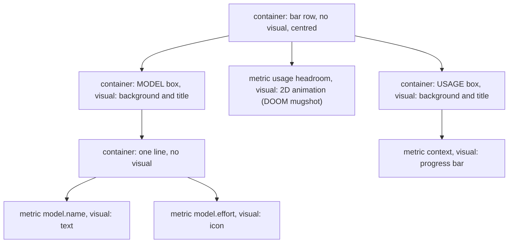
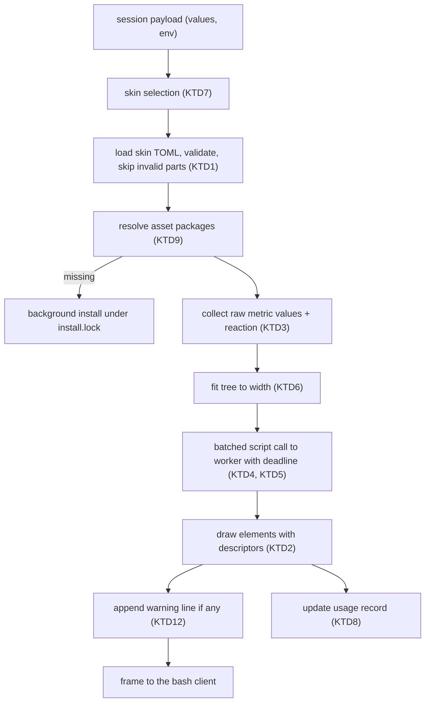
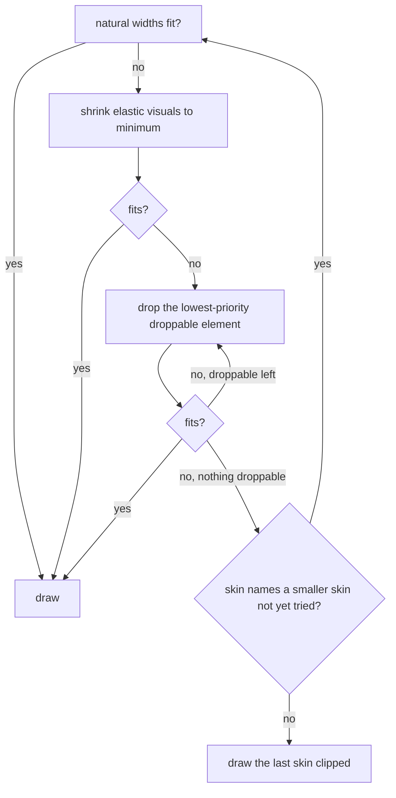
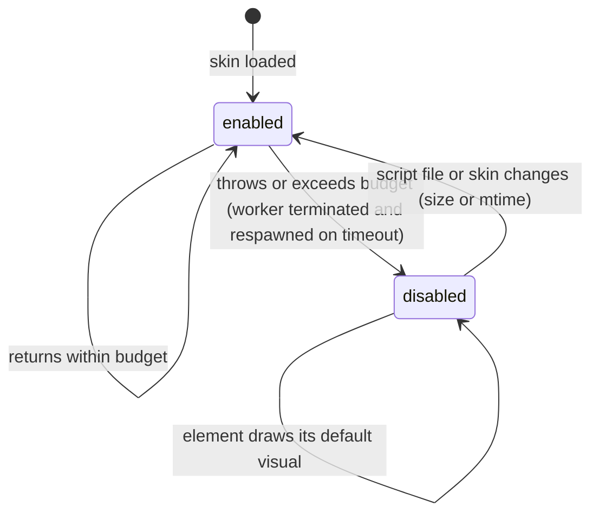

# Games as Skins - Plan

## Goal Capsule

- **Objective:** a new look for the bar, whether a new game such as Warcraft III or a user's own mix, is made from data, scripts and assets alone, out of one shared set of bar elements, without writing a new layout in the platform. A user can compose, name and keep their own bar, and only the assets the chosen skins need are installed.
- **Means:** a platform-owned catalogue of elements and visuals drawn from TOML skins (KTD1, KTD2), scripts in a stoppable worker (KTD4), and per-game asset packages under `@claude-game-bar` (KTD9, KTD10).
- **Product authority:** the project owner, in the brainstorm and plan review of 2026-11-16. The Product Contract wins on behaviour; Key Technical Decisions win on mechanism within it.
- **Execution profile:** one pull request into protected `master` (PR, green `test` and `e2e`), released as 2.0.0 by the existing release flow after the owner's npm bootstrap (Open Questions).
- **Stop conditions:** stop and ask the owner if U1 shows that no script runtime can meet R20 on Node 18 and Windows, or if a requirement turns out to contradict another in implementation.
- **Who finishes:** `ce-work` builds and verifies the units; the owner bootstraps the npm organisation and packages, checks the bar live on the Windows PC and the Raspberry Pi, and releases.
- **Open blockers:** none for building. Releasing waits on the owner's npm bootstrap.

---

## Product Contract

### Summary

The bar becomes a tree of shared elements: containers that lay out their children, with or without a visual of their own, and metric elements that always draw a value in one of a defined set of visuals. A skin describes that tree as data, binds metrics, sets the visual parameters and attaches scripts that may change any element before it is drawn. A game is a folder of assets, its scripts and conversation libraries among them, and bundled skins; standard assets are published to npm and installed on demand. The platform reads old theme and preset choices as skins when it draws, so an upgrade keeps every user's bar.

### Problem Frame

Today a game is code. `src/games/doom/layout.js` draws a row of boxes around the mugshot and uses the kit's width planner and preset fallback chain; `src/games/minecraft/layout.js` draws hearts, hunger, the XP bar, a 9-slot hotbar and the chat with its own fitting, its own width logic and a hard-coded palette, glyphs and frame characters, and uses neither the planner nor the fallback chain. The two games show the same metrics and react to the same game-neutral reaction, yet each draws its own elements.

That costs three things. Every new game (Warcraft III is next) means another layout written from scratch. A user cannot combine elements across games or change much beyond the metric bindings, and the README tells users to edit preset files inside the package, which an update overwrites. And a visual configurator (backlog G-11) would have to be written separately for each game, because nothing describes what a game's bar is made of.

The ideation of 2026-10-31 (`docs/ideation/2026-10-31-shared-game-layout-engine.md`) proposed a shared HUD kit under thin per-game layouts with fixed sockets. The owner has since chosen a different model: no per-game skeleton at all, only shared elements composed by skins.

### Key Decisions

- **A game is assets plus skins; the layout is free composition of shared elements.** (session-settled: user-directed — chosen over a fixed per-game skeleton with named sockets: every element is shared, so the next game and a user's own bar are composition, not code.) Governs R1, R13, R24.
- **Two element kinds: containers and metrics.** A container may or may not have a visual; a metric always has one. (session-settled: user-directed — chosen over separate layout-only and visual container kinds: a centring container and a titled box differ only in having a visual.) Governs R1, R2, R3.
- **A skin is a tree of containers, described as data, in the spirit of XAML.** (session-settled: user-approved — chosen over a cell grid and over "everything is a box": it extends today's box row and width planner, carries Minecraft and Warcraft III, and suits a tree-shaped configurator.) Governs R7.
- **The game ships skins; the user composes, saves and names their own.** (session-settled: user-directed — chosen over a layout owned by the platform or one fixed per user: the game delivers assets plus containers and metrics, the user may keep their own variants.) Governs R10, R11.
- **Scripts can come from anywhere and hook any visual element.** (session-settled: user-directed — chosen over scripts only in games bundled with the package: the owner wants to ship scripts for anything he thinks of.) This ends the earlier principle that nothing in configuration is executed. Governs R17, R18, R19.
- **A skin may use assets of any game.** (session-settled: user-approved — chosen over assets of the skin's own game only: a DOOM mugshot can sit in a Minecraft-styled bar.) Governs R8.
- **Narrow terminals use both priorities and a smaller skin.** (session-settled: user-directed — chosen over priorities alone and over a fallback chain alone.) Governs R9.
- **Bundled skins need not match today's output.** (session-settled: user-directed — chosen over a byte-for-byte match and over "the same in broad strokes": the move is a chance to redo both games.) Governs R25.
- **Old presets break.** (session-settled: user-directed — chosen over a one-time conversion and over reading the old format forever: few users have their own presets, and the changelog tells them how to rebuild.) Governs R26.
- **What no longer holds in a user's skin is skipped with a warning.** (session-settled: user-directed — chosen over a versioned format with automatic migration and over a hard break.) Governs R12.
- **Assets on demand belong to this work.** (session-settled: user-directed — chosen over leaving backlog G-10 for later.) Governs R14, R15, R16, R28, R29.
- **A skin counts as in use for 30 days after any session last drew it.** (session-settled: user-approved — chosen over "drawn within the daemon's idle period or set in a project's settings": neither can be checked when the installer runs, and a project opened weekly would otherwise reinstall its assets every week.) Governs R28.
- **Everything a game ships besides skins is an asset.** Images, models, sounds, scripts and conversation libraries live in one asset folder, in subfolders by kind. (session-settled: user-directed — chosen over separate rules for assets and scripts: one rule then covers installing, removing and referencing everything a game ships.) Governs R13, R14.
- **The element and visual set belongs to the platform and grows with it.** (session-settled: user-directed — chosen over games bringing their own visuals as scripts: a new kind of element, such as Warcraft III's minimap, is ordinary platform development.) Governs R3, R13.
- **The chat is a standard element fed by conversation libraries.** (session-settled: user-directed — chosen over a chat script owned by one game: the first library is questions and answers about the metrics; a skin can drop, change or add conversations.) Governs R22, R23.
- **A failing script never takes the bar down.** A user's script runs in the render daemon on every redraw, so one slow or broken script would otherwise blank every session the daemon serves. Governs R20.



The diagram shows part of today's DOOM bar as an element tree: the bar is a container without a visual, the MODEL box is a container with one, and the first line of that box is again a container without a visual holding two metric elements.

### Requirements

**Elements**

- R1. The bar is a tree of two element kinds: containers and metric elements.
- R2. A container lays out its children side by side or one under another, can be nested, and decides how its children shrink and drop when the width changes; it may have a visual (frame, title, background) or none.
- R3. A metric element shows one value and always has a visual from the platform's set, which grows as the platform develops: text, number, progress bar, graph (sparkline, equalizer), icon row, scrolling list, chat, and animation (2D frames, 3D model).
- R4. Every element type, every visual and each of their parameters has a machine-readable description (name, meaning, allowed values), complete enough to drive the configurator of backlog G-11.
- R5. Every metric in the catalogue has an id, a human-readable name and a value type (percentage, number, text, list, time series, conversation).
- R6. Every visual declares which value types it can show, so a progress bar is offered only for a percentage and a graph only for a time series.

**Skins**

- R7. A skin is a named tree of elements described as data: metric bindings, visual parameters (its own characters such as ♥ or frame lines, colours, icons), priorities, script bindings and asset references.
- R8. A skin may reference assets of any game.
- R9. When the terminal is too narrow, elements first shrink to their minimum width, then drop in the order of the priorities the skin gives them, lowest first; if the skin still does not fit, the bar switches to the smaller skin it names.
- R10. The user chooses the active skin by name, which replaces today's theme switch; on upgrade, a saved game choice and the installer's preset choice (full, standard, minimal) become the bundled skin of the same game and size.
- R11. The user can save a skin under their own name; an update replaces the bundled skins and never changes a user's skin.
- R12. A part of a user's skin that no longer holds after an update (an unknown element, parameter or metric) is skipped with one warning, and the rest of the skin is drawn.

**Games and assets**

- R13. A game is a folder of assets (images, models, sounds, scripts, conversation libraries, in subfolders by kind) and bundled skins; a game that uses only existing elements and visuals changes no platform code.
- R14. Standard assets are published to npm by the project and installed on demand when a skin in use references them, only as packages under the project's own npm scope with npm lifecycle scripts disabled, never by a package name written in a skin.
- R15. An asset folder committed to the repository is published to npm as a new asset batch by GitHub Actions.
- R16. A user who wants their own assets puts them in the folder of their own skin; the bar uses them from there and never fetches assets from anyone else.
- R28. Assets that no skin in use references are removed only when `claude-game-bar install` runs; a skin is in use when it is the saved choice, when any session of any installation drew it within the last 30 days, or when one of those names it as its smaller skin.
- R29. An element whose assets are not installed yet, or whose install failed, draws its default visual: rendering never waits for an install, the bar shows one warning naming the missing asset batch, and a failed install is retried later, not on every redraw.

**Scripts**

- R17. Every visual element can run a script before it is drawn, and the script can change that element's visual.
- R18. An element type may require a script (an animation needs one to pick the frame or model from its inputs) or come with a default script that a skin can replace with its own.
- R19. Scripts may come from any game folder or skin folder, bundled or the user's own.
- R20. A script that throws or exceeds its time budget does not break the bar or any other element: the bar stops it, its element falls back to its default visual, the bar shows a warning, and the script does not run again until it or its skin changes.
- R21. The bar runs scripts only from folders installed on the machine; it never downloads code from anywhere but the project's own npm packages.

**Chat**

- R22. The chat is a standard metric element whose value is the conversation it plays and whose visual is the chat; its property is the set of conversations, taken from conversation libraries, and the project ships a first library of questions and answers about the metrics.
- R23. A skin can drop, change or add conversations of a library it uses.

**Existing games and the release**

- R24. DOOM and Minecraft are rebuilt as game folders with skins; what is specific to them lives in their scripts (the mugshot's frame selection, Minecraft's highlighted hotbar cell that jumps to the last event and otherwise wanders).
- R25. The rebuilt skins may look different from today's output; the snapshot tests are recorded again and the owner reviews the result by eye.
- R26. Preset files in today's format that a user wrote or edited stop working; the release is a major version, and its changelog tells users how to rebuild their own presets as skins.
- R27. The glyph step and the line level (which glyph sets the terminal can draw, backlog D-17) stay settings of the platform per terminal, and a skin cannot override them.

### Key Flows

- F1. A user builds their own mixed skin
  - **Trigger:** the user wants the DOOM mugshot next to a Minecraft hotbar.
  - **Steps:** the user copies a bundled skin under their own name, edits its element tree to add the mugshot animation that references DOOM's assets, and chooses the skin by name; the bar installs DOOM's assets if they are missing and draws the skin.
  - **Covered by:** R7, R8, R10, R11, R14, R29
- F2. An update arrives
  - **Trigger:** the user upgrades the package.
  - **Steps:** bundled skins are replaced; a saved game and preset choice is drawn as the bundled skin of the same game and size; user skins stay as they are; parts of a user skin that no longer hold are skipped with a warning; when the user next runs `claude-game-bar install`, assets no skin in use references are removed.
  - **Covered by:** R10, R11, R12, R28
- F3. A script fails while the bar draws
  - **Trigger:** a skin's script throws or runs past its time budget.
  - **Steps:** the element draws its default visual, every other element draws normally, and the bar shows a warning naming the script.
  - **Covered by:** R20

### Acceptance Examples

- AE1. Covers R9. **Given** a skin whose elements at minimum width need 140 columns and whose AGENTS box has the lowest priority, **when** the terminal is 120 columns wide, **then** the AGENTS box is dropped first; **when** the terminal is 60 columns wide and the skin still does not fit after every droppable element is gone, **then** the bar draws the smaller skin the skin names.
- AE2. Covers R12. **Given** a user skin that binds a metric the update removed, **when** the bar draws it, **then** that metric element is skipped, one warning names it, and every other element is drawn.
- AE3. Covers R20. **Given** a skin whose hotbar highlight script never returns, **when** the time budget passes, **then** the hotbar draws without a highlighted cell, the rest of the bar is unchanged, and the bar shows a warning.
- AE4. Covers R14, R28. **Given** a user switches from a DOOM skin to a Minecraft skin, **when** the switch completes, **then** Minecraft's assets are installed if missing and DOOM's assets stay; **when** `claude-game-bar install` next runs and no skin in use references DOOM's assets, **then** they are removed.
- AE5. Covers R8, R24. **Given** a user skin with the DOOM mugshot animation inside a Minecraft-styled container, **when** the reaction turns to "ouch", **then** the mugshot shows its hurt frame chosen by DOOM's selection script.
- AE6. Covers R29. **Given** Minecraft's assets are not installed, **when** the user switches to a Minecraft skin, **then** the hotbar draws its default visual at once, the bar shows one warning, and the skin's own look appears once the install finishes.

### Success Criteria

- DOOM and Minecraft exist only as game folders with skins, scripts and assets; the platform has no layout code specific to either.
- A user can build a mixed skin, save it under their own name, and an update leaves it untouched.
- The descriptions of elements, visuals and metrics (R4, R5, R6) are enough to build the configurator of G-11 without code written per game.
- A small test game added as a folder alone, with no change to platform code, draws in the bar.
- A user on 1.x who upgrades without running `install` keeps the same game and bar size in every project.

### Scope Boundaries

**Deferred for later**

- Warcraft III itself; this work only defines the 3D animation visual it will use.
- The visual configurator (backlog G-11), which this work prepares for.
- Playing sounds (backlog F-4); a game may ship sounds, nothing plays them yet.
- A declarative table from inputs to animation frames instead of a selection script.
- Converting old preset files automatically.
- The line level of D-17 itself; this work only keeps glyph settings out of skins (R27).

**Not in this work**

- Behaviour without a network connection: the bar runs inside Claude Code, which itself needs one.
- Installing assets or scripts from anyone but the project (R14); user assets live only in the user's own skin folder (R16), and scripts come only from installed folders (R21).
- Scripts in the one-shot status line used without the render daemon: there an element with a script draws its default visual (KTD4).
- A sandbox against hostile scripts: scripts run with the user's rights, like any code the user installs (KTD4). Evidence that would change this: skins shared between users at scale.
- A `skin check` command listing every skipped part at once; the warning line of KTD12 names them one at a time. Evidence that would change this: users editing skins by hand often before G-11 exists.

<!-- ce-section: work-relationships -->
### How This Work Fits Together

This plan covers the element model, skins, scripts, conversation libraries and assets on demand. The breakdown below is the current understanding, not a committed roadmap.

- Shared HUD kit (G-4) and the hotbar on the shared width planner (G-5): absorbed; the shared elements of R1–R6 replace the kit, and Minecraft uses the shared width behaviour of R9.
- User preset overlay (G-3): replaced by user skins (R11).
- Assets on demand (G-10): part of this work (R14–R16, R28, R29).
- Chat as data and chat packs (G-6, G-7): this work makes the chat a standard element with conversation libraries (R22, R23); the declarative condition language and the conversation order of G-9 are still to decide.
- Visual configurator (G-11): depends on this work's element, visual and metric descriptions.
- Warcraft III (G-8, D-5, D-6): depends on this work; adds a 3D animation, a minimap and its own skins.
- Line art in the renderer (D-17): can proceed independently of this work; its glyph-set choice stays a terminal setting (R27).

### Dependencies / Assumptions

- npm is available wherever the bar is installed, and on-demand assets go to a directory the user can write, outside the package's install folder: a system-wide global npm folder may need sudo, which the render daemon does not have.
- The earlier decision that Warcraft III's art is the project's own and not Blizzard's still holds.

### Sources / Research

- `docs/ideation/2026-10-31-shared-game-layout-engine.md`: the earlier HUD kit and socket proposal this work replaces, and the chat packs proposal it builds on.
- `docs/BACKLOG.md`: G-3 to G-11, D-5, D-6, D-17, F-4.
- `src/games/doom/layout.js`, `src/games/minecraft/layout.js`, `src/games/minecraft/chat.js`, `src/games/doom/portrait.js`: what each game draws itself today.
- `src/kit/planner.js`: today's width planner and preset fallback chain (`resolvePreset` with its cycle guard).
- `src/kit/meters.js`: today's metric visuals (`bar`, `ammo`, `icons`, `spark`, `equalizer`, `list`, text and number); `scroll` is handled in the DOOM layout and the planner.
- `src/metrics/reaction.js`: the game-neutral reaction both games read.
- `src/theme.js`, `src/games/index.js`, `CONTRIBUTING.md`: today's theme switch, game registry and the note that the game interface is internal.

---

## Planning Contract

Product Contract preservation: changed: R28 — "in use" now means the saved choice or drawn by any session of any installation within 30 days, and removal runs only in `claude-game-bar install`, because the installer can see neither a daemon's memory nor every project's settings (owner confirmed 2026-11-16); F2 and AE4 follow R28. The Outstanding Questions of the brainstorm are answered by KTD1–KTD16 below and were removed. Otherwise unchanged.

### Key Technical Decisions

- KTD1. **Skins are TOML files with a flat table of elements keyed by id.** Each element names its kind (`row`, `column`, or a metric visual), its parameters, and for containers a `children` list of ids; the skin names its `root`, its `smaller` skin, a format `version` and the games whose assets it uses. Flat ids keep deep trees readable without nested arrays of tables, give the G-11 configurator stable handles, and reuse `smol-toml`, already the only dependency. Governs R7, R12.
- KTD2. **One descriptor per element kind and per visual, owned by the platform.** A descriptor carries its name, description, parameter schema (name, meaning, type, default, allowed values), accepted value types, minimum and natural width from its parameters, and its draw function. It unifies today's split between drawing in `src/kit/meters.js` and width in `src/kit/planner.js`, and the parameter schemas are the machine-readable description of R4. Governs R1–R4, R6.
- KTD3. **Metric producers emit raw values; presentation moves to visuals and skins.** Producers stop baking SGR colours (`loc.churn`), OSC 8 links (`loc.cwd`, `git.branch`, `pr.state`), icons (`model.effort`, `git.work`, `model.permission`) and colours of task marks into values. A link travels as a value attribute that the text visual renders, and icon maps become skin parameters. A catalogue module declares id, human name and value type for every key the producers emit. A skin that owns characters and colours (R7) cannot do so while values carry them. Governs R5, R7.
- KTD4. **Scripts run in one persistent worker thread per daemon, called synchronously with a deadline.** The render pass posts one batched request per session and waits with `Atomics.wait`; on timeout it terminates and respawns the worker, marks the timed-out script disabled until its file's size or mtime or its skin changes, and draws the element's default visual. Inside the worker each script runs in a `node:vm` context without timers, `eval` or `wasm`. Scripts are trusted like any code the user installs: `vm` is not a security boundary, and the README says so. The one-shot status line runs no scripts. (session-settled: user-approved — chosen over running scripts in the one-shot renderer with disable markers on disk: a fresh process per tick would pay a worker start and a full timeout every tick.) Governs R17–R21, R24.
- KTD5. **Scripts run after the fit and change only width-neutral things.** A script receives its element's bound values, the reaction, the time, the fitted width, the visible children and a state object kept per session and per element; it returns overrides of characters, colours, the selected child or the animation frame, never a size. Output wider than the fitted width is clipped. The Minecraft highlight then picks only among slots that fit. Governs R17, R18, R24.
- KTD6. **Fit uses declared widths, skin-wide priorities and the smaller-skin chain.** Each element reports minimum and natural width from its parameters, not from live text, so the bar does not flicker between layouts as values change. The fit tries natural widths, shrinks elastic visuals in lockstep as `planLayout` does today, drops elements by the skin's `priority` (lowest first, later position first on ties, `priority = "keep"` never drops, a container whose children all dropped drops too), then follows `smaller` with the cycle guard of `resolvePreset`. The last skin in the chain is drawn clipped. Containers decide only how their children shrink; the drop order is the skin's. Governs R2, R9.
- KTD7. **Skin selection is read at draw time, legacy settings included.** Precedence: the session's `GAMEBAR_SKIN`, forwarded per session like `GAMEBAR_THEME`, then the saved choice, then the legacy mapping of `GAMEBAR_THEME` / `DOOMBAR_THEME`, the saved theme file and the basename of `GAMEBAR_PRESET` / `DOOMBAR_PRESET`, then the default skin `doom-full`, matching what `install` writes today. Each game's manifest declares its legacy theme names and preset basenames, so no game name enters platform code (`test/games/general-part.test.mjs`). A `GAMEBAR_PRESET` whose basename no game declares is a hand-edited preset: the game's default skin is drawn with a warning (R26). (session-settled: user-approved — chosen over mapping only in `install`: an in-place `npm i -g` runs no code of ours, so every project would show "preset not found" until reinstalled.) Governs R10, R26.
- KTD8. **User state lives under `~/.claude/claude-game-bar/`.** It holds `skin.json` (the saved choice; 1.x keeps reading its own theme file), `skins/<name>/` (user skins with their own assets), `assets/` (the npm prefix for game packages), `usage.json` (the usage record of R28: skin and asset package with the time any session of any installation last drew it) and `install.lock`. Both installations and both renderers share it. User skins and scripts there are reloaded when their size or mtime changes, as `loadPreset` does for presets; a change under `src/` still restarts the daemon. Governs R11, R16, R28.
- KTD9. **Each game's assets are one npm package, `@claude-game-bar/<game>`, resolved by manifest only.** A game manifest names its package and the version range the platform release accepts. A checkout resolves assets from the repository's `games/<game>/assets/` folder; an installed bar resolves them from `assets/node_modules/@claude-game-bar/<game>`. A missing package triggers a background install through the existing Windows-safe npm runner (`src/install/old-package.js`), as `npm install --prefix <assets dir> --ignore-scripts --no-audit --no-fund` into a temporary prefix that is renamed into place under `install.lock`; a failure writes a retry-after marker of 10 minutes. `claude-game-bar install` and the skin switch command install in the foreground. Asset references in skins name a game, never a package. Governs R8, R14, R21, R29.
- KTD10. **Asset packages publish from `master` through their own workflow.** A workflow on pushes to `master` publishes each `games/<game>/assets` package whose version is not yet on npm, with OIDC trusted publishing and provenance. Each new package name needs a one-time manual first publish before trusted publishing can be configured, because npm allows that only for an existing package. (session-settled: user-directed — chosen over the owner's user scope and over unscoped prefixed names: the organisation scope is the project's name, can take a second maintainer, and is a stronger identity check than a name prefix.) Governs R14, R15.
- KTD11. **Raster caches key assets by path and stamp.** The face cache keys sprites today by bare name and package version (`src/games/doom/face.js`); keys become asset path plus size and mtime, so same-named sprites of two games do not collide and an asset that arrives mid-session replaces its default visual. Governs R8, R29.
- KTD12. **Warnings show as one dim line under the bar, 60 s per cause.** Skin parts skipped (R12), missing assets (R29) and failed scripts (R20) are collected during the render; the bar adds one dim line naming the first cause and the count of others while any cause is younger than 60 s since it first appeared in this daemon's life, and the one-shot renderer keeps the first-seen times in the runtime directory. Governs R12, R20, R29.
- KTD13. **An element whose required script or asset is unavailable draws a blank of its minimum width.** An animation with a failed selection script or a missing asset batch keeps its place in the layout, so the rest of the bar does not jump. Governs R18, R20, R29.
- KTD14. **The chat is a metric visual fed by conversation libraries; the metrics library ships with the platform.** A conversation library is a script asset exporting conversations with conditions; the platform's metrics library runs as platform code, a game's or a skin's library runs in the script worker. A skin lists the libraries a chat element uses and drops, replaces or adds conversations by key. Several chat elements may each have their own set. Governs R3, R22, R23.
- KTD15. **The animation visual takes frames from a selection script.** A 2D animation names an asset folder of frames and a selection script; the script receives the reaction, its bound metric and the time and returns a frame name, which goes through the existing glyph raster with the terminal's glyph step as the ceiling (R27). The 3D visual is declared in the catalogue with its parameters and draws its default visual until Warcraft III supplies a renderer. Governs R3, R18, R27.
- KTD16. **Bundled games stay data-only folders under `src/games/<game>/`; their assets move to `games/<game>/assets/`.** A game folder holds `game.toml` (name, description, legacy names, asset package and range, default skin) and `skins/*.toml`; the registry discovers folders instead of importing layouts. Asset packages live outside `src/`, so the daemon's source watch does not scan them and the main package does not ship them. Governs R13, R24.

### High-Level Technical Design

The render path after this work, per session and per pass:



The fit, as a decision flow:



The life of one script:



A skin, as directional guidance for the format (not the final schema):

```toml
version = 1
name = "doom-standard"
games = ["doom"]
root = "bar"
smaller = "doom-minimal"

[element.bar]
kind = "row"
align = "center"
children = ["model", "mugshot", "usage"]

[element.model]
kind = "row"
frame = { title = "MODEL", background = "#1c2036", title_color = "#dec880" }
children = ["model-name"]
priority = 3

[element.model-name]
kind = "text"
metric = "model.name"
icon = "🤖"

[element.mugshot]
kind = "animation-2d"
metric = "health.headroom"
frames = "doom:mugshot"
script = "doom:scripts/mugshot.js"
priority = "keep"
```

### Output Structure

```text
games/
  doom/assets/            # npm package @claude-game-bar/doom
    package.json
    images/mugshot/       # sprites moved from src/games/doom/assets/mugshot/alpha/
    scripts/mugshot.js    # frame selection
  minecraft/assets/       # npm package @claude-game-bar/minecraft
    package.json
    scripts/hotbar-highlight.js
    conversations/minecraft.js
src/
  games/
    index.js              # discovers game folders (data only)
    doom/game.toml
    doom/skins/{full,standard,minimal}.toml
    minecraft/game.toml
    minecraft/skins/minecraft.toml
  kit/elements/           # element and visual descriptors (KTD2)
  kit/skin/               # skin loader, validator, fit, draw
  metrics/catalogue.js    # metric ids, names, value types (KTD3)
  platform/scripts/       # worker host and worker entry (KTD4)
  platform/assets.js      # resolve, background install, usage record, removal
.github/workflows/publish-assets.yml
```

### Open Questions

**Gate on release (not on merge)**

- The owner creates the npm organisation `claude-game-bar`, publishes the first version of `@claude-game-bar/doom` and `@claude-game-bar/minecraft` by hand (`npm publish --access public`), and configures trusted publishing for both against `publish-assets.yml`. Until then an installed 2.0 cannot fetch assets; a checkout works from the repository folders.

**Deferred to implementation**

- The exact script budget per call and per pass; start at 20 ms per element and 200 ms per pass, and adjust from U1's measurements.
- Whether `Atomics.wait` on the daemon's main thread behaves on every supported Node version; U1 answers it, and its fallback is `node:vm` with `timeout` on the main thread, which stops synchronous loops but not memory growth.

---

## Implementation Units

| U-ID | Title | Files touched (primary) | Depends on |
|---|---|---|---|
| U1 | Script runtime | `src/platform/scripts/` | — |
| U2 | Metric catalogue and raw values | `src/metrics/catalogue.js`, `src/metrics/*.js` | — |
| U3 | Element and visual descriptors | `src/kit/elements/` | U2 |
| U4 | Skin loader and validator | `src/kit/skin/load.js` | U3 |
| U5 | Fit, draw and warning line | `src/kit/skin/fit.js`, `src/kit/skin/draw.js` | U3, U4 |
| U6 | Scripts in the render pass | `src/render.js`, `src/kit/skin/scripts.js` | U1, U5 |
| U7 | Game folders, skin selection and CLI | `src/games/index.js`, `src/skin-select.js`, `bin/cli.js` | U4 |
| U8 | Asset store, on-demand install, usage record | `src/platform/assets.js`, `src/games/doom/face.js` | U7 |
| U9 | DOOM as data | `src/games/doom/`, `games/doom/assets/` | U5, U6, U8 |
| U11 | Chat element and metrics library | `src/kit/elements/chat.js`, `src/kit/chat/` | U3, U6 |
| U10 | Minecraft as data | `src/games/minecraft/`, `games/minecraft/assets/` | U5, U6, U8, U11 |
| U12 | Asset publishing, packaging and docs | `.github/workflows/publish-assets.yml`, `package.json`, docs | U9, U10 |
| U13 | Test harness on skins | `test/games/`, `test/kit/` | U9, U10 |

### U1. Script runtime

**Goal:** a host that runs a batch of script calls synchronously from the render pass, stops any call past its deadline, and keeps disabled scripts disabled until their file changes.

**Requirements:** R17, R19, R20, R21; KTD4.

**Dependencies:** none.

**Files:** `src/platform/scripts/host.js`, `src/platform/scripts/worker.js`, `test/platform/script-host.test.mjs`.

**Approach:**
1. Measure first: a persistent worker answering a batched request through a `MessagePort` and `Atomics.wait` on a `SharedArrayBuffer`, on Node 18, 22 and 26, on Windows and Linux. Record round-trip time and spawn time in the test output.
2. The worker loads each script once into its own `vm` context (no timers, `codeGeneration` strings and wasm off, plain-data inputs and outputs) and caches it by path, size and mtime.
3. On a timed-out wait the host terminates the worker without awaiting it, respawns on the next call, and records the script as disabled with its size and mtime.
4. If step 1 shows `Atomics.wait` is not usable, fall back to `vm` with `timeout` on the main thread and note the lost memory bound in the code's header comment.

**Execution note:** start with the measurement and a failing test for a script that never returns.

**Patterns to follow:** the detached-child pattern of `maybeStartReaper` in `src/daemon.js` for lifecycle; `readFileSync`-based caches keyed by `mtimeMs:size` in `src/render.js`.

**Test scenarios:**
- A script returning `{ frame: "STFST01" }` within budget: the host returns that output.
- A script with `for (;;) {}`: the call returns a timeout result within budget plus a small margin, the next call to another script succeeds on a fresh worker, and the looping script reports disabled.
- A disabled script whose file is rewritten (new mtime): the next call runs it again.
- A script that throws: the call returns an error result naming the script; other scripts in the same batch still return.
- A script calling `setTimeout`, `eval` or `require`: the call returns an error result and nothing escapes the batch.
- A batch of 20 calls of a trivial script: total time stays under the per-pass budget on the measured machines.

**Verification:** the test suite passes on Windows locally and on Linux CI, and the measurements are written down in the unit's test output.

### U2. Metric catalogue and raw values

**Goal:** every metric key has a catalogue entry with a human name and value type, and producers emit raw values without colours, icons or links.

**Requirements:** R5, R7; KTD3.

**Dependencies:** none.

**Files:** `src/metrics/catalogue.js`, `src/metrics/session.js`, `src/metrics/activity.js`, `src/metrics/system.js`, `src/kit/values.js`, `test/metrics/catalogue.test.mjs`, existing metric tests under `test/metrics/`.

**Approach:**
1. Declare every key the producers emit (`collectValues` in `src/metrics/index.js`), with value type percentage, number, text, list, time series or conversation.
2. Change producers: `sys.cpu` and other numeric strings become numbers, `loc.cwd` / `git.branch` / `pr.state` carry `{ text, url }`, `model.effort` becomes the level name, `git.work` / `model.permission` / `model.mode` lose their baked icons, `act.tasklist` items carry a status instead of a colour, `loc.churn` loses its SGR codes.
3. Update `src/kit/values.js` (preview sample) to the raw shapes and add the keys it lacks.

**Patterns to follow:** absent-when-unknown keys, as today.

**Test scenarios:**
- Every key `collectValues` emits for the sample session has a catalogue entry, and every catalogue entry's type matches the emitted value's shape.
- `sys.cpu` is a number; `loc.churn` contains no escape sequence; `git.branch` is an object with `text` and `url`.
- `model.effort` for each effort level is the level name, not an emoji.
- A key absent from a session stays absent.

**Verification:** catalogue and metric tests pass; no value from a producer contains `\x1b`.

### U3. Element and visual descriptors

**Goal:** the platform's catalogue of element kinds and visuals, each with a parameter schema, accepted value types, widths and a draw function.

**Requirements:** R1–R4, R6; KTD2, KTD13, KTD15.

**Dependencies:** U2.

**Files:** `src/kit/elements/index.js`, `src/kit/elements/containers.js` (row, column, frame visuals: box, grid), `src/kit/elements/text.js`, `number.js`, `progress.js`, `sparkline.js`, `equalizer.js`, `icon-row.js`, `scroll-list.js`, `animation.js` (2D, 3D placeholder), `test/kit/elements.test.mjs`.

**Approach:**
1. Move drawing out of `src/kit/meters.js` (`rBar`, `rIcons`, `rSpark`, `rEqualizer`, `colorFor`) and width out of `src/kit/planner.js` (`metricFixedWidth`) into one descriptor per visual.
2. Rebuild the DOOM box header and `│` separators as the `box` frame and Minecraft's `┏┳┓` frame, slot cells and selected-slot edge as the `grid` frame, with characters and colours as parameters.
3. Icon maps (effort moons, permission icons) are visual parameters with platform defaults.
4. Every descriptor validates its parameters against its schema and reports unknown ones to the caller (for R12).

**Patterns to follow:** escape-safe width helpers in `src/kit/text.js` (`vlen`, `marquee`, `scrollWindow`).

**Test scenarios:**
- Each visual's schema lists every parameter its draw function reads, with a default.
- A progress bar given a text value is rejected by the value-type check; given 42 (percentage) it draws the same cells as today's `rBar` at the same width.
- An icon row with `glyph = "♥"`, `empty_glyph = "♡"`, value 60 % over 10 icons draws 6 full and 4 empty.
- A `grid` frame with 9 children and a selected index draws the selected cell with its highlight characters.
- An animation with no frames available draws a blank of its minimum width.
- A 3D animation declared in a skin draws its default visual.

**Verification:** descriptors cover every render type used by today's presets and the Minecraft layout.

### U4. Skin loader and validator

**Goal:** load a TOML skin into an element tree, skip and report what is invalid, and reload user skins when they change.

**Requirements:** R7, R11, R12; KTD1, KTD8.

**Dependencies:** U3.

**Files:** `src/kit/skin/load.js`, `test/kit/skin-load.test.mjs`, fixture skins under `test/fixtures/skins/`.

**Approach:**
1. Parse with `smol-toml`, build the tree from `root` through `children`, and validate each element against its descriptor and each metric against the catalogue (type match per R6).
2. An unknown kind, parameter or metric, a missing child id or a type mismatch skips that element and its subtree and adds a warning; a file that does not parse falls back to the game's default skin with a warning.
3. Cache by path plus size and mtime, as `loadPreset` in `src/render.js` does.

**Test scenarios:**
- Covers AE2. A skin binding a metric the catalogue lacks: that element is skipped, one warning names it, and the rest of the tree loads.
- A container listing a missing child id: the container loads without it and warns.
- A skin whose TOML does not parse: the default skin loads and one warning names the file.
- A child referenced twice or a cycle in `children`: the second reference is skipped with a warning.
- Rewriting a user skin file: the next load returns the new tree.

**Verification:** every bundled skin loads with no warnings.

### U5. Fit, draw and warning line

**Goal:** turn a loaded tree, values and a width into the bar's lines.

**Requirements:** R2, R9, R12, R20, R29; KTD6, KTD12, KTD13.

**Dependencies:** U3, U4.

**Files:** `src/kit/skin/fit.js`, `src/kit/skin/draw.js`, `src/kit/skin/warnings.js`, `src/kit/planner.js` (reduced to shared helpers or removed), `test/kit/skin-fit.test.mjs`, `test/kit/skin-draw.test.mjs`.

**Approach:**
1. Fit per KTD6, reusing the lockstep scale of `planLayout` and the cycle guard of `resolvePreset`.
2. Draw containers with their frame visuals and children, centring as the DOOM bar does today.
3. Warnings per KTD12: first-seen times live in daemon memory, or in a runtime-directory file for the one-shot renderer.

**Test scenarios:**
- Covers AE1. A skin needing 140 columns with AGENTS at the lowest priority: at 120 columns AGENTS is dropped; at 60 columns with nothing droppable left the named smaller skin is drawn.
- Two elements with equal priority: the later one in position drops first.
- An element with `priority = "keep"` is never dropped; a container whose children all dropped is dropped.
- Smaller-skin chain A → B → A: the chain stops at the repeat, the last skin tried is drawn clipped, and one warning names the cycle.
- The same skin and width with values of different text lengths: the set of dropped elements does not change.
- A warning cause seen at t=0 shows a dim line at t=30 s and none at t=61 s.

**Verification:** fit and draw tests pass; drawing a bundled skin at 80, 120 and 200 columns fits within the width.

### U6. Scripts in the render pass

**Goal:** run element scripts after the fit, apply their width-neutral overrides, and fall back to default visuals on failure.

**Requirements:** R17, R18, R20, R24; KTD4, KTD5, KTD13.

**Dependencies:** U1, U5.

**Files:** `src/render.js`, `src/kit/skin/scripts.js`, `src/statusline.js` (no scripts in one-shot mode), `src/daemon.js` (worker lifecycle with the daemon), `test/kit/skin-scripts.test.mjs`, `test/platform/daemon.test.mjs`.

**Approach:**
1. After the fit, collect every visible element with a script and send one batch per session to the U1 host with each element's inputs and stored state.
2. Apply returned overrides; clip anything wider than the fitted width.
3. Keep per-session per-element state in the daemon, reset when the skin or script changes.
4. `renderSession` takes a flag the one-shot path sets to skip scripts.

**Test scenarios:**
- Covers AE3. A highlight script that never returns: the hotbar draws without a highlighted cell, other elements are unchanged, a warning appears, and the script is not called on the next pass.
- A script returning a frame name: the animation draws that frame.
- A script returning text wider than its element: the output is clipped to the fitted width.
- A script that stores a counter in its state: the counter increases across passes for one session and starts fresh for another.
- One-shot mode: no script runs and the element draws its default visual.

**Verification:** a daemon test with a looping script keeps renewing every session's frame before its deadline.

### U7. Game folders, skin selection and CLI

**Goal:** discover data-only game folders, choose the skin per KTD7, and give the user a `skin` command.

**Requirements:** R10, R11, R13, R26; KTD7, KTD8, KTD16.

**Dependencies:** U4.

**Files:** `src/games/index.js`, `src/skin-select.js`, `src/theme.js` (reduced to legacy reading), `src/daemon.js` and `src/gamebar-client.sh` (forward `GAMEBAR_SKIN` and `DOOMBAR_SKIN`), `bin/cli.js` (`skin <name|next|list>`, `theme` as an alias, `install --skin`), `src/install/settings.js`, `test/games/registry.test.mjs`, `test/games/skin-select.test.mjs`, `test/platform/daemon.test.mjs`, `test/platform/client.test.mjs`, `test/install/installer.test.mjs`, `test/games/fixture-game/` (rebuilt as data).

**Approach:**
1. The registry reads `src/games/*/game.toml` and lists bundled skins; user skins come from `~/.claude/claude-game-bar/skins/`, and a user skin may not take a bundled skin's name.
2. Selection reads, in order, the session env, `skin.json`, the legacy mapping from each game's declared names, and the default `doom-full`.
3. `install` writes `GAMEBAR_SKIN` instead of `GAMEBAR_PRESET` and keeps removing the old settings it owns.
4. `GAMEBAR_SKIN` joins `FORWARDED_ENV` and the client's forward list in the same order.

**Test scenarios:**
- Covers F2. A saved theme file `{ "theme": "minecraft" }` and no skin choice: the Minecraft skin is drawn.
- `GAMEBAR_PRESET` pointing at the old `src/games/doom/presets/minimal.toml`: the `doom-minimal` skin is drawn.
- `GAMEBAR_PRESET` pointing at `~/my.toml`: the default DOOM skin is drawn with a warning naming the file.
- A session with `GAMEBAR_SKIN=minecraft` while the saved choice is `doom-full`: that session draws Minecraft, another session draws DOOM.
- `claude-game-bar skin next` cycles bundled skins in registry order, then user skins.
- `test/games/general-part.test.mjs` still passes: no game name in `src/` outside `src/games/` or in `bin/`.

**Verification:** a fixture game folder with only `game.toml` and one skin draws in the bar with no platform change.

### U8. Asset store, on-demand install and usage record

**Goal:** resolve assets per KTD9, install missing packages in the background, record usage, and remove unused packages during `install`.

**Requirements:** R8, R14, R16, R21, R28, R29; KTD8, KTD9, KTD11.

**Dependencies:** U7.

**Files:** `src/platform/assets.js`, `src/hook.js` (`--assets` background entry, like `--reap`), `src/install/old-package.js` (shared npm runner), `bin/cli.js` (`install` removal pass), `src/kit/raster/*` and `src/games/doom/face.js` (cache identity, asset paths), `test/platform/assets.test.mjs`, `test/install/installer.test.mjs`.

**Approach:**
1. Resolve `<game>:<path>` references through the game manifest to the checkout folder or the installed package; a user skin's own references resolve inside its folder.
2. On a missing package, start one detached `node src/hook.js --assets <game>` unless a lock or a fresh retry-after marker exists; it installs into a temporary prefix with `--ignore-scripts` and renames into place.
3. Each render updates `usage.json` with the skins and packages it drew, at most once a minute per skin.
4. `install` removes packages under `assets/` that neither `skin.json` nor a usage entry younger than 30 days (with smaller skins) references.
5. The raster cache keys on asset path plus size and mtime.

**Patterns to follow:** `runNpm` / `npmCommand` in `src/install/old-package.js`, the npm stub in `test/_npm-stub.mjs`, `writeAtomic` in `src/platform/runtime.js`.

**Test scenarios:**
- Covers AE6. A skin whose package is missing: the render returns at once with the default visual and a warning, and one background install starts; a second render during the install starts no other.
- Covers AE4. Switching from DOOM to Minecraft keeps the DOOM package; `install` with a usage entry for DOOM 31 days old removes it, and one 29 days old keeps it.
- A failed install writes a retry-after marker; renders within 10 minutes start no install, one after does.
- A skin reference naming a package directly (`@evil/pkg`) is rejected with a warning; only manifest packages install.
- The npm stub receives `--ignore-scripts` and a scoped `@claude-game-bar/` name.
- Two sprites named `STFST01.png` in two games are cached separately.

**Verification:** with the npm stub, a fresh assets directory ends with the chosen skin's package and nothing else.

### U9. DOOM as data

**Goal:** the three DOOM skins and the mugshot frame selection as data and a script, with the sprites in their asset package.

**Requirements:** R13, R24, R25, R27; KTD15, KTD16.

**Dependencies:** U5, U6, U8.

**Files:** `src/games/doom/game.toml`, `src/games/doom/skins/full.toml`, `standard.toml`, `minimal.toml`, `games/doom/assets/package.json`, `games/doom/assets/images/mugshot/*.png` (moved), `games/doom/assets/scripts/mugshot.js` (from `src/games/doom/portrait.js`), removal of `src/games/doom/layout.js`, `portrait.js`, `presets/`; `test/games/doom-skin.test.mjs`.

**Approach:**
1. Translate the boxes of `full.toml`, `standard.toml` and `minimal.toml` into element trees with priorities matching today's fallback chain (`full` → `standard` → `minimal` as `smaller`).
2. Port `EXPRESSION_SPRITES` and `portrait()` into the selection script.
3. Keep the `[mugshot] glyphs` ceiling as an animation parameter that can only lower the terminal's step (R27).

**Test scenarios:**
- Covers AE5. A Minecraft-styled container with the DOOM mugshot and reaction `ouch` at hp 2: the frame drawn is `STFOUCH2`.
- Dead reaction: `STFDEAD0`; god: `STFGOD0`; idle at several clock values cycles the three idle frames.
- The `doom-full` skin at 200 columns shows every box of today's full preset.

**Verification:** no file under `src/games/doom/` contains layout code; the DOOM skins draw at 80, 120 and 200 columns.

### U11. Chat element and metrics library

**Goal:** the chat visual and the platform's library of questions and answers about the metrics.

**Requirements:** R3, R22, R23; KTD14.

**Dependencies:** U3, U6.

**Files:** `src/kit/elements/chat.js` (from `chatColumn`, `wrapMessage` in `src/games/minecraft/layout.js` and `chatLog` in `src/games/minecraft/chat.js`), `src/kit/chat/metrics-library.js`, `test/kit/chat.test.mjs`.

**Approach:**
1. Split today's `SCRIPT` in `src/games/minecraft/chat.js`: neutral metric lines with keys go to the metrics library; hearts, food and potion wording and the banter stay for Minecraft's library in U10.
2. The chat element merges its libraries by key: later libraries replace, a skin's `drop` list removes, a skin's conversations add.
3. Speakers come from the running model and the library's cast, not a hard-coded model list.

**Test scenarios:**
- A chat with the metrics library and context at 80 %: a line about context appears within one script cycle.
- A skin that drops the key `ctx.ask`: that conversation never plays.
- A game library that replaces `ctx.answer`: the game's wording plays instead of the neutral one.
- Two chat elements with different libraries in one skin: each plays its own set.

**Verification:** the chat draws the same wrapping and colours as today's Minecraft chat at 60 and 100 columns.

### U10. Minecraft as data

**Goal:** the Minecraft skin, hotbar highlight script and conversation library as data, scripts and assets.

**Requirements:** R13, R22–R25; KTD5, KTD14, KTD16.

**Dependencies:** U5, U6, U8, U11.

**Files:** `src/games/minecraft/game.toml`, `src/games/minecraft/skins/minecraft.toml`, `games/minecraft/assets/package.json`, `games/minecraft/assets/scripts/hotbar-highlight.js` (from `selectedSlot`), `games/minecraft/assets/conversations/minecraft.js`, removal of `src/games/minecraft/layout.js`, `chat.js`, `presets/`; `test/games/minecraft-skin.test.mjs`.

**Approach:**
1. Hearts and hunger become icon rows, the XP bar a progress bar, the hotbar a `grid` container with nine metric children, the chat a chat element, inside rows and columns.
2. The highlight script keeps today's rule: jump to the slot bound to the last reaction for 6 s, otherwise wander every 7 s, choosing only among visible slots.

**Test scenarios:**
- Covers AE3's normal path. Reaction `ouch` with `act.errors` bound to slot 7: slot 7 is highlighted for 6 s, then the highlight wanders.
- At 40 columns the rightmost slots drop before the hearts and hunger.
- With context at 100 % used, the hunger row shows no full shanks.

**Verification:** the Minecraft skin draws at 60, 100 and 160 columns without overflow.

### U12. Asset publishing, packaging and docs

**Goal:** publish asset packages, stop shipping assets in the main package, and document 2.0.

**Requirements:** R15, R26; KTD10, KTD16.

**Dependencies:** U9, U10.

**Files:** `.github/workflows/publish-assets.yml`, `package.json` (`files` without game assets, version left for the release flow), `README.md`, `CONTRIBUTING.md`, `CHANGELOG.md` (`[Unreleased]` → 2.0.0 notes, how to rebuild a preset as a skin, scripts are trusted code), `docs/BACKLOG.md`.

**Approach:**
1. The workflow runs on pushes to `master`, compares each `games/*/assets/package.json` version with npm and publishes the new ones with OIDC and provenance, upgrading npm to at least 11.5.1 first as `publish.yml` does.
2. The changelog states the owner's one-time bootstrap and the breaking changes (old presets, `GAMEBAR_PRESET` replaced by `GAMEBAR_SKIN`, theme command now `skin`).

**Execution note:** packaging and workflow; verify with `npm pack --dry-run` and a workflow lint rather than unit tests.

**Test expectation:** none -- workflow and documentation; packaging checked by `npm pack --dry-run`.

**Verification:** the main package's file list contains no PNG sprites; the workflow publishes nothing when versions are unchanged.

### U13. Test harness on skins

**Goal:** snapshot tests render bundled skins through the new entry, and tests that imported game internals are rewritten or removed.

**Requirements:** R25; success criteria.

**Dependencies:** U9, U10.

**Files:** `test/games/render-snapshot.test.mjs`, `test/snapshots/*` (recorded again), `test/games/theme.test.mjs`, `test/games/render-context.test.mjs`, `test/kit/render-scroll.test.mjs`, `test/kit/resolve-preset.test.mjs`, `test/kit/layout.test.mjs`, `test/kit/preset-bands.test.mjs`, `test/metrics/reaction.test.mjs`, `test/metrics/statusline-savings.test.mjs`, `test/run-tests.test.mjs`.

**Approach:**
1. The snapshot harness calls `renderSession` with a fixed clock, skin and width instead of `buildBar` / `buildHotbar`.
2. `UPDATE_SNAPSHOTS=1` records the new output; the owner reviews it by eye before merge (R25).

**Test scenarios:**
- Each bundled skin at three widths and four reactions has a snapshot, and a second run matches byte for byte.
- A user skin fixture mixing the DOOM mugshot with the Minecraft hotbar renders and matches its snapshot (success criterion: mixed skin).

**Verification:** `npm test` passes with no test importing a removed game module.

---

## System-Wide Impact

- **Every user on upgrade:** old theme and preset choices keep working through the legacy mapping (KTD7); hand-edited presets fall back with a warning (R26).
- **Both installations on one machine** (checkout plus global, on the owner's PC and Raspberry Pi) share `~/.claude/claude-game-bar/` and its lock; a 1.x installation keeps its own theme file.
- **Daemon timing:** scripts add to every pass; KTD4's budget and disable rule keep frames within the 3 s deadline.
- **Second contributor:** Minecraft moves from code to data and scripts; the CONTRIBUTING guide changes accordingly.

## Risks & Dependencies

- `Atomics.wait` on the daemon's main thread may misbehave on some Node version; U1 measures before anything depends on it, and has a fallback.
- The first install of a skin fetches a package over the network; until it arrives the bar shows default visuals (R29), which the owner accepted.
- Trusted publishing cannot be configured for a package that does not exist; the owner's bootstrap is a release gate.
- Moving presentation out of metric values touches every metric producer; U2's type check against the catalogue catches a missed key.

---

## Verification Contract

| Gate | Command or check | Proves |
|---|---|---|
| Unit and integration tests | `npm test` (runs `scripts/run-tests.mjs`) | Every unit's scenarios, catalogue completeness, platform/game boundary |
| End-to-end | `npm run test:e2e` (CI job `e2e`) | Daemon, client and hooks with skins |
| Snapshots | `UPDATE_SNAPSHOTS=1 npm test`, then the owner's visual review | R25 |
| Packaging | `npm pack --dry-run` | No game assets in the main package |
| CI on the PR | `test` and `e2e` green on the protected `master` ruleset | Merge gate |
| Live check | The owner draws DOOM and Minecraft skins on the Windows PC and the Raspberry Pi | Real terminals before release |

## Definition of Done

- Every unit's verification holds and `npm test` and `npm run test:e2e` pass locally and in CI.
- No layout code specific to DOOM or Minecraft remains in `src/`; `test/games/general-part.test.mjs` passes.
- A fixture game added as a folder alone draws in the bar.
- The README, CONTRIBUTING and CHANGELOG describe skins, scripts as trusted code, the owner's npm bootstrap and the breaking changes.
- Code from abandoned attempts (for example a script runtime variant U1 rejected) is removed from the diff.
